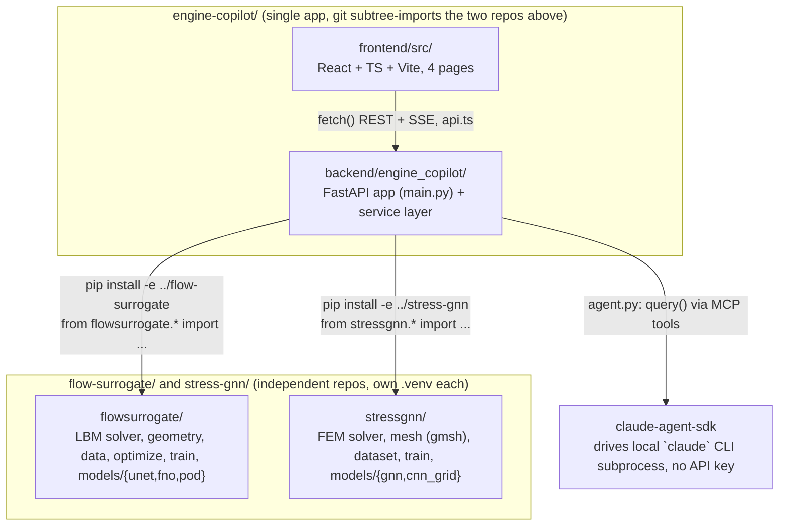

<!-- graph-baseline: eeeabf6 -->
# Knowledge Graph — Surrogate Engineering

> **Purpose**: navigation map of this repo for Claude. Read **this file** instead of
> re-scanning the whole project. Each node says *what a module does* and *what it depends
> on*; the inverse index sends you straight to the file(s) for a given task.

## In one sentence

Two independent, laptop-reproducible ML research repos — `flow-surrogate` (LBM flow +
learned surrogates + differentiable shape optimization) and `stress-gnn` (FEM elasticity +
GNN surrogates + design ranking) — plus `engine-copilot`, a FastAPI + React platform that turns
both into an interactive demo with a Claude Agent SDK chat layered on top.

## How to use this graph

1. Identify the **task** in the [inverse index](#inverse-index-task--files) → open only those files.
2. Need the full picture of a request? See [key flows](#key-flows).
3. Touching the ML repos' data/checkpoints? See [data & file model](#data--file-model-on-disk).
4. Wondering what's built vs planned? See [platform milestone status](#platform-milestone-status).
5. **Before finishing**, apply the [update protocol](#update-protocol) if you changed the repo's structure.

---

## Overview (module graph)



**Integration model**: `engine-copilot` treats both research repos strictly as **read-only
libraries** (editable-installed, never modified from platform code — see
`PLATFORM_PLAN.md`'s "INTOUCHABLES" directive). All physics/ML logic stays in
`flowsurrogate`/`stressgnn`; `engine-copilot/backend` only adapts their outputs to JSON and
streams them.

**Two servers, one browser tab**: `uvicorn` (backend, port 8000 by convention) and Vite dev
server (frontend, port 5173, CORS-allowed origin in `main.py`). No database, no persisted
platform state — every request recomputes from the trained checkpoints in `runs/`.

---

## Node catalogue

### `flow-surrogate/flowsurrogate/` — flow physics + surrogates (library)
| Module | Role |
|---|---|
| `geometry.py` | `Domain`, `solid_mask`, `area`, `sample_shapes`, boundary/radius helpers (+ torch variants used for differentiable optimization) |
| `lbm.py` | `LBMSolver`, `SolverConfig`, `equilibrium`, lattice constants `C` — the ground-truth solver |
| `data.py` | `Normalizer`, `input_channels`, `load_splits`, `FlowDataset` |
| `optimize.py` | `optimise`, `verify`, `render_inputs`, `to_params`, `boundary_xy` — gradient descent through the surrogate + solver-side verification |
| `train.py` | `load_model`, `pick_device`, `train` |
| `models/{unet.py,fno.py,pod.py}` | `UNet`, `FNO2d`, `PODRegressor` |
| `runs/*.pt` (+`*_history.json`) | trained checkpoints: `unet`, `unet-phys`, `fno`, `pod-*` |

Science/results are documented in `flow-surrogate/README.md` and `flow-surrogate/BACKGROUND.md`
(from-scratch explainer) — don't re-derive them here, cite them.

### `stress-gnn/stressgnn/` — elasticity physics + surrogates (library)
| Module | Role |
|---|---|
| `geometry.py` | `Design`, `is_valid`, `sample_design(s)` — perforated-plate design vector |
| `mesh.py` | `build_mesh` → `Mesh`, gmsh-backed (variable topology per design) |
| `fem.py` | `solve` → `FEMSolution`, `von_mises` — the ground-truth P1 FEM solver |
| `dataset.py` | `GraphDataset`, `build_graph`, `collate`, `Graph` |
| `train.py` | `load_model`, `pick_device` |
| `models/{gnn.py,cnn_grid.py}` | `MeshGraphNet`, `GridUNet` |
| `runs/*.pt` | checkpoints: `gnn-mp10`, `gnn-mp10-glob`, `gnn-mp10-glob-corr` |

Science/results documented in `stress-gnn/README.md` and `stress-gnn/BACKGROUND.md`.

**Shared repo layout** (both research repos): `<pkg>/` (library), `scripts/00-06_*.py`
(pipeline stages), `run_all.py` (orchestrates generate → train → optimize; `--quick`/`--force`),
`data/*.npz` (train/test/ood splits, not committed), `runs/` (checkpoints, committed),
`results/*.json` (metrics feeding README tables, committed), `tests/`.

### `engine-copilot/backend/engine_copilot/` — FastAPI service layer
| File | Role | Depends on |
|---|---|---|
| `main.py` | FastAPI app, `lifespan` warmup (loads both services + JIT-warms the LBM solver before first request), all routes | `agent_session`, `flow_service`, `stress_service`, `simulate_streaming` |
| `agent.py` | `AgentSession.chat()` — one `query()` call per browser turn (not a shared `ClaudeSDKClient`: a client left mid-response by a dropped HTTP connection corrupts the underlying CLI session for every future request); continuity via `options.resume = previous ResultMessage.session_id`; registers `ALL_TOOLS` as an in-process MCP server (`create_sdk_mcp_server`), `permission_mode="bypassPermissions"` because the tools are deterministic read-only wrappers | `tools.ALL_TOOLS` |
| `tools.py` | `@tool`-decorated MCP tools exposed to the agent: **`flow_predict_tool`**, **`get_model_card_tool`** → `ALL_TOOLS`. Only 2 of the 8 tools envisioned in `PLATFORM_PLAN.md` §5.3 are implemented | `flow_service`, `config.FLOW_MODEL_QUALITY` |
| `config.py` | Sibling-repo paths (`FLOW_RUNS_DIR`, `STRESS_RUNS_DIR`, ...), `FIELD_DOWNSCALE`, and **hand-copied** `FLOW_MODEL_QUALITY` / `STRESS_MODEL_QUALITY` tables from each repo's `RESULTS.md`/`results/metrics.json` — re-copy these by hand if a model is retrained, nothing auto-syncs them | none |
| `device_lock.py` | `MPS_LOCK`, a process-wide `threading.Lock` serializing all torch/MPS calls — Apple MPS is unsafe under concurrent multi-thread kernel submission; FastAPI's `run_in_executor` would otherwise let requests overlap | none |
| `flow_service.py` | `FlowService` singleton (`flow_service`): caches models by key, decodes physical units, runs Adam shape optimization as a generator (`optimise_streaming`), runs true-LBM verification (`verify`) | `flowsurrogate.{data,geometry,lbm,optimize,train}` |
| `lbm_frames.py` | `simulate_streaming()` — instrumented LBM run yielding intermediate frames for the live animation; duplicates `LBMSolver.run()`'s setup and drives `solver._step_fn` in a Python loop; module-level singleton solver shared with `flow_service.verify()` to pay `torch.compile` warmup once | `flowsurrogate.{geometry,lbm,optimize}` |
| `stress_service.py` | `StressService` singleton (`stress_service`): mesh + coarse-FEM-solve + GNN-forward per request; gmsh is process-global/not thread-safe → its own `_GMSH_LOCK`, plus one-time `gmsh.initialize()` on the main thread at import time; hole-position optimization uses randomized local search ((1+1)-style), not gradient descent, because the GNN isn't differentiable w.r.t. mesh topology | `stressgnn.{dataset,fem,geometry,mesh,train}` |
| `schemas.py` | Pydantic request/response models = the tool/route schemas (`FlowPredictRequest/Response`, `FlowVerifyRequest/Response`, `FlowSimulateRequest`, `StressPredictRequest/Response`, `StressOptimizeRequest`) | none |

**Routes** (`main.py`):

| Endpoint | Method | Role |
|---|---|---|
| `/api/health` | GET | `claude` CLI presence check |
| `/api/flow/predict` | POST | one-shot Cd + field prediction |
| `/api/flow/optimize` | POST (SSE) | streaming Adam shape optimization |
| `/api/flow/verify` | POST | re-run the true LBM solver on a design, for comparison against the surrogate |
| `/api/flow/simulate` | POST (SSE) | streaming LBM frames for the live-animation toggle |
| `/api/stress/predict` | POST | one-shot peak-stress + field prediction |
| `/api/stress/optimize` | POST (SSE) | streaming randomized hole-placement search |
| `/api/agent/chat` | POST (SSE) | Claude Agent SDK chat turn |

Not built: `/api/report/generate` (planned M6).

**Tests** (`backend/tests/`, fast, hit real singletons, no mocking): `test_flow_service.py`,
`test_stress_service.py`, `test_tools.py` (tool JSON output + unknown-model error path). No
test exercises the actual SDK loop in `agent.py`, only the underlying tool functions.

### `engine-copilot/frontend/src/` — React + TS + Vite UI

**shadcn/ui (new-york, Tailwind v4, `@/*` → `src/*`)**. `components.json` + `lib/utils.ts`
(`cn`) are the standard shadcn wiring; `components/ui/*` is vendored shadcn source on the
unified `radix-ui` package — **regenerate with the CLI, don't hand-edit**. The CLI resolves
the alias off the root `tsconfig.json` (which only holds project references), so
`shadcn add` writes into a literal `@/` folder at the repo root — move the files into
`src/components/ui/` afterwards.

```
App.tsx — <ChatProvider> + <TooltipProvider> wrapping a 3-column shell
├─ components/AppSidebar.tsx — left nav (icon rail < md), health dot footer
├─ main — <Routes>, own scroll container
│   ├─ pages/Home.tsx — hero, lab cards, principles
│   ├─ pages/FlowLab.tsx — debounced predict-on-change (250ms)
│   │   ├─ ShapeEditor.tsx — 6 Fourier sliders + Re; exports ShapePreview (reused read-only)
│   │   ├─ FieldViewer.tsx — u (sequential) / v, p (diverging, zmid 0) small multiples
│   │   ├─ FlowAnimation.tsx — Tabs: client-RK4 streamlines vs live LBM (SSE)
│   │   │   └─ StreamlineOverlay.tsx — 56 particles, direct SVG mutation, no React state
│   │   ├─ OptimizerPanel.tsx — Adam optimize (SSE), verify-with-solver, apply-design
│   │   │   └─ ConvergencePlot.tsx — live cd_best/cd_mean
│   ├─ pages/StressLab.tsx — debounced predict (300ms)
│   │   ├─ HoleEditor.tsx — click/drag/wheel hole placement + load-angle slider
│   │   ├─ StressViewer.tsx — magma von-Mises heatmap + pulsing peak marker
│   │   ├─ StressOptimizePanel.tsx — randomized local-search optimize (SSE)
└─ chat/ChatSidebar.tsx — right panel on EVERY page (overlay + backdrop < lg)
Shared: PageHeader.tsx (sticky, per-page actions + copilot toggle), StatTile.tsx,
MetricsBadge.tsx, ColorScaleLegend.tsx, AnimatedNumber.tsx, ToolCallCard.tsx
```

**Chat is a sidebar, not a page.** `chat/ChatProvider.tsx` holds the transcript above the
router, so the conversation survives navigation and panel collapse; `/chat` now redirects to
`/`. Each lab calls `usePublishChatContext({label, lines, suggestions})` to publish its live
design; `send()` prepends those lines to the wire message (the transcript still shows only
what the user typed) so "optimise cette forme" resolves against what is on screen. Suggestions
are per-page. Toggle: ⌘/Ctrl-J, persisted in `localStorage` (`engine-copilot.chat.open`), defaulting
open ≥1024px and closed below.

`api.ts`: typed fetch client. JSON: `predictFlow`, `verifyFlow`, `predictStress`, `getHealth`.
SSE via a custom `readSSE()` reader over `fetch`'s body stream (not `EventSource`, since POST
bodies are needed): `streamFlowOptimize` (**query-string params** — inconsistent with the
JSON-body convention used everywhere else), `streamFlowSimulate`, `streamStressOptimize`,
`streamAgentChat`.

**Design system — one dark scheme, no toggle.** `index.css` holds a single `:root` token set
(shadcn names, plain hex) plus `@theme inline`; `<html class="dark">` is stamped statically in
`index.html` only so shadcn's `dark:` utilities resolve. There is no light theme and no
`ThemeToggle`. Chart tokens are the dataviz reference palette's dark column, validated against
the `--card` surface (`#121419`); the UI `--primary` (`#256abf`) is a deeper step of chart
slot 1's own blue ramp, so accent and "series 1" are one hue at two steps.

`lib/chartTheme.ts` is the single source of truth for every Plotly plot (Plotly cannot read CSS
custom properties, so the hexes are **mirrored** there — keep the two in step): `SERIES`,
`MAGMA`/`DIVERGING`/`SEQUENTIAL` colorscales, `baseLayout()`, `axis()`, `FIELD_MARGIN`,
`fieldRange`/`symmetricRange`. Field heatmaps carry **no Plotly colorbar** — `ColorScaleLegend`
draws the key in the DOM instead, because Plotly's colorbar drops end labels on a short bar and
costs width that aspect-locked (`scaleanchor`) fields can't spare.

---

## Key flows

**Flow Lab predict** — slider change → debounce 250ms → `api.predictFlow` → `POST
/api/flow/predict` → `flow_service.predict` (cached model, `flowsurrogate.data.Normalizer`
decode) → `FieldViewer` + `MetricsBadge` re-render.

**Flow Lab optimize** — `OptimizerPanel` → `api.streamFlowOptimize` (query-string) → `POST
/api/flow/optimize` SSE → `flow_service.optimise_streaming` (Adam through the frozen
surrogate) → `ConvergencePlot` updates per iteration → on `done`, "Verify" button calls
`api.verifyFlow` → `POST /api/flow/verify` → `flow_service.verify` runs the **true LBM
solver** on the optimized design for an honest comparison.

**Flow Lab live simulate** — `FlowAnimation` toggle → `api.streamFlowSimulate` → `POST
/api/flow/simulate` SSE → `lbm_frames.simulate_streaming` (shares the warmed singleton
solver with `flow_service.verify`) → frame-by-frame field updates.

**Stress Lab predict/optimize** — mirrors the Flow Lab shape, through `stress_service`:
`HoleEditor` → `predictStress` → mesh (gmsh, `_GMSH_LOCK`) + coarse FEM + GNN forward →
`StressViewer`; `StressOptimizePanel` → `streamStressOptimize` → randomized local search
over hole positions (no gradient — GNN isn't differentiable w.r.t. mesh topology).

**Agent chat** — `ChatSidebar` composer → `ChatProvider.send()` (prepends the active page's
published context lines) → `streamAgentChat` → `POST /api/agent/chat` SSE →
`agent_session.chat()` → `query()` (Claude Agent SDK, `resume`d by session id) → SDK may call
`flow_predict`/`get_model_card` (in-process MCP tools, `bypassPermissions`) → text/tool-use
events streamed back → `ToolCallCard` renders each tool call, text streams into the transcript.
State lives in the provider above `<Routes>`, so switching labs mid-conversation keeps it.

---

## Data & file model on disk

Both research repos: `data/*.npz` (generated, not committed — hundreds of MB), `runs/*.pt` +
`*_history.json` (checkpoints, committed), `results/*.json` (metrics behind the README
tables, committed). `engine-copilot` has **no persistent state of its own** — no database, no
uploaded files; every request is computed fresh from the loaded checkpoints plus whatever the
browser sent in the request body. `engine_copilot/config.py`'s `FLOW_MODEL_QUALITY` /
`STRESS_MODEL_QUALITY` are the one place platform code duplicates a fact that lives elsewhere
(the two `results/metrics.json` files) — keep them in sync by hand after retraining.

---

## Platform milestone status

Full spec in `PLATFORM_PLAN.md` (French). Status as of baseline commit, cross-checked against
`git log` and `git status`:

| Milestone | What | Status |
|---|---|---|
| M0 | Scaffolding (health check, 4-tab shell) | done, committed |
| M1 | Flow prediction end-to-end (static) | done, committed |
| M2 | Animation (client streamlines + LBM SSE) | done, **uncommitted** (`lbm_frames.py`, `StreamlineOverlay.tsx`, `FlowAnimation.tsx`) |
| M3 | Live optimizer (Adam streaming + verify) | done, **uncommitted** (`OptimizerPanel.tsx`, `ConvergencePlot.tsx`; `flow_service.py`/`main.py` modified) |
| M4 | Stress Lab | done, **uncommitted** (`stress_service.py`, `HoleEditor.tsx`, `StressViewer.tsx`, `StressOptimizePanel.tsx`, `StressLab.tsx`, `stressGeometry.ts`; `ComingSoon.tsx` deleted in working tree) |
| M5 | Claude Agent SDK chat | done, committed (`eeeabf6`), then **moved into a sidebar** (uncommitted). Only 2/8 planned tools implemented (`flow_predict`, `get_model_card`) — `flow_optimize`, `flow_verify`, `flow_simulate`, `stress_predict`, `stress_optimize`, `render_report` exist as HTTP endpoints but not as agent tools |
| M6 | Report export + demo GIF + polish | **not started** — no `report.py`, no `/api/report/generate`, no `docs/demo.gif` |
| — | UI rebuild on shadcn/ui | done, **uncommitted** — dark-only token set (light theme + `ThemeToggle` removed), left nav + right copilot sidebar shell, all panels on shadcn primitives, unified `lib/chartTheme.ts`. `ChatOrchestrator.tsx`, `ThemeToggle.tsx`, `Skeleton.tsx`, `colors.ts`, `ComingSoon.tsx` deleted |

Committed `engine-copilot/README.md` still says "M0, M1, most of M3 backend landed" — the
working-tree version (uncommitted) claims M0–M5. **Trust `git status`, not the README**, until
the M2–M4 work above is committed.

---

## Inverse index (task → files)

| Task | Files |
|---|---|
| Add/change a flow surrogate model | `flow-surrogate/flowsurrogate/models/*.py`, `train.py`, `run_all.py`; then `engine_copilot/config.py` (`FLOW_MODEL_QUALITY`), `flow_service.py` (model cache key) |
| Add/change a stress surrogate model | `stress-gnn/stressgnn/models/*.py`, `train.py`; then `config.py` (`STRESS_MODEL_QUALITY`), `stress_service.py` |
| Add a new FastAPI route | `main.py` (route), `schemas.py` (request/response models), matching `*_service.py`, `api.ts` (frontend client), `PLATFORM_PLAN.md` §3 (API contract source of truth) |
| Add a new agent tool | `tools.py` (`@tool`-decorated function + add to `ALL_TOOLS`), `agent.py` (`SYSTEM_PROMPT` if it should mention the tool) |
| Change the agent's behavior/persona | `agent.py` (`SYSTEM_PROMPT`), `agent.py` (`_options`, e.g. `max_turns`) |
| Add a new frontend page | `App.tsx` (route), new file in `pages/`, `AppSidebar.tsx` (nav entry), `PageHeader` at the top of the page, `usePublishChatContext` so the copilot sees it |
| Change the color theme | `frontend/src/index.css` (token set) **and** `lib/chartTheme.ts` (the mirrored hexes Plotly needs) — re-run the dataviz palette validator against the new `--card` surface |
| Add/restyle a chart | `lib/chartTheme.ts` (scales + `baseLayout`/`axis`), the component; use `ColorScaleLegend` rather than a Plotly colorbar for field heatmaps |
| Add a shadcn primitive | `pnpm dlx shadcn@latest add <name>`, then move it out of the literal `@/` folder into `src/components/ui/` |
| Change the copilot sidebar | `chat/ChatProvider.tsx` (state, context plumbing), `chat/ChatSidebar.tsx` (UI) |
| Change SSE streaming behavior (backend) | the relevant `*_streaming` generator in `flow_service.py`/`stress_service.py`/`lbm_frames.py`, the route in `main.py` |
| Change SSE streaming behavior (frontend) | `api.ts` (`readSSE`, `stream*` functions), the consuming page/component |
| Debug an MPS/gmsh threading issue | `device_lock.py` (`MPS_LOCK`), `stress_service.py` (`_GMSH_LOCK`, `gmsh.initialize()` call site) |
| Touch the LBM solver ground truth | `flow-surrogate/flowsurrogate/lbm.py`; mirrored/instrumented copy in `engine-copilot/backend/engine_copilot/lbm_frames.py` — **keep both in sync by hand** |
| Understand the science behind a result | `flow-surrogate/README.md` + `BACKGROUND.md`, or `stress-gnn/README.md` + `BACKGROUND.md` — don't re-derive from code |

---

## Config & externals

| Item | Value / role |
|---|---|
| Backend | FastAPI + `uvicorn`, CORS allowed for `http://localhost:5173` only |
| Frontend | Vite dev server, port 5173 |
| Claude auth | `claude-agent-sdk` drives the local `claude` CLI subprocess — reuses `claude login`, **no `ANTHROPIC_API_KEY`, no `.env` secret**, ever |
| Agent permission mode | `bypassPermissions` — justified because the only tools exposed are deterministic, read-only wrappers with no shell/filesystem access |
| Device | Apple MPS; all torch calls serialized behind `device_lock.MPS_LOCK` (MPS is not safe under concurrent multi-thread kernel submission) |
| Mesh backend | `gmsh`, process-global — serialized behind `stress_service._GMSH_LOCK`, initialized once on the main thread at import time |
| Python deps | `engine-copilot/pyproject.toml`: `fastapi>=0.115`, `uvicorn[standard]>=0.30`, `pydantic>=2.7`, `numpy`, `torch`, `sse-starlette>=2.1`, `claude-agent-sdk`, `anyio`. `flowsurrogate`/`stressgnn` installed separately, editable (`pip install -e ../flow-surrogate -e ../stress-gnn -e .`) |
| Environments | Each of `flow-surrogate/`, `stress-gnn/`, `engine-copilot/` has its **own** `.venv` — always run `./.venv/bin/python` from inside the relevant directory |
| Git history | `engine-copilot/` was merged into this repo via subtree-style imports (`git log`: "Add 'flow-surrogate/' from commit ...", "Add 'stress-gnn/' from commit ...") — the two research repos' own histories are preserved, then squashed into this monorepo going forward |

---

## Update protocol

This graph is **versioned** (git) and **diffable** — you don't need to re-read everything to
keep it current.

**Every session where you change the repo's structure:**

1. Read the baseline at the top of this file (`<!-- graph-baseline: eeeabf6 -->`).
2. List what moved:
   ```bash
   git diff --name-only <baseline>..HEAD ; git status --porcelain
   ```
3. **Only re-read the files listed.** Update only:
   - the **node catalogue** if a module's role/dependencies changed,
   - the **route table** if `main.py` gained/lost a route,
   - **key flows** or the **module graph** if a flow or the architecture changed,
   - **platform milestone status** if a milestone landed or a commit changed the uncommitted set,
   - the **inverse index** if a task gained/lost a relevant file.
4. Replace the baseline (line 1) with the new short `HEAD` (`git rev-parse --short HEAD`).

**When NOT to touch it**: internal refactor within an already-listed file, CSS tweaks,
wording, hyperparameter changes that don't change a module's role. This graph maps
*structure* (routes, flows, files, dependencies), not implementation detail.

**Watch especially**: `PLATFORM_PLAN.md`'s milestone list and `config.py`'s hand-copied
quality tables are the two things most likely to silently drift from reality — check them
first when picking up work here after a gap.
