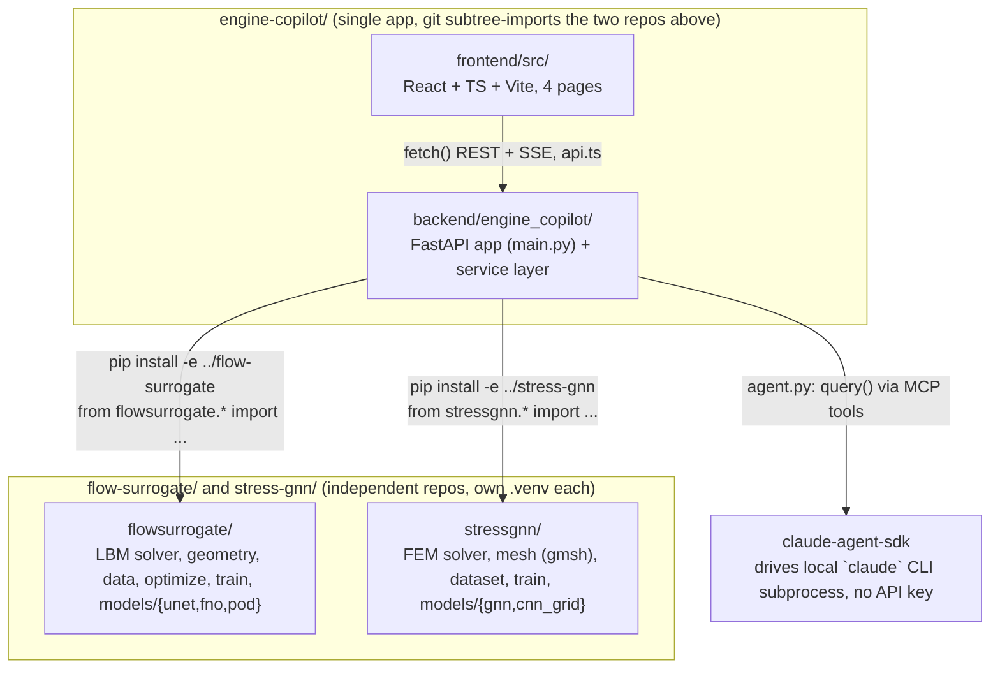

<!-- graph-baseline: 85f5ce3 -->
# Knowledge Graph — Surrogate Engineering

> **Purpose**: navigation map of this repo for Claude. Read **this file** instead of
> re-scanning the whole project. Each node says *what a module does* and *what it depends
> on*; the inverse index sends you straight to the file(s) for a given task.

## In one sentence

Two independent, laptop-reproducible ML research repos — `flow-surrogate` (LBM flow +
learned surrogates + differentiable shape optimization) and `stress-gnn` (FEM elasticity +
GNN surrogates + design ranking) — plus `engine-copilot`, a FastAPI + React platform that turns
both into an interactive demo with a Claude Agent SDK chat layered on top.

## How to use this graph

1. Identify the **task** in the [inverse index](#inverse-index-task--files) → open only those files.
2. Need the full picture of a request? See [key flows](#key-flows).
3. Touching the ML repos' data/checkpoints? See [data & file model](#data--file-model-on-disk).
4. Wondering what's built vs planned? See [platform milestone status](#platform-milestone-status).
5. **Before finishing**, apply the [update protocol](#update-protocol) if you changed the repo's structure.

---

## Overview (module graph)



**Integration model**: `engine-copilot` treats both research repos strictly as **read-only
libraries** (editable-installed, never modified from platform code — see
`PLATFORM_PLAN.md`'s "INTOUCHABLES" directive). All physics/ML logic stays in
`flowsurrogate`/`stressgnn`; `engine-copilot/backend` only adapts their outputs to JSON and
streams them.

**Two servers, one browser tab**: `uvicorn` (backend, port 8000 by convention) and Vite dev
server (frontend, port 5173, CORS-allowed origin in `main.py`). No database, no persisted
platform state — every request recomputes from the trained checkpoints in `runs/`.

---

## Node catalogue

### `flow-surrogate/flowsurrogate/` — flow physics + surrogates (library)
| Module | Role |
|---|---|
| `geometry.py` | `Domain`, `solid_mask`, `area`, `sample_shapes`, boundary/radius helpers (+ torch variants used for differentiable optimization) |
| `lbm.py` | `LBMSolver`, `SolverConfig`, `equilibrium`, lattice constants `C` — the ground-truth solver |
| `data.py` | `Normalizer`, `input_channels`, `load_splits`, `FlowDataset` |
| `optimize.py` | `optimise`, `verify`, `render_inputs`, `to_params`, `boundary_xy` — gradient descent through the surrogate + solver-side verification |
| `train.py` | `load_model`, `pick_device`, `train` |
| `models/{unet.py,fno.py,pod.py}` | `UNet`, `FNO2d`, `PODRegressor` |
| `runs/*.pt` (+`*_history.json`) | trained checkpoints: `unet`, `unet-phys`, `fno`, `pod-*` |

Science/results are documented in `flow-surrogate/README.md` and `flow-surrogate/BACKGROUND.md`
(from-scratch explainer) — don't re-derive them here, cite them.

### `stress-gnn/stressgnn/` — elasticity physics + surrogates (library)
| Module | Role |
|---|---|
| `geometry.py` | `Design`, `is_valid`, `sample_design(s)` — perforated-plate design vector |
| `mesh.py` | `build_mesh` → `Mesh`, gmsh-backed (variable topology per design) |
| `fem.py` | `solve` → `FEMSolution`, `von_mises` — the ground-truth P1 FEM solver |
| `dataset.py` | `GraphDataset`, `build_graph`, `collate`, `Graph` |
| `train.py` | `load_model`, `pick_device` |
| `models/{gnn.py,cnn_grid.py}` | `MeshGraphNet`, `GridUNet` |
| `runs/*.pt` | checkpoints: `gnn-mp10`, `gnn-mp10-glob`, `gnn-mp10-glob-corr` |

Science/results documented in `stress-gnn/README.md` and `stress-gnn/BACKGROUND.md`.

**Shared repo layout** (both research repos): `<pkg>/` (library), `scripts/00-06_*.py`
(pipeline stages), `run_all.py` (orchestrates generate → train → optimize; `--quick`/`--force`),
`data/*.npz` (train/test/ood splits, not committed), `runs/` (checkpoints, committed),
`results/*.json` (metrics feeding README tables, committed), `tests/`.

### `engine-copilot/backend/engine_copilot/` — FastAPI service layer
| File | Role | Depends on |
|---|---|---|
| `main.py` | FastAPI app, `lifespan` warmup (loads both services + JIT-warms the LBM solver before first request), all routes | `agent_session`, `flow_service`, `stress_service`, `simulate_streaming` |
| `agent.py` | `AgentSession.chat()` — one `query()` call per browser turn (not a shared `ClaudeSDKClient`: a client left mid-response by a dropped HTTP connection corrupts the underlying CLI session for every future request); continuity via `options.resume = previous ResultMessage.session_id`; registers `ALL_TOOLS` as an in-process MCP server (`create_sdk_mcp_server`), `permission_mode="bypassPermissions"` because the tools are deterministic read-only wrappers | `tools.ALL_TOOLS` |
| `tools.py` | `@tool`-decorated MCP tools exposed to the agent: **`flow_predict_tool`**, **`get_model_card_tool`** → `ALL_TOOLS`. Only 2 of the 8 tools envisioned in `PLATFORM_PLAN.md` §5.3 are implemented | `flow_service`, `config.FLOW_MODEL_QUALITY` |
| `config.py` | Sibling-repo paths (`FLOW_RUNS_DIR`, `STRESS_RUNS_DIR`, ...), `FIELD_DOWNSCALE`, and **hand-copied** `FLOW_MODEL_QUALITY` / `STRESS_MODEL_QUALITY` tables from each repo's `RESULTS.md`/`results/metrics.json` — re-copy these by hand if a model is retrained, nothing auto-syncs them | none |
| `device_lock.py` | `MPS_LOCK`, a process-wide `threading.Lock` serializing all torch/MPS calls — Apple MPS is unsafe under concurrent multi-thread kernel submission; FastAPI's `run_in_executor` would otherwise let requests overlap | none |
| `flow_service.py` | `FlowService` singleton (`flow_service`): caches models by key, decodes physical units, runs Adam shape optimization as a generator (`optimise_streaming`), runs true-LBM verification (`verify`) | `flowsurrogate.{data,geometry,lbm,optimize,train}` |
| `lbm_frames.py` | `simulate_streaming()` — instrumented LBM run yielding intermediate frames for the live animation; duplicates `LBMSolver.run()`'s setup and drives `solver._step_fn` in a Python loop; module-level singleton solver shared with `flow_service.verify()` to pay `torch.compile` warmup once | `flowsurrogate.{geometry,lbm,optimize}` |
| `stress_service.py` | `StressService` singleton (`stress_service`): mesh + coarse-FEM-solve + GNN-forward per request; gmsh is process-global/not thread-safe → its own `_GMSH_LOCK`, plus one-time `gmsh.initialize()` on the main thread at import time; hole-position optimization uses randomized local search ((1+1)-style), not gradient descent, because the GNN isn't differentiable w.r.t. mesh topology | `stressgnn.{dataset,fem,geometry,mesh,train}` |
| `report.py` | `render_report(project, context)` → Markdown. **Deterministic template, no LLM**: `PLATFORM_PLAN.md` §3.3 describes the route as calling Claude but §5.3 requires the *tool* to use a fixed template to avoid recursion — the template wins for both callers, so a report is the same document whoever asked and costs no CLI subprocess. Every field is optional and degrades to `n/a`, because the agent passes a summarised (partial) context and a report with one blank row beats a 500 | `config.{FLOW,STRESS}_MODEL_QUALITY` |
| `schemas.py` | Pydantic request/response models = the tool/route schemas (`FlowPredictRequest/Response`, `FlowVerifyRequest/Response`, `FlowSimulateRequest`, `StressPredictRequest/Response`, `StressOptimizeRequest`) | none |

**Routes** (`main.py`):

| Endpoint | Method | Role |
|---|---|---|
| `/api/health` | GET | `claude` CLI presence check |
| `/api/flow/predict` | POST | one-shot Cd + field prediction |
| `/api/flow/optimize` | POST (SSE) | streaming Adam shape optimization |
| `/api/flow/verify` | POST | re-run the true LBM solver on a design, for comparison against the surrogate |
| `/api/flow/simulate` | POST (SSE) | streaming LBM frames for the live-animation toggle |
| `/api/stress/predict` | POST | one-shot peak-stress + field prediction |
| `/api/stress/optimize` | POST (SSE) | streaming randomized hole-placement search |
| `/api/report/generate` | POST | deterministic Markdown report from an optimisation result |
| `/api/agent/chat` | POST (SSE) | Claude Agent SDK chat turn |

All planned routes exist. `/api/report/generate` is the only synchronous non-trivial one —
rendering is pure string formatting, so it is a plain `def` with nothing offloaded to a
thread.

**Tests** (`backend/tests/`, fast, hit real singletons, no mocking): `test_flow_service.py`,
`test_stress_service.py`, `test_tools.py` (tool JSON output + unknown-model error path). No
test exercises the actual SDK loop in `agent.py`, only the underlying tool functions.

### `engine-copilot/frontend/src/` — React + TS + Vite UI

**shadcn/ui (new-york, Tailwind v4, `@/*` → `src/*`)**. `components.json` + `lib/utils.ts`
(`cn`) are the standard shadcn wiring; `components/ui/*` is vendored shadcn source on the
unified `radix-ui` package — **regenerate with the CLI, don't hand-edit**. The CLI resolves
the alias off the root `tsconfig.json` (which only holds project references), so
`shadcn add` writes into a literal `@/` folder at the repo root — move the files into
`src/components/ui/` afterwards.

```
App.tsx — <ChatProvider> + <TooltipProvider> wrapping <Backdrop> + a 3-column shell
├─ Backdrop (in App.tsx) — gradient masses + grain, viewport-fixed, shared by every page
├─ components/ContourField.tsx — burnt iso-lines, scoped to the content column only
├─ components/AppSidebar.tsx — left nav (icon rail < md), health dot footer
├─ main — <Routes>, own scroll container
│   ├─ pages/Home.tsx — hero, lab cards, principles
│   ├─ pages/FlowLab.tsx — debounced predict-on-change (250ms)
│   │   ├─ ShapeEditor.tsx — 6 Fourier sliders + Re; exports ShapePreview (reused read-only)
│   │   ├─ FieldViewer.tsx — u (sequential blue→red) / v, p (diverging, zmid 0) small multiples
│   │   ├─ FlowAnimation.tsx — Tabs: client-RK4 streamlines vs live LBM (SSE)
│   │   │   └─ StreamlineOverlay.tsx — 56 particles coloured by local speed (STREAK),
│   │   │      direct SVG mutation, no React state
│   │   ├─ OptimizerPanel.tsx — Adam optimize (SSE), verify-with-solver, apply-design
│   │   │   └─ ConvergencePlot.tsx — live cd_best/cd_mean
│   ├─ pages/StressLab.tsx — debounced predict (300ms)
│   │   ├─ HoleEditor.tsx — click/drag/wheel hole placement + load-angle slider
│   │   ├─ StressViewer.tsx — von-Mises heatmap on the measure ramp + pulsing peak marker
│   │   ├─ StressOptimizePanel.tsx — randomized local-search optimize (SSE)
└─ chat/ChatSidebar.tsx — right panel on EVERY page (overlay + backdrop < lg)
Shared: PageHeader.tsx (sticky, per-page actions + copilot toggle), StatTile.tsx
(the one 40px figure + its interval), ColorScaleLegend.tsx, AnimatedNumber.tsx,
ToolCallCard.tsx
Shared libs: lib/chartTheme.ts (Plotly), lib/motion.ts (the one entrance curve),
lib/utils.ts (`cn`)
```

**Chat is a sidebar, not a page.** `chat/ChatProvider.tsx` holds the transcript above the
router, so the conversation survives navigation and panel collapse; `/chat` now redirects to
`/`. Each lab calls `usePublishChatContext({label, lines, suggestions})` to publish its live
design; `send()` prepends those lines to the wire message (the transcript still shows only
what the user typed) so "optimise cette forme" resolves against what is on screen. Suggestions
are per-page. Toggle: ⌘/Ctrl-J, persisted in `localStorage` (`engine-copilot.chat.open`), defaulting
open ≥1024px and closed below.

`api.ts`: typed fetch client. JSON: `predictFlow`, `verifyFlow`, `predictStress`, `getHealth`.
SSE via a custom `readSSE()` reader over `fetch`'s body stream (not `EventSource`, since POST
bodies are needed): `streamFlowOptimize` (**query-string params** — inconsistent with the
JSON-body convention used everywhere else), `streamFlowSimulate`, `streamStressOptimize`,
`streamAgentChat`.

**Design system — "Calque": registre sobre et dense.** One light scheme, no toggle. The full
charte is installed as a Claude skill at `~/.claude/skills/calque/` (SKILL.md + `references/`
+ `assets/tokens.css`) — **read it before touching any UI**, it is the source of truth this
implementation follows.

Its governing rules, because they explain choices that otherwise look arbitrary:

- **The register is quiet, and this outranks everything else.** Small, dense, one-pixel rules
  and tiny labels. No display face, no full-width flat. A screen that looks like a landing page
  is out of charte however correct its colours are.
- **A 40px type ceiling and exactly three faces** (Instrument Sans / Instrument Serif / IBM Plex
  Mono — there is **no** display face, and adding one is the classic drift). The whole scale is
  declared in `index.css` as `--text-k` 9 · `--text-band` 11 · `--text-body` 12.5 · `--text-ctl`
  13 · `--text-title` 14 · `--text-value` 40, and it stops there on purpose: reaching for
  `text-[52px]` is normally the signal a screen has drifted. `.cq-value` (Serif **roman**, 40px,
  weight 400) is the single figure a panel gets; outside the one exception below, weights never
  pass 600 and tracking never goes tighter than -0.015em.
- **Orange is a measuring scale, not a brand colour.** Every orange mark encodes a quantity
  (drag, stress, error, latency, load). An orange flat with no quantity behind it is a bug —
  which is why the nav's active item is a 2px rule rather than a filled pill, the chat's user
  turns are white sheets rather than orange bubbles, and the "send" button is outlined.
- **Two budgets to count before shipping**: **one** black-filled element outside text, and
  **one** filled orange button — and they draw on the *same* budget, so each lab has exactly one
  ("Optimiser").
- **No red, no green in the chrome.** Nominal is plain ink; anything out of envelope is
  `--burnt`. Status is always carried by a word and a mark as well as a colour. (This is why
  `MetricsBadge` was deleted: its good/warning tint had no home here, and the model, its measured
  error, the interval and the latency now sit as `.cq-row` key/value lines inside each lab's
  panel.)
- **The background is atmosphere: if you notice it, it is too strong.** `<Backdrop>` in
  `App.tsx` lays down the viewport-wide layers (blurred gradient masses, then `feTurbulence`
  grain) once for the whole app; pages never repeat them. The mass opacities sit under the
  charte's own numbers (.22/.16/.11 against .30/.22/.16) because this shell is full-bleed rather
  than the charte's 1160px centred column, and at the published values a 1500px viewport washes
  orange.

**Four owner-approved deviations from the published charte.** They are deliberate and were asked
for explicitly; the same list is at the top of `index.css`. Do not "restore" any of them without
asking:

1. **Solver fields are blue↔red, not the orange ramp** (`SEQUENTIAL`/`DIVERGING` in
   `lib/chartTheme.ts`, plus `STREAK` for the streamline hairlines). Scoped strictly to
   rasterised fields — everywhere else orange is still the only quantity colour, which is what
   keeps the exception legible as an exception.
2. **The two overview ratios are `--text-hero`** (76px, weight 700, `.cq-hero`) — above both the
   size ceiling and the weight cap. Instrument Sans, because Instrument Serif has no bold.
3. **No Instrument Serif italic anywhere.** The charte's "one serif moment per screen" was
   dropped wholesale; what those sentences carried is now plain data (Flow Lab's interval is an
   `Intervalle` row, Stress Lab's coarse-FEM gap a `Manqué par le FEM` row).
4. **`<ContourField>` replaces the charte's two large background arcs.** Marching-squares
   iso-lines of a smooth scalar field, drawn in `--burnt` hairlines — sharper than the arcs, and
   it earns its orange by genuinely being level sets of a field. It is mounted on the content
   column's wrapper, **not** fixed to the viewport, so it never appears behind the nav rail or
   the copilot panel; and `.cq-calque` was raised to .88 (the charte's own upper bound) so the
   lines never read through a panel carrying numbers. Cards are opaque, so plots are unaffected.

`index.css` holds the Calque token set (`--paper/--ink*/--or/--burnt/--peach/--gone`, the
`--m0..--m5` measure ramp, brown-orange shadows, the three font stacks, the type scale), then
**maps shadcn's names onto them** (`--primary: var(--or)`, `--good: var(--ink2)`, …) so the
vendored primitives inherit the charte for free. `<html>` no longer carries `dark`; the `dark`
custom variant is kept pointed at a class nothing stamps, purely so the `dark:` utilities baked
into `components/ui/*` still compile. The `.cq-*` vocabulary lives in `@layer components`, one
layer *below* Tailwind's utilities, so a `text-burnt` next to a `.cq-k` still wins — written
unlayered, as the charte's own `tokens.css` is, `.cq-k`'s ink3 would silently beat every colour
override. Everything Calque changes about the shadcn primitives is at the bottom of the file as
**unlayered rules keyed on `data-slot`** (1px slider track, warm card shadow, paper-white
outline buttons…) — unlayered CSS outranks every Tailwind layer, so the generated components
restyle without being hand-edited, which keeps `shadcn add` regenerable.

One deliberate deviation, stated so it isn't "fixed" by accident: the charte positions calque
panels as 246–300px cards absolutely anchored in the corners of a data canvas. Each lab's
headline panel keeps the recipe's width (298px) and translucency but sits in the document flow
above the field plots, because floating it over them would cover the data the user is
manipulating.

`lib/chartTheme.ts` is the single source of truth for every Plotly plot (Plotly cannot read CSS
custom properties, so the hexes are **mirrored** there — keep the two in step): `MARK` (marks by
*role* — `measure`/`focus`/`context`/`gone` — because the charte has no categorical palette and
series separate by stroke and value, never by hue), the `SEQUENTIAL`/`DIVERGING`/`STREAK`
colorscales, `sampleScale()`, `baseLayout()`, `axisX`/`axisY` (horizontal gridlines only, no
frame, no ticks), `FIELD_MARGIN`, `fieldRange`/`symmetricRange`.

The three field scales are the blue↔red deviation (#1 above) and differ by job: `SEQUENTIAL` for
unsigned magnitude (axial velocity, von Mises), `DIVERGING` for signed fields **always with
`zmid: 0`** — without that anchor Plotly centres the neutral on the data's own midpoint, the
crossover drifts off zero and the sign stops meaning anything. `STREAK` exists because
`SEQUENTIAL`'s crossover band is near-white: invisible as a 2px hairline, so the streamlines
route through darker mid values instead. Everything that is *not* a rasterised field —
convergence traces, intervals, progress rules — stays on orange. Field heatmaps carry **no
Plotly colorbar**: `ColorScaleLegend` draws the key in the DOM instead, because Plotly's
colorbar drops end labels on a short bar and costs width that aspect-locked (`scaleanchor`)
fields can't spare.

`lib/motion.ts` holds the charte's single entrance curve (`cubic-bezier(.2,.7,.2,1)`) as
`reveal()` (block arrival, 22px rise), `settle()` (in-place state change) and `axisDelay()`
(stagger by a datum's position on its axis, not by array index). Reduced motion is honoured
globally in `index.css`.

---

## Key flows

**Flow Lab predict** — slider change → debounce 250ms → `api.predictFlow` → `POST
/api/flow/predict` → `flow_service.predict` (cached model, `flowsurrogate.data.Normalizer`
decode) → `FieldViewer` + the headline calque panel (`StatTile` + its `.cq-row` lines) re-render.

**Flow Lab optimize** — `OptimizerPanel` → `api.streamFlowOptimize` (query-string) → `POST
/api/flow/optimize` SSE → `flow_service.optimise_streaming` (Adam through the frozen
surrogate) → `ConvergencePlot` updates per iteration → on `done`, "Verify" button calls
`api.verifyFlow` → `POST /api/flow/verify` → `flow_service.verify` runs the **true LBM
solver** on the optimized design for an honest comparison.

**Flow Lab live simulate** — `FlowAnimation` toggle → `api.streamFlowSimulate` → `POST
/api/flow/simulate` SSE → `lbm_frames.simulate_streaming` (shares the warmed singleton
solver with `flow_service.verify`) → frame-by-frame field updates.

**Stress Lab predict/optimize** — mirrors the Flow Lab shape, through `stress_service`:
`HoleEditor` → `predictStress` → mesh (gmsh, `_GMSH_LOCK`) + coarse FEM + GNN forward →
`StressViewer`; `StressOptimizePanel` → `streamStressOptimize` → randomized local search
over hole positions (no gradient — GNN isn't differentiable w.r.t. mesh topology).

**Agent chat** — `ChatSidebar` composer → `ChatProvider.send()` (prepends the active page's
published context lines) → `streamAgentChat` → `POST /api/agent/chat` SSE →
`agent_session.chat()` → `query()` (Claude Agent SDK, `resume`d by session id) → SDK may call
`flow_predict`/`get_model_card` (in-process MCP tools, `bypassPermissions`) → text/tool-use
events streamed back → `ToolCallCard` renders each tool call, text streams into the transcript.
State lives in the provider above `<Routes>`, so switching labs mid-conversation keeps it.

---

## Data & file model on disk

Both research repos: `data/*.npz` (generated, not committed — hundreds of MB), `runs/*.pt` +
`*_history.json` (checkpoints, committed), `results/*.json` (metrics behind the README
tables, committed). `engine-copilot` has **no persistent state of its own** — no database, no
uploaded files; every request is computed fresh from the loaded checkpoints plus whatever the
browser sent in the request body. `engine_copilot/config.py`'s `FLOW_MODEL_QUALITY` /
`STRESS_MODEL_QUALITY` are the one place platform code duplicates a fact that lives elsewhere
(the two `results/metrics.json` files) — keep them in sync by hand after retraining.

---

## Platform milestone status

Full spec in `PLATFORM_PLAN.md` (French). Status as of baseline commit, cross-checked against
`git log` and `git status`:

| Milestone | What | Status |
|---|---|---|
| M0 | Scaffolding (health check, 4-tab shell) | done, committed |
| M1 | Flow prediction end-to-end (static) | done, committed |
| M2 | Animation (client streamlines + LBM SSE) | done, committed (`4ef16a8`) |
| M3 | Live optimizer (Adam streaming + verify) | done, committed (`4ef16a8`) |
| M4 | Stress Lab | done, committed (`4ef16a8`) |
| M5 | Claude Agent SDK chat | done, committed (`eeeabf6`), then moved into a sidebar (`85f5ce3`). Only 2/8 planned tools implemented (`flow_predict`, `get_model_card`) — `flow_optimize`, `flow_verify`, `flow_simulate`, `stress_predict`, `stress_optimize`, `render_report` exist as HTTP endpoints but not as agent tools |
| M6 | Report export + demo GIF + polish | **partly done** — `report.py` + `/api/report/generate` landed; still no `render_report` agent tool, no frontend entry point, no `docs/demo.gif` |
| — | UI rebuild on shadcn/ui | done, committed (`85f5ce3`) — left nav + right copilot sidebar shell, all panels on shadcn primitives, unified `lib/chartTheme.ts`. `ChatOrchestrator.tsx`, `ThemeToggle.tsx`, `Skeleton.tsx`, `colors.ts`, `ComingSoon.tsx` deleted |
| — | Calque restyle | done, **uncommitted** — the shadcn/ui *structure* of `85f5ce3` kept, its dark blue/slate skin replaced by the Calque charte (see the design-system section above). Touches `index.html`, `index.css`, `lib/chartTheme.ts`, new `lib/motion.ts`, `App.tsx` and every page/component; `MetricsBadge.tsx` deleted, `ContourField.tsx` added. No route, service or data-flow change |

`engine-copilot/README.md` claims M0–M5, which now matches the committed tree.

---

## Inverse index (task → files)

| Task | Files |
|---|---|
| Add/change a flow surrogate model | `flow-surrogate/flowsurrogate/models/*.py`, `train.py`, `run_all.py`; then `engine_copilot/config.py` (`FLOW_MODEL_QUALITY`), `flow_service.py` (model cache key) |
| Add/change a stress surrogate model | `stress-gnn/stressgnn/models/*.py`, `train.py`; then `config.py` (`STRESS_MODEL_QUALITY`), `stress_service.py` |
| Add a new FastAPI route | `main.py` (route), `schemas.py` (request/response models), matching `*_service.py`, `api.ts` (frontend client), `PLATFORM_PLAN.md` §3 (API contract source of truth) |
| Change what a report says | `backend/engine_copilot/report.py` (one `_flow_report`/`_stress_report` template each — deterministic, never call a model from here) |
| Add a new agent tool | `tools.py` (`@tool`-decorated function + add to `ALL_TOOLS`), `agent.py` (`SYSTEM_PROMPT` if it should mention the tool) |
| Change the agent's behavior/persona | `agent.py` (`SYSTEM_PROMPT`), `agent.py` (`_options`, e.g. `max_turns`) |
| Add a new frontend page | `App.tsx` (route), new file in `pages/`, `AppSidebar.tsx` (nav entry), `PageHeader` at the top of the page, `usePublishChatContext` so the copilot sees it |
| Style / restyle anything visual | Read `~/.claude/skills/calque/SKILL.md` **first** (+ `references/components.md` for a screen with more than one block, `references/charts.md` once a number becomes a shape) |
| Change the color theme or the type scale | `frontend/src/index.css` (Calque tokens → shadcn names, the `--text-*` scale, plus the `data-slot` overrides at the bottom) **and** `lib/chartTheme.ts` (the mirrored hexes Plotly needs) |
| Restyle a shadcn primitive | **Not** `components/ui/*` (CLI-generated, regenerable) — add an unlayered `[data-slot="…"]` rule at the bottom of `index.css` |
| Add/restyle a chart | `lib/chartTheme.ts` (`MARK`, scales, `baseLayout`/`axisX`/`axisY`), the component; one ramp only, series by stroke not hue, `ColorScaleLegend` rather than a Plotly colorbar for field heatmaps |
| Change an entrance animation | `lib/motion.ts` — one curve for the whole app; don't hand-tune a `transition` in a component |
| Add a shadcn primitive | `pnpm dlx shadcn@latest add <name>`, then move it out of the literal `@/` folder into `src/components/ui/` |
| Change the copilot sidebar | `chat/ChatProvider.tsx` (state, context plumbing), `chat/ChatSidebar.tsx` (UI) |
| Change SSE streaming behavior (backend) | the relevant `*_streaming` generator in `flow_service.py`/`stress_service.py`/`lbm_frames.py`, the route in `main.py` |
| Change SSE streaming behavior (frontend) | `api.ts` (`readSSE`, `stream*` functions), the consuming page/component |
| Debug an MPS/gmsh threading issue | `device_lock.py` (`MPS_LOCK`), `stress_service.py` (`_GMSH_LOCK`, `gmsh.initialize()` call site) |
| Touch the LBM solver ground truth | `flow-surrogate/flowsurrogate/lbm.py`; mirrored/instrumented copy in `engine-copilot/backend/engine_copilot/lbm_frames.py` — **keep both in sync by hand** |
| Understand the science behind a result | `flow-surrogate/README.md` + `BACKGROUND.md`, or `stress-gnn/README.md` + `BACKGROUND.md` — don't re-derive from code |

---

## Config & externals

| Item | Value / role |
|---|---|
| Backend | FastAPI + `uvicorn`, CORS allowed for `http://localhost:5173` only |
| Frontend | Vite dev server, port 5173 |
| Claude auth | `claude-agent-sdk` drives the local `claude` CLI subprocess — reuses `claude login`, **no `ANTHROPIC_API_KEY`, no `.env` secret**, ever |
| Agent permission mode | `bypassPermissions` — justified because the only tools exposed are deterministic, read-only wrappers with no shell/filesystem access |
| Device | Apple MPS; all torch calls serialized behind `device_lock.MPS_LOCK` (MPS is not safe under concurrent multi-thread kernel submission) |
| Mesh backend | `gmsh`, process-global — serialized behind `stress_service._GMSH_LOCK`, initialized once on the main thread at import time |
| Python deps | `engine-copilot/pyproject.toml`: `fastapi>=0.115`, `uvicorn[standard]>=0.30`, `pydantic>=2.7`, `numpy`, `torch`, `sse-starlette>=2.1`, `claude-agent-sdk`, `anyio`. `flowsurrogate`/`stressgnn` installed separately, editable (`pip install -e ../flow-surrogate -e ../stress-gnn -e .`) |
| Environments | Each of `flow-surrogate/`, `stress-gnn/`, `engine-copilot/` has its **own** `.venv` — always run `./.venv/bin/python` from inside the relevant directory |
| Git history | `engine-copilot/` was merged into this repo via subtree-style imports (`git log`: "Add 'flow-surrogate/' from commit ...", "Add 'stress-gnn/' from commit ...") — the two research repos' own histories are preserved, then squashed into this monorepo going forward |

---

## Update protocol

This graph is **versioned** (git) and **diffable** — you don't need to re-read everything to
keep it current.

**Every session where you change the repo's structure:**

1. Read the baseline at the top of this file (`<!-- graph-baseline: 85f5ce3 -->`).
2. List what moved:
   ```bash
   git diff --name-only <baseline>..HEAD ; git status --porcelain
   ```
3. **Only re-read the files listed.** Update only:
   - the **node catalogue** if a module's role/dependencies changed,
   - the **route table** if `main.py` gained/lost a route,
   - **key flows** or the **module graph** if a flow or the architecture changed,
   - **platform milestone status** if a milestone landed or a commit changed the uncommitted set,
   - the **inverse index** if a task gained/lost a relevant file.
4. Replace the baseline (line 1) with the new short `HEAD` (`git rev-parse --short HEAD`).

**When NOT to touch it**: internal refactor within an already-listed file, CSS tweaks,
wording, hyperparameter changes that don't change a module's role. This graph maps
*structure* (routes, flows, files, dependencies), not implementation detail.

**Watch especially**: `PLATFORM_PLAN.md`'s milestone list and `config.py`'s hand-copied
quality tables are the two things most likely to silently drift from reality — check them
first when picking up work here after a gap.
