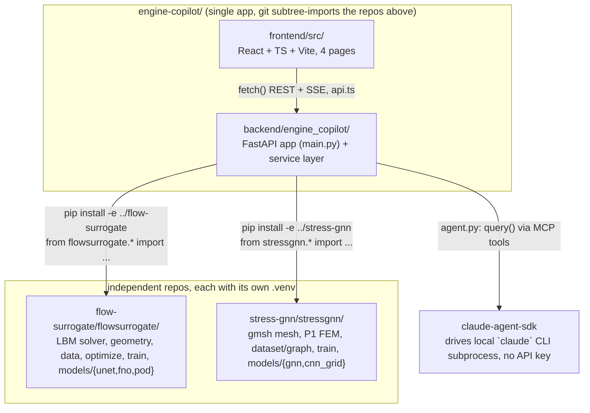

<!-- graph-baseline: e2c90e8 -->
# Knowledge Graph — Surrogate Engineering

> **Purpose**: navigation map of this repo for Claude. Read **this file** instead of
> re-scanning the whole project. Each node says *what a module does* and *what it depends
> on*; the inverse index sends you straight to the file(s) for a given task.

## In one sentence

Two laptop-reproducible ML research repos — `flow-surrogate` (LBM flow + learned surrogates +
differentiable shape optimization) and `stress-gnn` (FEM elasticity + mesh graph networks +
design ranking) — plus `engine-copilot`, a FastAPI + React platform that turns both into an
interactive demo with a Claude Agent SDK chat layered on top.

**`main` carries the Flow Lab and the Stress Lab.** The one remaining lab is deliberately
absent from this branch and lives on its own, branched off `01282b2`:

| Branch | Lab |
|---|---|
| `thermal-pinn` | Thermal PINN (WIP) — `thermal-pinn/`, research repo only, no platform wiring yet |
| `fcso-chairs` | FCSO Review — `fcso-chairs/` research repo + static `/fcso` page |
| `bracket-lab` | Bracket Lab — static `/bracket` page (study lives outside this repo) |
| `all-labs` | `main` + `bracket-lab` + `fcso-chairs` merged: one app with Flow, Stress, FCSO and Bracket |

`stress-lab` still exists as a branch, but `main` is now ahead of it on every file it
holds — treat `main` as the Stress Lab's home and that branch as history.

Nothing below describes the WIP branch; this graph maps `main`. When you merge a lab back,
re-read its branch and extend the catalogue rather than trusting this file for it.

## How to use this graph

1. Identify the **task** in the [inverse index](#inverse-index-task--files) → open only those files.
2. Need the full picture of a request? See [key flows](#key-flows).
3. Touching the ML repos' data/checkpoints? See [data & file model](#data--file-model-on-disk).
4. Wondering what's built vs planned? See [platform milestone status](#platform-milestone-status).
5. **Before finishing**, apply the [update protocol](#update-protocol) if you changed the repo's structure.

---

## Overview (module graph)



**Integration model**: `engine-copilot` treats both research repos strictly as **read-only
libraries** (editable-installed, never modified from platform code — see
`PLATFORM_PLAN.md`'s "INTOUCHABLES" directive). All physics/ML logic stays in
`flowsurrogate`/`stressgnn`; `engine-copilot/backend` only adapts their outputs to JSON and
streams them.

**Two servers, one browser tab**: `uvicorn` (backend, port 8000 by convention) and Vite dev
server (frontend, port 5173, CORS-allowed origin in `main.py`). No database, no persisted
platform state — every request recomputes from the trained checkpoints in `runs/`.

---

## Node catalogue

### `flow-surrogate/flowsurrogate/` — flow physics + surrogates (library)
| Module | Role |
|---|---|
| `geometry.py` | `Domain`, `solid_mask`, `area`, `sample_shapes`, boundary/radius helpers (+ torch variants used for differentiable optimization) |
| `lbm.py` | `LBMSolver`, `SolverConfig`, `equilibrium`, lattice constants `C` — the ground-truth solver |
| `data.py` | `Normalizer`, `input_channels`, `load_splits`, `FlowDataset` |
| `optimize.py` | `optimise`, `verify`, `render_inputs`, `to_params`, `boundary_xy` — gradient descent through the surrogate + solver-side verification |
| `train.py` | `load_model`, `pick_device`, `train` |
| `models/{unet.py,fno.py,pod.py}` | `UNet`, `FNO2d`, `PODRegressor` |
| `runs/*.pt` (+`*_history.json`) | trained checkpoints: `unet`, `unet-phys`, `fno`, `pod-*` |

Science/results are documented in `flow-surrogate/README-full.md` (the unabridged README:
the problem in equations, the solver, the five models, the optimiser) and
`flow-surrogate/BACKGROUND.md` (from-scratch explainer) — don't re-derive them here, cite
them. **Both are gitignored and local-only**: the repo ships the root `README.md` plus a
short `flow-surrogate/README.md`. They are still on disk and still the right thing to
read; just never link to them from a committed file, and don't reintroduce them to git.

**Repo layout**: `flowsurrogate/` (library), `scripts/00-06_*.py` (pipeline stages),
`run_all.py` (orchestrates generate → train → optimize; `--quick`/`--force`), `data/*.npz`
(train/test/ood splits, not committed), `runs/` (checkpoints, committed), `results/*.json`
(metrics feeding README tables, committed), `tests/`. `stress-gnn/` and the lab repos on
the other branches follow the same layout.

### `stress-gnn/stressgnn/` — elasticity + mesh graph networks (library)
| Module | Role |
|---|---|
| `geometry.py` | `Design` (2–6 holes + load angle), `is_valid`, `sample_design(s)`, and the `WIDTH`/`HEIGHT`/`MIN_R`/`MAX_R` envelope the UI validates against |
| `mesh.py` | `Mesh`, `build_mesh(design, h)` — gmsh triangulation, node classification (clamped / loaded / hole boundary), `loaded_edges`. **gmsh's C++ state is process-global and not thread-safe** |
| `fem.py` | P1 plane-stress FEM: `assemble_stiffness`, `load_vector`, `solve` → `FEMSolution`, `von_mises`, `elements_to_nodes`, `interpolate` — the ground truth |
| `dataset.py` | `solve_pair` (fine + coarse), `generate_split`, `rasterise`, `Graph`/`build_graph`/`collate`, `GraphDataset` (carries the `mean`/`std` and `peak_mean`/`peak_std` normalisation stats) |
| `train.py` | `TrainConfig`, `train`, `load_model`, `pick_device`, `loss_fn` (field term + graph-level peak head) |
| `models/{gnn.py,cnn_grid.py}` | `MeshGraphNet` (+ global latent, + coarse-solve input), `GridUNet` — the Cartesian baseline that wins in-distribution |
| `evaluate.py` | `predict`, `field_metrics`, `baseline_metrics`, `latency_ms` |
| `runs/*.pt` (+`*_history.json`) | trained checkpoints: `gnn-mp{0,2,5,10,15}`, `gnn-mp10-glob[-corr,-maxloss,-nopos]`, `grid-cnn` |

Numbers live in `stress-gnn/RESULTS.md` (generated by `scripts/03_report.py`) and the
science in `stress-gnn/README.md` + `BACKGROUND.md` — cite them, don't re-derive. Unlike
`flow-surrogate`, **both long-form docs here are still committed**; the local-only
convention applied to `flow-surrogate` in `05c9c69` was not extended to this repo.

### `engine-copilot/backend/engine_copilot/` — FastAPI service layer
| File | Role | Depends on |
|---|---|---|
| `main.py` | FastAPI app, `lifespan` warmup (loads both services + JIT-warms the LBM solver and gmsh before first request), all routes | `agent_session`, `flow_service`, `stress_service`, `simulate_streaming` |
| `agent.py` | `AgentSession.chat()` — one `query()` call per browser turn (not a shared `ClaudeSDKClient`: a client left mid-response by a dropped HTTP connection corrupts the underlying CLI session for every future request); continuity via `options.resume = previous ResultMessage.session_id`; registers `ALL_TOOLS` as an in-process MCP server (`create_sdk_mcp_server`), `permission_mode="bypassPermissions"` because the tools are deterministic read-only wrappers | `tools.ALL_TOOLS` |
| `tools.py` | `@tool`-decorated MCP tools exposed to the agent → `ALL_TOOLS`. All eight of `PLATFORM_PLAN.md` §5.3: `flow_predict`, `flow_optimize`, `flow_verify`, `flow_simulate`, `stress_predict`, `stress_optimize`, `get_model_card`, `render_report`. Two invariants: every service call goes through `anyio.to_thread.run_sync` (the MCP server shares the event loop with the SSE streams feeding the labs), and the streaming services are consumed to completion so only scalars reach the model — no fields, meshes or frames, and convergence curves are downsampled to ~20 points | `flow_service`, `stress_service`, `lbm_frames`, `report`, `config.*_MODEL_QUALITY` |
| `config.py` | Sibling-repo paths (`FLOW_RUNS_DIR`, `STRESS_DATA_DIR`, ...), `FIELD_DOWNSCALE`, the stress mesh/grid constants (`STRESS_H_COARSE`, `STRESS_GRID_NX/NY`), and the **hand-copied** `FLOW_MODEL_QUALITY` / `STRESS_MODEL_QUALITY` tables from each repo's `RESULTS.md`/`results/metrics.json` — re-copy them by hand if a model is retrained, nothing auto-syncs them | none |
| `device_lock.py` | `MPS_LOCK`, a process-wide `threading.Lock` serializing all torch/MPS calls — Apple MPS is unsafe under concurrent multi-thread kernel submission; FastAPI's `run_in_executor` would otherwise let requests overlap | none |
| `flow_service.py` | `FlowService` singleton (`flow_service`): caches models by key, decodes physical units, runs Adam shape optimization as a generator (`optimise_streaming`), runs true-LBM verification (`verify`) | `flowsurrogate.{data,geometry,lbm,optimize,train}` |
| `lbm_frames.py` | `simulate_streaming()` — instrumented LBM run yielding intermediate frames for the live animation; duplicates `LBMSolver.run()`'s setup and drives `solver._step_fn` in a Python loop; module-level singleton solver shared with `flow_service.verify()` to pay `torch.compile` warmup once | `flowsurrogate.{geometry,lbm,optimize}` |
| `stress_service.py` | `StressService` singleton (`stress_service`): meshes the current hole layout with gmsh, runs the coarse P1 FEM solve, builds the graph and runs the GNN; `optimise_streaming` is a **randomised local search** at constant removed area, not a descent — the mesh topology changes with every hole move, so there is no gradient. Two serialisations: `MPS_LOCK` for torch, its own `_GMSH_LOCK` for mesh building; and `gmsh.initialize()` is forced at import time on the main thread, since it registers a SIGINT handler CPython only allows there. `_grid_field` resamples the nodal field onto a regular grid via `LinearTriInterpolator`, whose mask *is* the "no material here" signal the frontend draws | `stressgnn.{dataset,fem,geometry,mesh,train}`, `config`, `device_lock` |
| `report.py` | `render_report(project, context)` → Markdown; `project` is `"flow"` or `"stress"`. **Deterministic template, no LLM**: `PLATFORM_PLAN.md` §3.3 describes the route as calling Claude but §5.3 requires the *tool* to use a fixed template to avoid recursion — the template wins for both callers, so a report is the same document whoever asked and costs no CLI subprocess. Every field is optional and degrades to `n/a`, because the agent passes a summarised (partial) context and a report with one blank row beats a 500 | `config.FLOW_MODEL_QUALITY` |
| `schemas.py` | Pydantic request/response models = the tool/route schemas (`FlowPredictRequest/Response`, `FlowVerifyRequest/Response`, `FlowSimulateRequest`, `FlowOptimizeRequest`, `StressPredictRequest/Response`, `StressOptimizeRequest`, `ReportRequest/Response`) | none |

**Routes** (`main.py`):

| Endpoint | Method | Role |
|---|---|---|
| `/api/health` | GET | `claude` CLI presence check |
| `/api/flow/predict` | POST | one-shot Cd + field prediction |
| `/api/flow/optimize` | POST (SSE) | streaming Adam shape optimization |
| `/api/flow/verify` | POST | re-run the true LBM solver on a design, for comparison against the surrogate |
| `/api/flow/simulate` | POST (SSE) | streaming LBM frames for the live-animation toggle |
| `/api/stress/predict` | POST | mesh + coarse FEM solve + GNN von Mises field and its peak |
| `/api/stress/optimize` | POST (SSE) | streaming randomised local search over hole layouts |
| `/api/report/generate` | POST | deterministic Markdown report from an optimisation result |
| `/api/agent/chat` | POST (SSE) | Claude Agent SDK chat turn |
| `/api/agent/reset` | POST | drop the resumed SDK session — what *Clear the conversation* calls, since clearing the transcript alone leaves the agent resuming turns the user deleted |

Every planned route exists. `/api/report/generate` is the only synchronous non-trivial one
— rendering is pure string formatting, so it is a plain `def` with nothing offloaded to a
thread.

**Tests** (`backend/tests/`, hit real singletons, no mocking — ~55 s, model loading and a
real gmsh mesh included): `test_flow_service.py`, `test_stress_service.py` (one end-to-end
predict: positive peak, no NaN survives the mask), `test_tools.py` (the 8-tool roster, JSON
output, payload-size guards, error paths), `test_report.py` (both templates, partial context,
extrapolation warning, unknown-project rejection, and the `flow_optimize` payload spelling
the agent forwards). `pyproject.toml` sets `pythonpath = ["backend"]`; without it every
module dies at import. Two gaps, both deliberate: no test exercises the SDK loop in
`agent.py`, only the underlying tool functions; and `flow_verify`/`flow_simulate` have no
tool-level test because both run the real LBM for tens of seconds — their service-layer
counterparts are covered instead.

### `engine-copilot/frontend/src/` — React + TS + Vite UI

**shadcn/ui (new-york, Tailwind v4, `@/*` → `src/*`)**. `components.json` + `lib/utils.ts`
(`cn`) are the standard shadcn wiring; `components/ui/*` is vendored shadcn source on the
unified `radix-ui` package — **regenerate with the CLI, don't hand-edit**. The CLI resolves
the alias off the root `tsconfig.json` (which only holds project references), so
`shadcn add` writes into a literal `@/` folder at the repo root — move the files into
`src/components/ui/` afterwards.

```
App.tsx — <ChatProvider> + <TooltipProvider> wrapping <Backdrop> + a 3-column shell
├─ Backdrop (in App.tsx) — gradient masses + grain, viewport-fixed, shared by every page
├─ components/ContourField.tsx — burnt iso-lines, scoped to the content column only
├─ components/AppSidebar.tsx — left nav (icon rail < md), health dot footer, the mark (32px)
├─ main — <Routes>, own scroll container
│   ├─ pages/Home.tsx — hero, lab cards, principles
│   ├─ pages/FlowLab.tsx — debounced predict-on-change (250ms)
│   │   ├─ ShapeEditor.tsx — 6 Fourier sliders + Re; exports ShapePreview (reused read-only)
│   │   ├─ FieldViewer.tsx — u (sequential blue→red) / v, p (diverging, zmid 0) small multiples
│   │   ├─ FlowAnimation.tsx — Tabs: client-RK4 streamlines vs live LBM (SSE)
│   │   │   └─ StreamlineOverlay.tsx — 56 particles coloured by local speed (STREAK),
│   │   │      direct SVG mutation, no React state
│   │   ├─ OptimizerPanel.tsx — Adam optimize (SSE), verify-with-solver, apply-design,
│   │   │      export-report (sends `verify` only once the LBM has run, so an
│   │   │      unconfirmed optimum is reported as unconfirmed)
│   │   │   └─ ConvergencePlot.tsx — live cd_best/cd_mean
│   ├─ pages/StressLab.tsx — debounced predict-on-change (300ms), coarse-FEM compare toggle
│   │   ├─ HoleEditor.tsx — direct-manipulation SVG plate: click adds, drag moves, wheel
│   │   │      resizes, double-click removes; validated client-side against stressGeometry.ts
│   │   ├─ StressViewer.tsx — von Mises heatmap (SEQUENTIAL) + a pulsing peak marker driven
│   │   │      as two Plotly traces, not a CSS overlay
│   │   └─ StressOptimizePanel.tsx — randomised search (SSE), apply-design, export-report
│   ├─ pages/FcsoReview.tsx — /fcso, STATIC (no backend): review of fcso-chairs, 3 tiles, FCSO vs GD
│   │      trajectory grid per chair, all-methods table; reads public/fcso/{summary.json,meshes/<id>.json}
│   │   └─ ChairViewer.tsx — useChairViewer: one three.js canvas over the grid, a scissored
│   │          viewport per `data-cell`, shared orbit camera (no wheel zoom)
│   └─ pages/BracketLab.tsx — /bracket, STATIC (no backend call): result of the external
│       bracket-lab study (agent vs Optuna lowering a 3D bracket's mass, FEA-verified).
│       Stat tiles, baseline vs best renders, comparison table, best-design parameters
│       └─ BracketMassPlot.tsx — lightest feasible mass vs FEA run, one step line per run
└─ chat/ChatSidebar.tsx — right panel on EVERY page (overlay + backdrop < lg), mark in
   its header
   └─ chat/Markdown.tsx — react-markdown + remark-gfm, every element mapped onto the
          charte; the agent answers in Markdown and hands `render_report` back verbatim,
          so the transcript needs tables, not a bold-only patch
Shared: PageHeader.tsx (sticky, per-page actions + copilot toggle + the mark once the
copilot is folded), Mark.tsx (the only `` in the app — three call
sites, 32/24/24px), StatTile.tsx (the one 40px figure + its interval),
ColorScaleLegend.tsx, AnimatedNumber.tsx, ToolCallCard.tsx
Shared libs: lib/chartTheme.ts (Plotly), lib/motion.ts (the one entrance curve),
lib/utils.ts (`cn`), lib/bracket.ts (types + cached fetch of `public/bracket/bracket.json`,
shared by BracketLab and the Home card), stressGeometry.ts (the plate envelope + `isValid`, mirroring
stressgnn.geometry so a drag can be rejected without a round trip)
```

**Chat is a sidebar, not a page.** `chat/ChatProvider.tsx` holds the transcript above the
router, so the conversation survives navigation and panel collapse; `/chat` now redirects to
`/`. Each lab calls `usePublishChatContext({label, lines, suggestions})` to publish its live
design; `send()` prepends those lines to the wire message (the transcript still shows only
what the user typed) so "optimise this shape" resolves against what is on screen. Suggestions
are per-page. Toggle: ⌘/Ctrl-J, persisted in `localStorage` (`engine-copilot.chat.open`, stored
as `'1'`/`'0'` — any other value reads as "no explicit choice" and falls back to the breakpoint),
defaulting open ≥1024px and closed below. *Clear the conversation* clears the transcript **and**
`POST`s `/api/agent/reset`: the conversation also lives in the SDK session the backend resumes by
id, and dropping only the local half leaves the agent answering out of turns the user deleted.

Two rules about what the transcript shows. Assistant text goes through `chat/Markdown.tsx`,
never raw — the agent writes Markdown and is told to return `render_report`'s document
untouched, so headings, GFM tables, lists and `code` all have to render (and `**1.03 %**`
must not reach the reader as asterisks). And `agent.py` only emits tool events for
`_ALLOWED_TOOLS`: the CLI runs housekeeping tools of its own, they are not calls on the
user's design, and a card for one is noise in a panel that promises the lab's model calls.

`api.ts`: typed fetch client. JSON: `predictFlow`, `verifyFlow`, `getHealth`,
`generateReport` (+ `downloadMarkdown`, a Blob/object-URL save helper — its `context` is
deliberately `Record<string, unknown>`, since the backend renders `n/a` for whatever is missing
rather than holding both sides to one schema).
SSE via a custom `readSSE()` reader over `fetch`'s body stream (not `EventSource`, since POST
bodies are needed): `streamFlowOptimize` (**query-string params** — inconsistent with the
JSON-body convention used everywhere else), `streamFlowSimulate`, `streamAgentChat`.

**Design system — "Calque": registre sobre et dense.** One light scheme, no toggle. The full
charte is installed as a Claude skill at `~/.claude/skills/calque/` (SKILL.md + `references/`
+ `assets/tokens.css`) — **read it before touching any UI**, it is the source of truth this
implementation follows.

Its governing rules, because they explain choices that otherwise look arbitrary:

- **The register is quiet, and this outranks everything else.** Small, dense, one-pixel rules
  and tiny labels. No display face, no full-width flat. A screen that looks like a landing page
  is out of charte however correct its colours are.
- **A 40px type ceiling and exactly three faces** (Instrument Sans / Instrument Serif / IBM Plex
  Mono — there is **no** display face, and adding one is the classic drift). The whole scale is
  declared in `index.css` as `--text-k` 9 · `--text-band` 11 · `--text-body` 12.5 · `--text-ctl`
  13 · `--text-title` 14 · `--text-value` 40, and it stops there on purpose: reaching for
  `text-[52px]` is normally the signal a screen has drifted. `.cq-value` (Serif **roman**, 40px,
  weight 400) is the single figure a panel gets; outside the one exception below, weights never
  pass 600 and tracking never goes tighter than -0.015em.
- **Orange is a measuring scale, not a brand colour.** Every orange mark encodes a quantity
  (drag, stress, error, latency, load). An orange flat with no quantity behind it is a bug —
  which is why the nav's active item is a 2px rule rather than a filled pill, the chat's user
  turns are white sheets rather than orange bubbles, and the "send" button is outlined.
- **Two budgets to count before shipping**: **one** black-filled element outside text, and
  **one** filled orange button — and they draw on the *same* budget, so each lab has exactly one
  ("Optimise").
- **No red, no green in the chrome.** Nominal is plain ink; anything out of envelope is
  `--burnt`. Status is always carried by a word and a mark as well as a colour. (This is why
  `MetricsBadge` was deleted: its good/warning tint had no home here, and the model, its measured
  error, the interval and the latency now sit as `.cq-row` key/value lines inside each lab's
  panel.)
- **The background is atmosphere: if you notice it, it is too strong.** `<Backdrop>` in
  `App.tsx` lays down the viewport-wide layers (blurred gradient masses, then `feTurbulence`
  grain) once for the whole app; pages never repeat them. The mass opacities sit under the
  charte's own numbers (.22/.16/.11 against .30/.22/.16) because this shell is full-bleed rather
  than the charte's 1160px centred column, and at the published values a 1500px viewport washes
  orange.

**Four owner-approved deviations from the published charte.** They are deliberate and were asked
for explicitly; the same list is at the top of `index.css`. Do not "restore" any of them without
asking:

1. **Solver fields are blue↔red, not the orange ramp** (`SEQUENTIAL`/`DIVERGING` in
   `lib/chartTheme.ts`, plus `STREAK` for the streamline hairlines). Scoped strictly to
   rasterised fields — everywhere else orange is still the only quantity colour, which is what
   keeps the exception legible as an exception.
2. **The overview ratios are `--text-hero`** (76px, weight 700, `.cq-hero`) — above both the
   size ceiling and the weight cap. Instrument Sans, because Instrument Serif has no bold.
   One per lab card, so two on this branch.
3. **No Instrument Serif italic anywhere.** The charte's "one serif moment per screen" was
   dropped wholesale; what those sentences carried is now plain data (Flow Lab's interval is an
   `Intervalle` row).
4. **`<ContourField>` replaces the charte's two large background arcs.** Marching-squares
   iso-lines of a smooth scalar field, drawn in `--burnt` hairlines — sharper than the arcs, and
   it earns its orange by genuinely being level sets of a field. It is mounted on the content
   column's wrapper, **not** fixed to the viewport, so it never appears behind the nav rail or
   the copilot panel; and `.cq-calque` was raised to .88 (the charte's own upper bound) so the
   lines never read through a panel carrying numbers. Cards are opaque, so plots are unaffected.

`index.css` holds the Calque token set (`--paper/--ink*/--or/--burnt/--peach/--gone`, the
`--m0..--m5` measure ramp, brown-orange shadows, the three font stacks, the type scale), then
**maps shadcn's names onto them** (`--primary: var(--or)`, `--good: var(--ink2)`, …) so the
vendored primitives inherit the charte for free. `<html>` no longer carries `dark`; the `dark`
custom variant is kept pointed at a class nothing stamps, purely so the `dark:` utilities baked
into `components/ui/*` still compile. The `.cq-*` vocabulary lives in `@layer components`, one
layer *below* Tailwind's utilities, so a `text-burnt` next to a `.cq-k` still wins — written
unlayered, as the charte's own `tokens.css` is, `.cq-k`'s ink3 would silently beat every colour
override. Everything Calque changes about the shadcn primitives is at the bottom of the file as
**unlayered rules keyed on `data-slot`** (1px slider track, warm card shadow, paper-white
outline buttons…) — unlayered CSS outranks every Tailwind layer, so the generated components
restyle without being hand-edited, which keeps `shadcn add` regenerable.

One deliberate deviation, stated so it isn't "fixed" by accident: the charte positions calque
panels as 246–300px cards absolutely anchored in the corners of a data canvas. Each lab's
headline panel keeps the recipe's width (298px) and translucency but sits in the document flow
above the field plots, because floating it over them would cover the data the user is
manipulating.

`lib/chartTheme.ts` is the single source of truth for every Plotly plot (Plotly cannot read CSS
custom properties, so the hexes are **mirrored** there — keep the two in step): `MARK` (marks by
*role* — `measure`/`focus`/`context`/`gone` — because the charte has no categorical palette and
series separate by stroke and value, never by hue), the `SEQUENTIAL`/`DIVERGING`/`STREAK`
colorscales, `sampleScale()`, `baseLayout()`, `axisX`/`axisY` (horizontal gridlines only, no
frame, no ticks), `FIELD_MARGIN`, `fieldRange`/`symmetricRange`.

The three field scales are the blue↔red deviation (#1 above) and differ by job: `SEQUENTIAL` for
unsigned magnitude (axial velocity, von Mises stress), `DIVERGING` for signed fields **always with
`zmid: 0`** — without that anchor Plotly centres the neutral on the data's own midpoint, the
crossover drifts off zero and the sign stops meaning anything. `STREAK` exists because
`SEQUENTIAL`'s crossover band is near-white: invisible as a 2px hairline, so the streamlines
route through darker mid values instead. Everything that is *not* a rasterised field —
convergence traces, intervals, progress rules — stays on orange. Field heatmaps carry **no
Plotly colorbar**: `ColorScaleLegend` draws the key in the DOM instead, because Plotly's
colorbar drops end labels on a short bar and costs width that aspect-locked (`scaleanchor`)
fields can't spare.

`lib/motion.ts` holds the charte's single entrance curve (`cubic-bezier(.2,.7,.2,1)`) as
`reveal()` (block arrival, 22px rise), `settle()` (in-place state change) and `axisDelay()`
(stagger by a datum's position on its axis, not by array index). Reduced motion is honoured
globally in `index.css`.

### `docs/` — README assets (root level)

Everything the root `README.md` shows, plus the scripts that produce it — nothing here is
hand-drawn or hand-cropped. Three scripts, in dependency order:

- **`make_logo.py`** owns the mark and nothing else: the dot **"C"**, a square lattice of
  cells clipped to an annulus with a wedge cut out on the right, so the top and bottom arcs
  land on exactly two rows. A cell's *radius* follows the horizontal axis (smallest against
  the mouth, ~3× larger at the back), its *colour* the vertical one on the measure ramp. It
  writes `logo.svg` (mark on its paper tile), `logo-plain.svg`, `logo-dark.svg` — **and**
  the app's two copies, `frontend/public/favicon.svg` (tiled, a browser tab needs its own
  ground) and `frontend/public/mark.svg` (plain, what `AppSidebar` sets). Neither is copied
  by hand any more. Needs only numpy.
- **`make_brand.py`** builds the README banner and imports `make_logo` for the mark rather
  than holding a copy; `build_logo()` is now a two-line delegation. Writes `banner.png`.
- **`capture.py`** drives a **running** platform through optimise → verify and writes
  `flow-lab.png` + `optimizer.png`, so the numbers in the screenshots are a real session.

The last two run on `engine-copilot/.venv` — the only venv here with matplotlib *and*
playwright. Running `make_brand.py` regenerates the mark on the way, so it is the single
command that refreshes everything the README shows except the screenshots.

The mark this replaced — iso-lines of `rho - r(theta)`, the surrogate's own input rendered
as a logo — is in the history, at `make_brand.py`'s `build_logo()` before the dot-C commit.

---

## Key flows

**Flow Lab predict** — slider change → debounce 250ms → `api.predictFlow` → `POST
/api/flow/predict` → `flow_service.predict` (cached model, `flowsurrogate.data.Normalizer`
decode) → `FieldViewer` + the headline calque panel (`StatTile` + its `.cq-row` lines) re-render.

**Flow Lab optimize** — `OptimizerPanel` → `api.streamFlowOptimize` (query-string) → `POST
/api/flow/optimize` SSE → `flow_service.optimise_streaming` (Adam through the frozen
surrogate) → `ConvergencePlot` updates per iteration → on `done`, "Verify" button calls
`api.verifyFlow` → `POST /api/flow/verify` → `flow_service.verify` runs the **true LBM
solver** on the optimized design for an honest comparison.

**Flow Lab live simulate** — `FlowAnimation` toggle → `api.streamFlowSimulate` → `POST
/api/flow/simulate` SSE → `lbm_frames.simulate_streaming` (shares the warmed singleton
solver with `flow_service.verify`) → frame-by-frame field updates.

**Stress Lab predict** — hole drag/wheel/click (validated client-side against
`stressGeometry.ts` so an invalid layout never leaves the browser) → debounce 300ms →
`api.predictStress` → `POST /api/stress/predict` → `stress_service.predict`: gmsh re-meshes
*this* layout, the coarse P1 FEM solve runs, `build_graph` normalises it, the GNN forward
pass returns a nodal field + a graph-level peak → `_grid_field` resamples onto a 128×64 grid
→ `StressViewer` heatmap + peak marker + the headline calque panel re-render. ~230 ms.

**Stress Lab optimize** — `StressOptimizePanel` → `api.streamStressOptimize` → `POST
/api/stress/optimize` SSE → `stress_service.optimise_streaming`: every candidate is a real
re-mesh + re-solve + forward pass, accepted only if it lowers the peak, at constant removed
area → the trace updates per iteration → on `done`, *Apply this design* pushes the layout
back into the editor. There is no Verify button here: the fine FEM solve the surrogate was
trained against is not wired into the platform.

**Report export** — two entry points, one renderer. The lab's *Export report*
button → `api.generateReport` → `POST /api/report/generate` → `report.render_report` →
`downloadMarkdown` saves a `.md` via an object URL; or the copilot's `render_report` tool
calls `render_report` directly, in-process. Nothing on this path touches a model, so a
report is the same document and the same cost whoever asked for it. Both labs use it;
`project` picks the template.

**Agent chat** — `ChatSidebar` composer → `ChatProvider.send()` (prepends the active page's
published context lines) → `streamAgentChat` → `POST /api/agent/chat` SSE →
`agent_session.chat()` → `query()` (Claude Agent SDK, `resume`d by session id) → SDK may call
`flow_predict`/`get_model_card` (in-process MCP tools, `bypassPermissions`) → text/tool-use
events streamed back → `ToolCallCard` renders each tool call, text streams into the transcript.
State lives in the provider above `<Routes>`, so switching labs mid-conversation keeps it.

---

## Data & file model on disk

`flow-surrogate/`: `data/*.npz` (generated, not committed — hundreds of MB), `runs/*.pt` +
`*_history.json` (checkpoints, committed), `results/*.json` (metrics behind the README
tables, committed).

`stress-gnn/` differs on one point that bites: **`runs/` is gitignored here too**, along
with `data/`, so a fresh clone has neither the checkpoints nor `data/train.npz`. The backend
needs both at *import* time — `StressService.__init__` builds a `GraphDataset` from
`data/train.npz` purely for the normalisation stats, and `_get_model` loads from `runs/` —
so without them `import engine_copilot.main` fails outright rather than degrading. Restore
them with `stress-gnn/run_all.py` or by copying from the `stress-lab` worktree.

`engine-copilot` has **no persistent state of its own** — no database, no uploaded files;
every request is computed fresh from the loaded checkpoints plus whatever the browser sent
in the request body. `config.py`'s `FLOW_MODEL_QUALITY`/`STRESS_MODEL_QUALITY` are the one
place platform code duplicates a fact that lives elsewhere (each repo's
`results/metrics.json`) — keep them in sync by hand after retraining.

The `data/` and `runs/` of a lab that lives on another branch are likewise **not** carried
by git, so checking that branch out gives you its code but not its trained checkpoints —
regenerate them with that repo's `run_all.py`.

---

## Platform milestone status

Full spec in `PLATFORM_PLAN.md` (French). Status as of baseline commit, cross-checked against
`git log` and `git status`:

| Milestone | What | Status |
|---|---|---|
| M0 | Scaffolding (health check, 4-tab shell) | done, committed |
| M1 | Flow prediction end-to-end (static) | done, committed |
| M2 | Animation (client streamlines + LBM SSE) | done, committed (`4ef16a8`) |
| M3 | Live optimizer (Adam streaming + verify) | done, committed (`4ef16a8`) |
| M4 | Stress Lab | **done** — built in `4ef16a8`, removed from `main` in `4409beb`, restored here (uncommitted): `stress-gnn/`, `stress_service.py`, `/api/stress/*`, the 2 stress tools, `StressLab.tsx` + `HoleEditor`/`StressViewer`/`StressOptimizePanel`, all re-verified live against the trained checkpoints |
| M5 | Claude Agent SDK chat | **done** — chat committed (`eeeabf6`), moved into a sidebar (`85f5ce3`), all 8 tools wired (`035c78a`) and all 8 present again. The plan's acceptance criterion was checked live against a running backend: "Optimise my shape at Re=100 and verify" calls `flow_optimize` then `flow_verify` and quotes both Cd |
| M6 | Report export + demo GIF + polish | **done except the GIF** — `report.py` + `/api/report/generate` (`871dd9e`), `render_report` tool (`035c78a`), *Export report* in both labs + README with a mermaid architecture. No `docs/demo.gif`: recording it needs a headless browser driver and `ffmpeg`, neither installed, and adding Playwright to the frontend deps for one animation is the repo owner's call |
| — | `main` reduced to the Flow Lab, then widened again | `4409beb` moved the Stress Lab off `main` onto `stress-lab`; it is now back on `main`, ported forward across the shadcn rebuild, the Calque restyle and the English pass. `thermal-pinn` still holds the one lab that was never merged |
| — | UI rebuild on shadcn/ui | done, committed (`85f5ce3`) — left nav + right copilot sidebar shell, all panels on shadcn primitives, unified `lib/chartTheme.ts`. `ChatOrchestrator.tsx`, `ThemeToggle.tsx`, `Skeleton.tsx`, `colors.ts`, `ComingSoon.tsx` deleted |
| — | Calque restyle | done, committed (`d746eb8`) — the shadcn/ui *structure* of `85f5ce3` kept, its dark blue/slate skin replaced by the Calque charte (see the design-system section above). Touches `index.html`, `index.css`, `lib/chartTheme.ts`, new `lib/motion.ts`, `App.tsx` and every page/component; `MetricsBadge.tsx` deleted, `ContourField.tsx` added. No route, service or data-flow change |
| — | Platform in English | done, committed (`05c9c69`) — every user-facing string (pages, components, chat panel, `<html lang>`), the report template in `report.py`, and the assertions in `test_report.py`/`test_tools.py`. `docs/capture.py`'s Playwright selectors follow the button labels, so they moved too, and the screenshots were re-captured against the English UI. The Calque `.cq-*` class vocabulary stays French — it is internal, not copy. `agent.py` still answers in whatever language the user writes in |
| — | Long-form docs made local-only | done, committed (`05c9c69`) — `flow-surrogate/README.md` (560 l.) became the gitignored `README-full.md`, `BACKGROUND.md` was untracked in place, and a short `flow-surrogate/README.md` replaced them. The root `README.md` no longer links to either. **Not applied to `stress-gnn`**: its 462-line `README.md` and 811-line `BACKGROUND.md` came back committed, so the convention is currently half-applied |

| — | Bracket Lab | committed (`691ac51`), branch `bracket-lab`, merged into `all-labs` — static page `/bracket` + Home card + nav entry. Data in `frontend/public/bracket/` (`bracket.json`, `baseline.png`, `best_stress.png`), generated by `frontend/scripts/build_bracket_data.py <path-to-bracket-lab>` from that study's run logs, `docs/results.md`, `README.md` and source constants. No backend change |
| — | FCSO Review | committed (`76ee91b`), branch `fcso-chairs`, merged into `all-labs` — static page `/fcso` + nav entry. Data in `frontend/public/fcso/`, generated by `fcso-chairs/scripts/export_platform.py`. No backend change |

`engine-copilot/README.md` claims M0–M6 minus the GIF, which matches the committed tree.

---

## Inverse index (task → files)

| Task | Files |
|---|---|
| Add/change a flow surrogate model | `flow-surrogate/flowsurrogate/models/*.py`, `train.py`, `run_all.py`; then `engine_copilot/config.py` (`FLOW_MODEL_QUALITY`), `flow_service.py` (model cache key) |
| Widen the Flow Lab's design space (why the optimum never moves, tunable constraints, a Cl head) | `FLOW_DESIGN_SPACE_PLAN.md` (French, proposed — nothing implemented). Its §1 is a **measured** diagnosis: the optimum is a corner of the coefficient box, identical for every Re, and widening the Re range is ruled out by an LBM ground-truth sweep. Don't re-measure it |
| Add/change a stress surrogate model | `stress-gnn/stressgnn/models/*.py`, `train.py`, `run_all.py`; then `config.py` (`STRESS_MODEL_QUALITY`), `schemas.py` (`StressModelKey`), `StressLab.tsx` (`MODELS`) and `api.ts`'s model union — the key is spelled in five places |
| Work on the Thermal PINN | `git checkout thermal-pinn` — none of its files exist on `main`, so searching here for them will always come up empty |
| Add a new FastAPI route | `main.py` (route), `schemas.py` (request/response models), matching `*_service.py`, `api.ts` (frontend client), `PLATFORM_PLAN.md` §3 (API contract source of truth) |
| Change what a report says | `backend/engine_copilot/report.py` (`_flow_report`/`_stress_report` — deterministic, never call a model from here) |
| Change what a report *receives* | the `runExport` context in `OptimizerPanel.tsx`, and `render_report_tool` in `tools.py` — two callers, one renderer, and they spell two keys differently (`cd_surrogate_final`/`history.cd_best` vs `flow_optimize`'s `cd_final`/`convergence_cd_best`); `_flow_report` accepts both |
| Change how the copilot's answers are displayed | `chat/Markdown.tsx` (element → charte mapping), not `ChatSidebar.tsx` |
| Add a new agent tool | `tools.py` (`@tool`-decorated function + add to `ALL_TOOLS`), `agent.py` (`SYSTEM_PROMPT` if it should mention the tool) |
| Change the agent's behavior/persona | `agent.py` (`SYSTEM_PROMPT`), `agent.py` (`_options`, e.g. `max_turns`) |
| Refresh the Bracket Lab numbers / images | re-run `engine-copilot/frontend/scripts/build_bracket_data.py /path/to/bracket-lab` (needs only Pillow); `lib/bracket.ts` holds the JSON's types, `pages/BracketLab.tsx` + `components/BracketMassPlot.tsx` the view |
| Change the FCSO review page or its data | `pages/FcsoReview.tsx`, `components/ChairViewer.tsx`; data: rerun `python3 fcso-chairs/scripts/export_platform.py` after `make_report.py` (writes `engine-copilot/frontend/public/fcso/`, never hand-edit) |
| Add a new frontend page | `App.tsx` (route), new file in `pages/`, `AppSidebar.tsx` (nav entry), `PageHeader` at the top of the page, `usePublishChatContext` so the copilot sees it |
| Style / restyle anything visual | Read `~/.claude/skills/calque/SKILL.md` **first** (+ `references/components.md` for a screen with more than one block, `references/charts.md` once a number becomes a shape) |
| Change the color theme or the type scale | `frontend/src/index.css` (Calque tokens → shadcn names, the `--text-*` scale, plus the `data-slot` overrides at the bottom) **and** `lib/chartTheme.ts` (the mirrored hexes Plotly needs) |
| Restyle a shadcn primitive | **Not** `components/ui/*` (CLI-generated, regenerable) — add an unlayered `[data-slot="…"]` rule at the bottom of `index.css` |
| Add/restyle a chart | `lib/chartTheme.ts` (`MARK`, scales, `baseLayout`/`axisX`/`axisY`), the component; one ramp only, series by stroke not hue, `ColorScaleLegend` rather than a Plotly colorbar for field heatmaps |
| Change an entrance animation | `lib/motion.ts` — one curve for the whole app; don't hand-tune a `transition` in a component |
| Add a shadcn primitive | `pnpm dlx shadcn@latest add <name>`, then move it out of the literal `@/` folder into `src/components/ui/` |
| Change the copilot sidebar | `chat/ChatProvider.tsx` (state, context plumbing), `chat/ChatSidebar.tsx` (UI) |
| Change SSE streaming behavior (backend) | the relevant `*_streaming` generator in `flow_service.py`/`lbm_frames.py`, the route in `main.py` |
| Change SSE streaming behavior (frontend) | `api.ts` (`readSSE`, `stream*` functions), the consuming page/component |
| Debug an MPS threading issue | `device_lock.py` (`MPS_LOCK`); for meshing, `stress_service.py`'s own `_GMSH_LOCK` and the import-time `build_mesh` call that pins `gmsh.initialize()` to the main thread |
| Change the plate's validity envelope | `stress-gnn/stressgnn/geometry.py` (`is_valid`, `MIN_R`/`MAX_R`) **and** `frontend/src/stressGeometry.ts` — the client copy exists so a drag is rejected without a round trip, and the two must agree or the UI will offer layouts the backend rejects |
| Touch the LBM solver ground truth | `flow-surrogate/flowsurrogate/lbm.py`; mirrored/instrumented copy in `engine-copilot/backend/engine_copilot/lbm_frames.py` — **keep both in sync by hand** |
| Understand the science behind a result | Flow: `flow-surrogate/README-full.md` + `BACKGROUND.md` — local-only (gitignored); the committed `flow-surrogate/README.md` is a short summary. Stress: `stress-gnn/README.md` + `BACKGROUND.md`, both committed. Don't re-derive from code |
| Change UI copy | The interface, the agent's replies and the exported report are **English**. `report.py`'s template and `backend/tests/{test_report,test_tools}.py` assert on that copy, and `docs/capture.py` drives the screenshots by button label — a wording change breaks all three |
| Redo the README mark/banner or its screenshots | `docs/make_brand.py` (mark + banner; it calls `make_logo`), `docs/capture.py` (screenshots, needs both servers up) — run both with `engine-copilot/.venv/bin/python` |
| Change the mark itself | `docs/make_logo.py` only — lattice pitch, mouth angles and the dot-radius ratio are constants at the top. Rerun it and the favicon, the banner and all three in-app placements follow; never hand-edit the SVGs |
| Change *where* the mark appears, or how big | `components/Mark.tsx` is the single ``; its three call sites are `AppSidebar.tsx` (nav header, 32px, the only one with an `alt`/`title` since it is the whole header on the collapsed rail), `chat/ChatSidebar.tsx` (copilot header, 24px) and `PageHeader.tsx` (24px, beside the re-open button, rendered only while the copilot is folded) |

---

## Config & externals

| Item | Value / role |
|---|---|
| Backend | FastAPI + `uvicorn`, CORS allowed for `http://localhost:5173` only |
| Frontend | Vite dev server, port 5173 |
| Claude auth | `claude-agent-sdk` drives the local `claude` CLI subprocess — reuses `claude login`, **no `ANTHROPIC_API_KEY`, no `.env` secret**, ever |
| Agent permission mode | `bypassPermissions` — justified because the only tools exposed are deterministic, read-only wrappers with no shell/filesystem access |
| Device | Apple MPS; all torch calls serialized behind `device_lock.MPS_LOCK` (MPS is not safe under concurrent multi-thread kernel submission) |
| Python deps | `engine-copilot/pyproject.toml`: `fastapi>=0.115`, `uvicorn[standard]>=0.30`, `pydantic>=2.7`, `numpy`, `torch`, `sse-starlette>=2.1`, `claude-agent-sdk`, `anyio`. `flowsurrogate` and `stressgnn` installed separately, editable (`pip install -e ../flow-surrogate -e ../stress-gnn -e .`), which is also what pulls in `gmsh`, `scipy` and `matplotlib` |
| Environments | Each of `flow-surrogate/`, `stress-gnn/`, `engine-copilot/` has its **own** `.venv` — always run `./.venv/bin/python` from inside the relevant directory |
| Git history | `engine-copilot/` was merged into this repo via subtree-style imports (`git log`: "Add 'flow-surrogate/' from commit ...", "Add 'stress-gnn/' from commit ...") — the research repos' own histories are preserved, then squashed into this monorepo going forward |

---

## Update protocol

This graph is **versioned** (git) and **diffable** — you don't need to re-read everything to
keep it current.

**Every session where you change the repo's structure:**

1. Read the baseline at the top of this file (`<!-- graph-baseline: 85f5ce3 -->`).
2. List what moved:
   ```bash
   git diff --name-only <baseline>..HEAD ; git status --porcelain
   ```
3. **Only re-read the files listed.** Update only:
   - the **node catalogue** if a module's role/dependencies changed,
   - the **route table** if `main.py` gained/lost a route,
   - **key flows** or the **module graph** if a flow or the architecture changed,
   - **platform milestone status** if a milestone landed or a commit changed the uncommitted set,
   - the **inverse index** if a task gained/lost a relevant file.
4. Replace the baseline (line 1) with the new short `HEAD` (`git rev-parse --short HEAD`).

**When NOT to touch it**: internal refactor within an already-listed file, CSS tweaks,
wording, hyperparameter changes that don't change a module's role. This graph maps
*structure* (routes, flows, files, dependencies), not implementation detail.

**Watch especially**: `PLATFORM_PLAN.md`'s milestone list and `config.py`'s hand-copied
quality tables are the two things most likely to silently drift from reality — check them
first when picking up work here after a gap.
