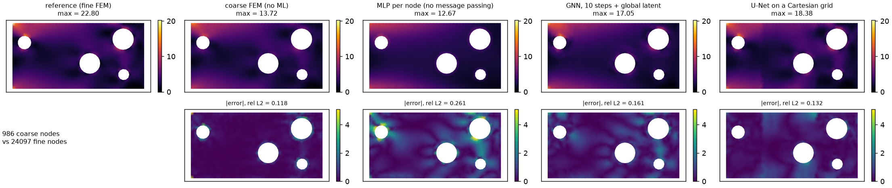
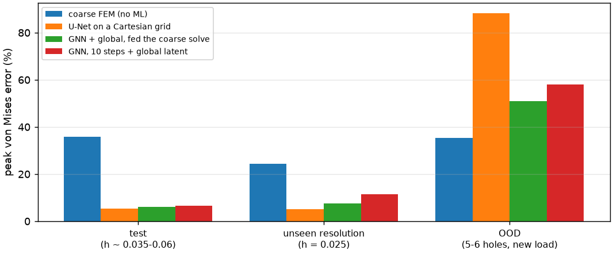
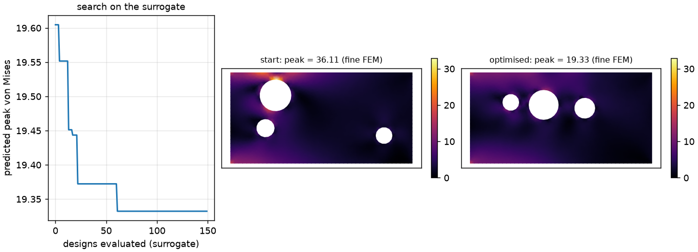
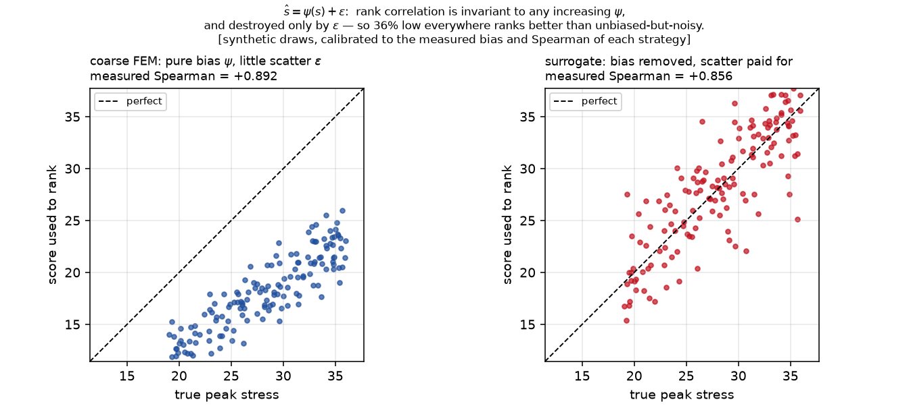
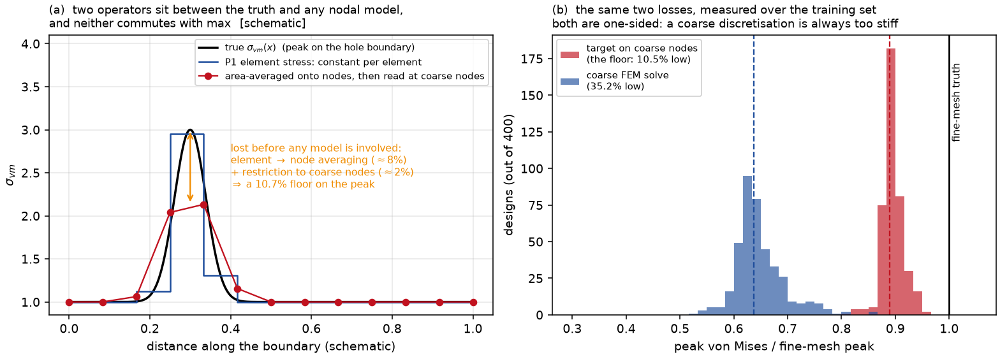
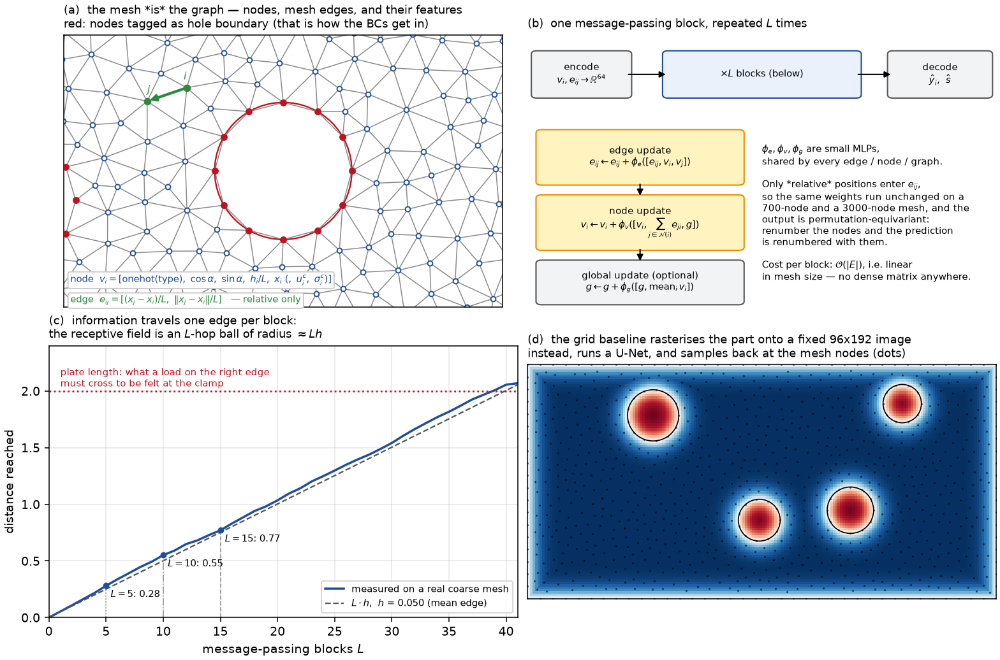
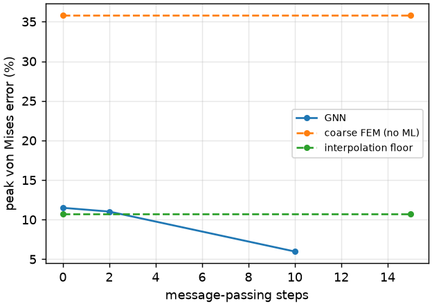

# stress-gnn

A finite-element solver for perforated brackets, surrogates that predict the
**fine-mesh** stress field from a **coarse** mesh, and an experiment on whether any of
it actually changes a design decision.

Everything runs on a laptop: ~20 min to generate the dataset, 0.3-13 min per model to
train.  Numbers are in [`RESULTS.md`](RESULTS.md), regenerated by `scripts/03_report.py`.

> **New to finite elements or graph networks?**  [`BACKGROUND.md`](BACKGROUND.md) explains
> everything this README assumes, from first principles — what stress and von Mises are,
> why a Galerkin solution is always too stiff, what message passing does, why the peak
> stress needs its own output head, and why rank correlation forgives a 35 % bias — with
> the mathematics and three explanatory figures.


*(a)* the design vector and the boundary conditions; *(b)* the coarse mesh the
surrogate consumes, coloured by the node-type feature; *(c)* the same geometry meshed
twice — the coarse triangulation chords the hole, and the peak (star) sits exactly
there; *(d)* how far ten rounds of message passing actually reach.
Regenerate with `python scripts/05_setup_figure.py`.

## Headline

400 training designs, 120 unseen test designs, 35 epochs each.  The quantity of
interest is the peak von Mises stress of the part.

| | field rel L2 | **peak error** | unseen mesh size | off-distribution |
|---|---|---|---|---|
| coarse FEM, no ML | 0.098 | **35.8 %** | 24.4 % | **35.5 %** |
| interpolation floor | 0 | 10.7 % | 10.2 % | 10.5 % |
| U-Net on a Cartesian grid | 0.126 | **5.2 %** | **5.1 %** | 88.1 % |
| MeshGraphNet, 15 steps | 0.160 | 5.5 % | 10.6 % | 73.7 % |
| MeshGraphNet + global, fed the coarse solve | **0.042** | 6.0 % | **7.6 %** | 51.0 % |
| MLP per node (no message passing) | 0.250 | 11.5 % | 14.1 % | **44.5 %** |



*One test design on its 986-node coarse mesh: reference (fine FEM interpolated onto
those nodes), then the coarse solve and three surrogates, absolute error underneath.
Read the `max` annotations: 22.80 for the reference against 13.72-18.38 for everything
else.  Every model's field maximum is too low — that is the interpolation floor of §3.1
in one picture, and it is why the peak numbers in the tables come from a dedicated head
rather than from these fields.  Note also where the reference peaks: the clamped
top-left corner, not a hole (see §6).*

Four results, three of which are not what I expected going in:

**1. On its own distribution the surrogate is worth ~6x.**  A coarse solve reads the
peak stress 35.8 % low; the same mesh through a network reads it 5.2-6.0 % off.  And
the graph-level peak head does beat the interpolation floor (10.7 %) that bounds any
model reading the peak off a nodal field — the same networks score 10.1-11.4 % when
you take the maximum of their predicted field instead of using the head, i.e. exactly
at the floor, as §3.1 predicts.

**2. The Cartesian baseline wins, and it should be said plainly.**  The grid U-Net is
the most accurate model here and the cheapest to evaluate (2.8 ms against 6.4-19.8 ms).
The honest reading is that this benchmark is close to a best case for a grid: the outer
boundary is a fixed rectangle, the only topology change is circular holes, and at
dx = 0.0104 the grid resolves them with ~20 cells across.  The graph representation's
structural advantages — no background grid to size, cost scaling with surface
complexity rather than bounding-box volume, direct consumption of a CAD mesh — buy
nothing at this scale.  They would start to matter on curved outer boundaries, thin
features, or in 3-D where the equivalent grid is 512³.

**3. Discretisation invariance is not free — it has to be trained for.**  This is the
result that surprised me most.  Re-mesh the *same* test designs at h = 0.025, finer
than anything in training (h ~ U[0.035, 0.060]), and the mesh-aware graph network
degrades from 6.0 % to 13.5 %, while the mesh-*blind* U-Net does not move at all
(5.2 % -> 5.1 %) — it never saw the mesh, so it cannot be surprised by it.  Feeding the
coarse FEM solution in as a node feature is what recovers robustness (6.0 % -> 7.6 %),
because that input carries the resolution information the network needs.  "GNNs are
discretisation invariant" is a claim about the hypothesis class, not about a trained
model.

**4. Off-distribution, every surrogate is worse than the cheap solve it replaces.**  On
designs with 5-6 holes and load angles from a quadrant never trained on, peak errors run
44-88 % against the coarse solve's 35.5 %.  The ordering also inverts: the *least*
expressive model (a pointwise MLP, 18k parameters) generalises best and the grid U-Net
worst.  A surrogate is trustworthy inside its training envelope and actively harmful
outside it, which is the argument for keeping the solver in the loop rather than
retiring it.



*The same four models across the three splits.  The blue bar (coarse FEM) is the only
one that never moves much — it has no training distribution to leave; on the OOD split
it is the shortest bar in the group.*

Two ablations, for completeness: removing node coordinates costs a lot (6.6 % -> 12.0 %
— on a fixed domain, absolute position is real information), and an extra loss term
pulling the predicted field's maximum toward the target's *hurts* the peak head
(6.6 % -> 10.1 %), because it fights the field MSE instead of helping it.

## Does any of it change a decision?

`scripts/04_optimize.py` — 150 hole layouts at constant removed area (a lightweighting
study), each scored three ways: fine FEM (truth, computed only to grade the others),
coarse FEM, and the surrogate on the same coarse mesh.  A design loop does not need
exact stresses, it needs the *ranking* to be right:

| strategy | Spearman vs truth | regret of its top-1 pick | regret of a verified top-3 shortlist | cost / design |
|---|---|---|---|---|
| fine FEM | 1.000 | 0 | 0 | 0.83 s |
| coarse FEM | **+0.892** | 2.07 % | **0.00 %** | 0.04 s |
| GNN (corrected coarse) | +0.856 | **1.41 %** | 1.41 % | 0.11 s |



*Left: best-so-far as the 150 candidates are visited in the surrogate's preferred order.
Right: worst and best layout of the study — same removed area, peak stress 36.1 against
19.3, i.e. the decision is worth a factor 1.9.*

**The coarse solve is the better ranker**, despite being 35 % wrong in absolute terms,
and the reason is worth writing down.  Model any strategy's score as

$$\hat s(d) = \psi\big(s(d)\big) + \varepsilon(d),$$

where $s$ is the truth, $\psi$ a systematic distortion and $\varepsilon$ the scatter.
Spearman correlation depends only on the ordering, so it is **completely blind to
$\psi$** as long as $\psi$ is increasing: a strategy can be 35 % low everywhere and
still rank perfectly.  It is only $\varepsilon$ that destroys rank.  The coarse solve is
almost pure $\psi$ — a stiff discretisation under-predicts every design in much the
same way — whereas the surrogate is trained to remove exactly that $\psi$ (its peak bias
is +1.6 %) and pays for it in $\varepsilon$ (p95 error 18.8 %).  What ranking rewards is
the opposite of what an accuracy metric rewards.



*The same statement as a picture: a large systematic bias with little scatter ranks
better than no bias with more scatter.  Synthetic draws, calibrated to the measured bias
and Spearman of each strategy.*

What a design study actually loses is the regret of the design it makes you keep:

$$R_k = \frac{s\big(\arg\min_{d\in S_k} s(d)\big) - \min_d s(d)}{\min_d s(d)},\qquad S_k = \{k \text{ lowest-scoring designs}\},$$

$R_1$ being "trust the score", $R_3$ "shortlist three and verify them with the real
solver".  Both strategies are within ~2 % of the best of 150 candidates on $R_1$; with
a three-design shortlist the coarse solve finds the true optimum exactly.

That sharpens what a surrogate is actually for.  If the question is *which of these
designs is best*, a cheap solve answers it and the ML is unnecessary.  If the question
is *does this part pass at 250 MPa*, the coarse solve is 35 % low and useless, and that
is where the 5 % surrogate earns its place.  Design exploration and certification are
different jobs.

On cost: the pipeline is 8x cheaper per design than the fine solve, and the breakdown
is not where I assumed.  Of the 105 ms per design, meshing is 30 ms, the coarse solve
this variant is fed is 13 ms, and the network path is 62 ms
— and most of *that* is host-side graph construction (edge extraction, feature
assembly), not the forward pass.  Caching graph topology across design iterations, or
building it inside the mesher, is the obvious next optimisation and would roughly
double the speed-up.

---

## 1. The problem, in equations

### 1.1 The physics

Plane-stress linear elasticity on a perforated plate $\Omega(d)$: find the displacement
$u:\Omega(d)\to\mathbb R^2$ with

$$-\nabla\cdot\sigma = 0 \quad\text{in }\Omega(d),\qquad \sigma = \mathsf D\,\varepsilon(u),\qquad \varepsilon(u) = \tfrac12\big(\nabla u + \nabla u^{\top}\big),$$

$$\mathsf D = \frac{E}{1-\nu^2}\begin{pmatrix} 1 & \nu & 0\\ \nu & 1 & 0\\ 0 & 0 & \frac{1-\nu}{2}\end{pmatrix},\qquad \nu = 0.3,$$

clamped on the left edge ($u = 0$ on $\Gamma_c$), loaded by a uniform traction on the
right ($\sigma n = t(\alpha) = (\cos\alpha, \sin\alpha)$ on $\Gamma_\ell$), and traction
free everywhere else — the holes and the top and bottom edges.

Two consequences of linearity are worth having in mind.  The map $t\mapsto u$ is linear,
so the solution for any load angle is a combination of two solves,
$u(\alpha) = \cos\alpha\ u_x + \sin\alpha\ u_y$; the load angle is therefore *not* where
the difficulty of this learning problem lives.  It lives in the geometry, and in the
fact that the quantity of interest is a **nonlinear** functional of $\sigma$.

### 1.2 The quantity of interest, and why it is the hard one

$$\sigma_{vm} = \sqrt{\sigma_{xx}^2 - \sigma_{xx}\sigma_{yy} + \sigma_{yy}^2 + 3\sigma_{xy}^2},\qquad s(d) = \max_{x\,\in\,\Omega(d)} \sigma_{vm}(x).$$

$s$ is the number a structural engineer signs off on, and it is the worst-behaved
functional in the problem: a **pointwise maximum** of a **derivative** of the solution,
attained on a **curved boundary**.  For reference, Kirsch's solution for a circular hole
in an infinite plate under uniaxial tension gives a stress concentration factor of 3 at
the hole flank; here the holes interact through finite ligaments, which is precisely
what a lightweighting study explores.

### 1.3 The design space

$$d = \big\{(x_j, y_j, r_j)\big\}_{j=1}^{n_h} \cup \{\alpha\},\qquad n_h \in \{2,3,4\},\quad r_j \in [0.08, 0.18],\quad \alpha\in[-\tfrac\pi2, 0],$$

on a $2\times 1$ plate, rejection-sampled with a minimum ligament of 0.07 to the outer
boundary and 0.09 between holes.  Unlike the flow project, the **topology** changes from
sample to sample: $n_h$ is part of the design vector, so the domain, the mesh, the node
count and the connectivity are all different for every sample.  That is the whole reason
this project reaches for a graph network rather than a CNN.

## 2. The expensive model

### 2.1 Discretisation

Multiply by a test function and integrate by parts: find a displacement in
$V = \{v\in H^1(\Omega)^2 : v|_{\Gamma_c} = 0\}$ such that

$$a(u,v) = \int_\Omega \varepsilon(v) : \mathsf D : \varepsilon(u)\,\mathrm d\Omega \;=\; \int_{\Gamma_\ell} t\cdot v\,\mathrm ds \;=\; \ell(v) \qquad \forall v \in V.$$

`stressgnn/fem.py` discretises this with P1 (constant-strain) triangles, so $u_h$ is
piecewise linear and the strain is *constant* per element, $\varepsilon|_{T_e} = B_e u_e$:

$$K = \sum_e A_e\,B_e^{\top}\mathsf D\,B_e, \qquad K u = f, \qquad f_i = \int_{\Gamma_\ell} N_i\, t\,\mathrm ds = \tfrac12\, |e|\,t \ \ \text{ per endpoint of a loaded edge } e,$$

assembled vectorised and solved directly.  The compliance $C = f^{\top}u = 2\times$
strain energy is stored as a second, global quantity of interest.

### 2.2 Why the peak stress is 35 % low and the compliance is not

`scripts/01_validate_fem.py` measures what a coarse mesh costs (errors relative to
h = 0.008, averaged over 12 designs):

| h | nodes | mesh + solve | peak von Mises err | compliance err |
|---|---|---|---|---|
| 0.060 | 787 | 0.04 s | **-28.4 %** | -2.60 % |
| 0.045 | 1 350 | 0.05 s | **-24.7 %** | -1.64 % |
| 0.030 | 2 897 | 0.10 s | -17.3 % | -0.79 % |
| 0.020 | 6 318 | 0.24 s | -11.6 % | -0.35 % |
| 0.014 | 12 808 | 0.55 s | -7.1 % | -0.14 % |
| **0.010 (reference)** | 24 772 | 1.20 s | -3.2 % | -0.04 % |
| 0.008 | 38 598 | 2.13 s | 0 | 0 |

The two columns behave completely differently, and Galerkin orthogonality says why.
Since $a(u - u_h, v_h) = 0$ for every $v_h$ in the discrete space,

$$C - C_h = a(u,u) - a(u_h,u_h) = a(u-u_h,\, u-u_h) = \lVert u - u_h\rVert_a^2 = O(h^2),$$

so the compliance error is *exactly* the squared energy-norm error: second order, and
**always negative** — a Galerkin solution is stiffer than the truth.  Every compliance
entry in the table is indeed negative, and by h = 0.06 the energy is already converged
to 2.6 %.

The peak stress has none of that protection.  $\sigma_h = \mathsf D B u_h$ is a
*derivative* of the finite-element solution, so it loses one order ($O(h)$ in $L^2$ at
best); it is piecewise **constant**, so it cannot represent the gradient across a stress
concentration; the maximum is an $L^\infty$ functional, with no superconvergence; and the
curved hole boundary is meshed as a polygon whose chords are $O(h)$ long — a *geometric*
error committed exactly where the peak lives.  Panel (c) of the figure at the top is
that last sentence drawn to scale.

Over the 400-design training set the coarse solve under-predicts the peak by **35 %**,
worse than the 12-design table above: the tail of tight-ligament designs is where coarse
meshes fail hardest, and it is exactly the tail a lightweighting study walks into.

### 2.3 Verification

`tests/test_fem.py` runs the standard checks before anything is learned: a
constant-stress **patch test** (uniform tension reproduced to 1e-9 with roller
supports), an **energy balance** ($f^\top u = 2\times$ strain energy, to 1e-9),
linearity, zero-load, clamped-node kinematics, element areas against the analytic
material area, and monotone convergence of the peak stress under refinement.

## 3. What is being learned

### 3.1 The target, and the interpolation floor

Every design is solved twice — fine ($h = 0.010$, ~25k nodes) and coarse
($h \sim U[0.035, 0.060]$, ~1k nodes) — and the learning target is the fine nodal field
**interpolated onto the coarse nodes**:

$$y_i = \big(\Pi\,\sigma^{\text{fine}}_{vm}\big)(x_i),\qquad x_i \in \text{coarse nodes},$$

barycentrically, through the actual fine triangulation, so values are never interpolated
across a hole.  A perfect model would give fine-mesh answers at coarse-mesh cost.

Two operators sit between the truth and *any* nodal model, and neither commutes with
$\max$:

1. **element -> node averaging.**  P1 element stresses are piecewise constant and noisy,
   so they are area-averaged onto nodes,
   $\sigma_i^{\text{node}} = \sum_{e \ni i} A_e\sigma_e \big/ \sum_{e\ni i} A_e$.  An
   average, hence $\max_i \sigma^{\text{node}}_i \le \max_e \sigma_e$, strictly at a
   concentration — this alone loses ~8 % of the peak at h = 0.010;
2. **restriction to the coarse node set**, $\max_i (\Pi\sigma)(x_i) \le \max_x \sigma(x)$
   — another ~2 %.



*Left, schematically: neither operator commutes with $\max$.  Right, measured over the
400 training designs: both ratios sit entirely below 1.*

So even with $\hat y \equiv y$ exactly, reading the peak off the predicted field is
**10.7 % low**.  That is the `interpolation floor` row in the tables: a property of the
representation, not of the model.  A nodal-field model can only get under it by
over-predicting somewhere, which is not a capability worth relying on — so every model
here also carries a **graph-level head** that regresses $s$ directly.
Both numbers are reported — `peak err` from the head, `peak-from-field err` from the
maximum of the predicted field — so the difference is visible rather than quietly chosen:
the heads score 5.2-6.0 % and the same models' fields score 10.1-11.4 %, i.e. pinned to
the floor.

### 3.2 The mesh as a graph

$G = (V, E)$: $V$ the coarse nodes, $E$ the mesh edges in both orientations.  Features:

$$v_i^{(0)} = \Big[\ \text{onehot}(\text{type}_i)\in\mathbb R^5,\ \ \cos\alpha,\ \ \sin\alpha,\ \ h_i/L,\ \ x_i,\ \ \big(u_i^{\text{coarse}},\ \sigma_i^{\text{coarse}}\big)\ \Big],$$

$$e_{ij}^{(0)} = \Big[\ \frac{x_j - x_i}{L},\ \ \frac{\lVert x_j - x_i\rVert}{L}\ \Big],$$

with $L = 0.05$, $h_i$ the mean incident edge length (the resolution cue), and the last
two node features present only in the `-corr` variant.  Node types are
interior / clamped / loaded / hole / free, which is how the boundary conditions of §1.1
reach the network — panel (b) of the top figure is exactly this feature.



*The mesh as a graph, one message-passing block, how far $L$ blocks reach on a real
coarse mesh, and what the grid baseline does instead.  [`BACKGROUND.md`](BACKGROUND.md)
§6–§8 is the long version.*

### 3.3 Message passing, and how far it reaches

`stressgnn/models/gnn.py` is a MeshGraphNet-style encode-process-decode network.  Each of
the $L$ blocks is a residual update of edges, then nodes, then (optionally) a global
latent:

$$e_{ij} \leftarrow e_{ij} + \phi_e\big([\,e_{ij},\, v_i,\, v_j\,]\big),$$

$$v_i \leftarrow v_i + \phi_v\Big(\big[\,v_i,\ \textstyle\sum_{j\in\mathcal N(i)} e_{ji},\ g\,\big]\Big),$$

$$g \leftarrow g + \phi_g\Big(\big[\,g,\ \operatorname{mean}_i v_i\,\big]\Big),$$

followed by $\hat y_i = \phi_d(v_i)$ and $\hat s = \phi_p\big([\operatorname{mean}_i v_i, g]\big)$.
Only *relative* positions enter the edge features, which is what makes the same weights
run unchanged on a 700-node and a 3000-node mesh.

The two knobs are swept rather than tuned quietly, because they are the two things that
decide whether this works on a stress field:

- **`n_message_passing`.**  Information travels exactly one edge per block, so after $L$
  blocks node $i$ has seen its $L$-hop ball, of radius $\approx L\,h$.  With $L = 10$ and
  $h = 0.045$ that is $\approx 0.45$ against a plate 2.0 long — panel (d) of the top
  figure measures 0.43 — so a load applied on the right edge structurally *cannot* be
  seen from the clamped edge.  The sweep is monotone and saturating: peak error 11.5 %
  (0 blocks, i.e. a pointwise MLP) -> 11.0 % (2) -> 7.2 % (5) -> 6.0 % (10) -> 5.5 % (15),
  for 18k -> 456k parameters and 1.5 ms -> 8.9 ms of inference;
- **`use_global`** — the $g$ above, pooled from and broadcast to every node in each
  block: an $O(1)$-hop shortcut for exactly that long-range coupling, far cheaper than
  stacking 40 blocks.  In-distribution it does not help (6.6 % against 6.0 %) and it
  triples inference; off-distribution it helps a lot (58 % against 79 %).  Worth having,
  not worth defaulting to.



*Peak-stress error against the number of message-passing blocks, with the two
non-learned references as dashed lines.  Zero blocks is a pointwise MLP.*

### 3.4 The loss

$$\mathcal L(\theta) = \frac{1}{|V|}\sum_{i\in V}\big(\hat y_i - y_i\big)^2 \;+\; \lambda_{\text{peak}}\big(\hat s - s\big)^2 \;\Big[\;+\;\lambda_{\max}\Big(\max_i \hat y_i - \max_i y_i\Big)^2\Big],$$

with $\lambda_{\text{peak}} = 0.3$ and $\lambda_{\max} = 0$ by default; targets are
standardised by the training-set statistics.  The bracketed term is the `-maxloss`
ablation, and it makes things worse (6.6 % -> 10.1 %): pushing the *field*'s maximum
around fights the field MSE, and the head that actually predicts the peak gets nothing
out of it.

## 4. The models

Two variants change the problem rather than the architecture:

- **`-corr`** appends the coarse displacement and the coarse von Mises value to each
  node's features, so the network sees $\sigma^{\text{coarse}}_i$ and has only to learn
  the discretisation *error* $y_i - \sigma^{\text{coarse}}_i$ instead of the field
  itself — a correction model rather than a pure surrogate (the residual is learned, not
  hard-wired: nothing in the architecture forces $\hat y_i \approx \sigma^{\text{coarse}}_i$).
  It is by far the best on the *field* (rel L2 0.042
  against 0.126-0.160) and the most robust to an unseen mesh size, at the price of a
  coarse solve you were paying anyway;
- **`-maxloss`** adds the loss term above.  See above.

The **grid baseline** (`stressgnn/models/cnn_grid.py`) rasterises the part onto a
192x96 signed-distance image, runs a U-Net, and samples the prediction back at the mesh
nodes by bilinear interpolation.  It is given a fair shot — the grid spacing matches the
fine element size, the loss is evaluated at exactly the same nodes — and, as reported
above, it wins.

## 5. Splits

| split | what changes |
|---|---|
| `test` | new geometries, coarse mesh size drawn from the training range |
| `res` | the *same* designs re-meshed at h = 0.025, a resolution never seen in training |
| `ood` | 4-6 holes (training tops out at 4) and load angles from a different quadrant |

## 6. Limitations

- Linear elasticity, plane stress, small strain, one material.  Nothing here transfers
  directly to contact, plasticity or buckling.
- The geometry family is circular holes in a rectangle — which, as result 2 above
  shows, is precisely the family that flatters a Cartesian grid.  A fair test of the
  graph representation needs geometries a grid cannot cover cheaply.
- **The clamped edge meets the free top and bottom edges at two mixed-boundary-condition
  corners, where the elasticity solution has an unbounded stress** ($\sigma \sim r^{\lambda-1}$
  with $\mathrm{Re}\,\lambda < 1$).  In a 12-design spot check, 4 designs had their global
  peak at such a corner rather than on a hole boundary; there the "converged" reference
  is really whatever h = 0.010 produces, and refining further would keep raising it.  The
  surrogate learns that reference faithfully, which is the right behaviour for this
  benchmark and the wrong thing to quote as a physical stress.  A fillet, or loading a
  self-equilibrated plate, would remove the singularity.
- Uniform element size per mesh; production meshes are graded, and graded meshes are
  where the local-size feature would really earn its place.
- 35 training epochs per model, chosen to fit ten models into an hour on a laptop.  The
  ranking between architectures is stable across the sweep, but none of them is trained
  to convergence.
- The reference is a converged *discretisation*, not an experiment: the surrogate
  learns the FEM, and the FEM's own model error is out of scope.

## 7. Running it

```bash
uv venv --python 3.12 .venv && VIRTUAL_ENV=.venv uv pip install -e .
./.venv/bin/python run_all.py            # everything, ~1 h 40 on an M-series laptop
```

or step by step:

```bash
python scripts/00_generate_data.py       # ~20 min  -> data/
python scripts/01_validate_fem.py        # ~2 min   -> results/fem_convergence.json
python scripts/02_train_all.py           # ~55 min  -> runs/   (resumable; skips finished runs)
python scripts/03_report.py              #          -> RESULTS.md, figs/
python scripts/04_optimize.py            # ~4 min   -> results/optimization.json
python scripts/05_setup_figure.py        # ~10 s    -> figs/setup.png
python scripts/06_explainer_figures.py   # ~10 s    -> figs/{graph_explained,interpolation_floor,ranking_vs_accuracy}.png
python -m pytest tests -q
```

`scripts/02_train_all.py --epochs 15 --skip-ablations` gives a smoke run in ~5 min.

`RESULTS.md`, `results/*.json` and `figs/*.png` are committed, so the numbers and every
figure in this README can be read without re-running anything; `data/` and `runs/` (the
solve pairs and the checkpoints) are not, being ~55 MB.

## 8. Layout

```
stressgnn/
  geometry.py    hole layouts, validity constraints, load cases
  mesh.py        gmsh meshing, node tagging, boundary extraction
  fem.py         vectorised CST assembly, sparse solve, von Mises, interpolation
  dataset.py     fine/coarse solve pairs, packing, graph construction, rasterisation
  models/        gnn.py (MeshGraphNet + peak head), cnn_grid.py (grid baseline)
  train.py       shared training loop, device-resident batches
  evaluate.py    field / peak-stress metrics against the three references
  plots.py       figures drawn on the mesh
scripts/         00 generate, 01 mesh convergence, 02 train, 03 report,
                 04 design selection, 05 setup figure,
                 06 explainer figures (for BACKGROUND.md)
tests/           FEM verification, meshing, graph construction
BACKGROUND.md    the mathematics behind every model here, from scratch
```
