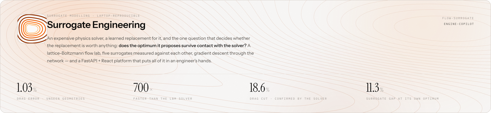
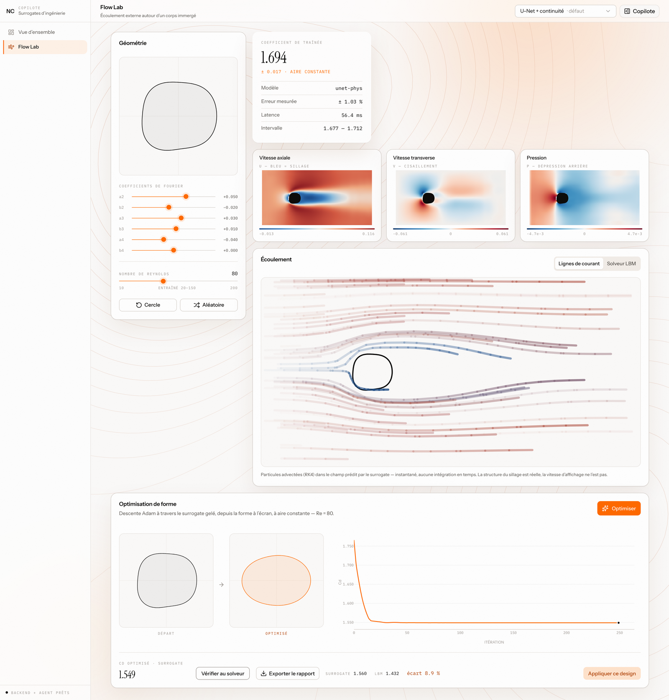
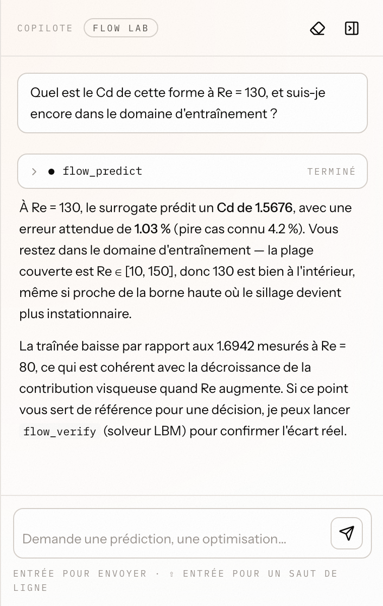
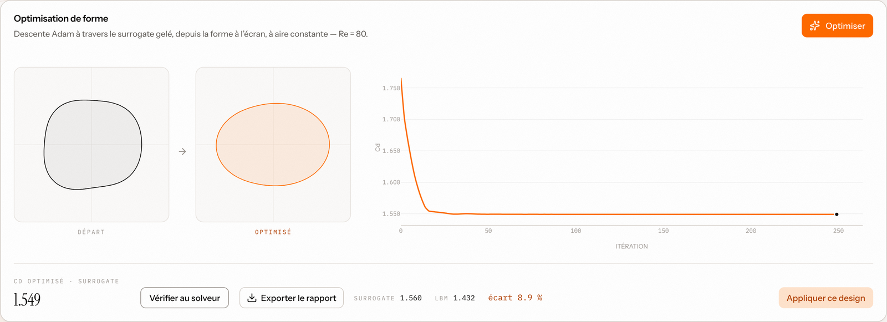

<p align="center">
  
</p>

<p align="center">
  <a href="flow-surrogate">flow-surrogate</a>&nbsp; · &nbsp;<a href="engine-copilot">engine-copilot</a>&nbsp; · &nbsp;<a href="flow-surrogate/BACKGROUND.md">background</a>&nbsp; · &nbsp;<a href="KNOWLEDGE-GRAPH.md">code&nbsp;map</a>
</p>

<p align="center">
  <sub>
    lattice Boltzmann &nbsp;·&nbsp; POD / U-Net / FNO &nbsp;·&nbsp; differentiable shape optimisation
    <br>
    PyTorch (Apple MPS) &nbsp;·&nbsp; FastAPI &nbsp;·&nbsp; React + Vite &nbsp;·&nbsp; Claude Agent SDK
  </sub>
</p>

---

One self-contained repository taking an expensive physics solver and asking how far a
learned model can replace it — and, on top of it, an interactive platform that puts the
result in an engineer's hands.

> **Other labs live on other branches.**  `main` deliberately carries the flow project
> alone.  [`stress-lab`](../../tree/stress-lab) holds the companion study — 2-D linear
> elasticity on unstructured meshes, mesh graph networks, and a design-ranking result
> that cuts against the premise it was built on — together with the two-project
> comparison this README used to open with.  `bridge-lab` and `thermal-pinn` hold work
> in progress.

| | [`flow-surrogate`](flow-surrogate) |
|---|---|
| physics | 2-D incompressible flow (lattice Boltzmann) |
| geometry | parametric obstacle, **fixed Cartesian lattice** |
| what varies | 7 shape coefficients + Reynolds number |
| surrogate input | rasterised level set |
| models compared | POD + ridge / POD + kernel ridge / U-Net / U-Net + physics loss / FNO |
| the question | *can I differentiate through the surrogate to optimise a shape, and does the optimum survive contact with the solver?* |

It runs end to end on a laptop (Apple M-series, MPS).  Data generation is ~20-25 min;
training is minutes per model.

> **Not familiar with these models?**  The repo carries a `BACKGROUND.md` that explains
> everything its README assumes, from first principles and with figures:
> [`flow-surrogate/BACKGROUND.md`](flow-surrogate/BACKGROUND.md) covers reduced-order
> models (POD + ridge / kernel ridge), U-Nets, physics-informed losses, Fourier neural
> operators, shape derivatives and the winner's curse.  It assumes no prior CFD or deep
> learning.


*The problem: a body in a channel, parametrised by six Fourier coefficients on a fixed
192x96 lattice.*

## The platform

[`engine-copilot`](engine-copilot) wraps the research repo — untouched, as a read-only
library — in a FastAPI backend and a React interface, so the surrogate can be *used*
rather than read about.  Move a Fourier coefficient and the drag coefficient follows in
about 60 ms; the fields, the streamlines and the interval move with it.

<p align="center">
  
</p>

*One real session, captured by [`docs/capture.py`](docs/capture.py) against a running
backend — not a mock-up.*

What the lab does, top to bottom:

- **Predict** — six sliders and a Reynolds number in, a drag coefficient out, next to the
  model's measured error, its confidence interval and the latency it took.  The three
  fields (axial velocity, transverse velocity, pressure) are the network's actual output.
- **Animate** — client-side RK4 streamlines through the predicted field, or the true LBM
  streamed frame by frame over SSE, in the same panel, on a toggle.
- **Optimise** — Adam through the frozen surrogate at constant projected area, streaming
  its convergence live.
- **Verify** — re-run the optimised design in the real solver.  This is the button the
  whole project is about, and it is deliberately not automatic.
- **Report** — export the run as Markdown.  A report produced before the verification
  says in as many words that nothing has confirmed the surrogate.
- **Ask** — a Claude Agent SDK copilot (⌘/Ctrl-J) that sees the design on screen and
  reaches the same services the interface does, through six read-only tools called
  in-process.  It drives the local `claude` CLI, so there is no API key anywhere in this
  project.

<p align="center">
  
</p>

*The copilot is given the design on screen, so a question needs no preamble.  It never
states a drag coefficient without the error attached to it, and every tool call it makes
stays in the transcript — this one is a real turn, captured with the rest.*

<p align="center">
  
</p>

*The optimiser lands on a design it scores at $C_d = 1.549$; the solver, re-run on that
same design, returns 1.432 — an 8.9 % gap between the surrogate's account of its own
optimum and the physics.  The committed run in `results/optimization.json` measures the
same effect at 11.3 %, against a drag cut of 18.6 % that the solver does confirm.
Surfacing that gap rather than hiding it is the point of the panel.*

## Results at a glance

**`flow-surrogate`** — 640 solver runs, 128 unseen test geometries.

| | field rel L2 | drag error | vs solver |
|---|---|---|---|
| POD + kernel ridge (ROM baseline) | 0.107 | 3.78 % | 19 800x |
| U-Net + continuity loss | **0.078** | **1.03 %** | 700x |

Gradient descent through the surrogate cuts drag **18.6 % at constant area, verified by
the solver** — 4 000 design evaluations in 17 s against ~2 h of solver time.  The
surrogate was 11 % wrong about its own optimum, and one round of active learning halved
that gap without moving the optimum: it bought reliability, not a better design.  The
ROM/network crossover sits at ~320 solver runs.

---

## The problem, formally

A design vector $d$ fixes a geometry $\Omega(d)$; a PDE gives a field; a functional of
that field is the number an engineer actually wants:

$$\mathcal A\big(u;\,\Omega(d)\big) = 0,\qquad J(d) = Q\big(u_d\big).$$

Here $\mathcal A$ is steady Navier–Stokes and $J$ is the drag coefficient $C_d$.  $J$ is
a *boundary* functional of a *derivative* of $u$ — which is why field accuracy and
engineering accuracy disagree throughout the project.  One evaluation costs 1.7 s, so a
thousand-design loop is hours.

**Stage 1 — sample and solve.**  Draw $\{d_i\}_{i=1}^N$, run the solver, keep both the
field and $J$.  **Stage 2 — fit** an encoder $X(d)$ and a network:

$$\theta^\star = \arg\min_\theta\ \frac1N\sum_{i=1}^N \ell\Big(N_\theta\big(X(d_i)\big),\ \big(u_{d_i},\, J(d_i)\big)\Big),$$

with $\ell$ carrying a field term *and* a term on $J$ itself, because a model fitted to
the field alone is not fitted to the quantity of interest.  **Stage 3 — put it in a
design loop:**

$$\min_{d\,\in\,\mathcal D}\ \hat J_{\theta^\star}(d)\qquad\text{s.t.}\qquad g(d) = 0,$$

the constraint being constant area, so that the optimiser cannot cheat by removing
material.

Everything about the method follows from **the encoder $X$**.  A fixed Cartesian lattice
makes $X(d)$ a tensor of constant shape and, crucially, a *differentiable* function of
$d$, so stage 3 is gradient descent through the whole pipeline.  (Change that one choice
— an unstructured mesh, where node count and connectivity are combinatorial functions of
$d$ — and nothing differentiates, stage 3 becomes a search over sampled candidates, and a
different toolbox applies.  That is the companion study on `stress-lab`.)

### The failure mode

**Optimising against your own error.**  Write $\hat J = J + e$.  Minimising $\hat J$
does not sample $e$ neutrally — it actively seeks out the designs where $e$ is most
negative, so

$$\mathbb E\big[\,e(d)\ \big|\ d = \arg\min \hat J\,\big] \;<\; \mathbb E\big[\,e(d)\,\big]$$

even for a surrogate that is unbiased on its training distribution.  This is the
surrogate's winner's curse, and it is a statement about the predicted *value*, not about
the design.

Measured here: **11.3 % off at the optimum, against 1.03 % on the test split** — the
error where the optimiser chose to stand is an order of magnitude larger than the error
the model advertises for itself, and the optimum sits on the boundary of the box the
model was trained in.  (In this run it lands on the pessimistic side: the solver finds
*less* drag than the surrogate promised.  The magnitude is the finding, not the sign.)
The design itself is genuinely 18.6 % better, verified by the solver, and one
active-learning round on the 32 designs the optimiser proposed halves the gap.

The consequence the whole project is built around: a surrogate used as an *objective*
must be verified by the solver.

## Method

The discipline, which is the part that transfers:

- **the solver is verified before anything is learned from it** — `flow-surrogate`
  reproduces published cylinder drag to a few percent after the standard blockage
  correction;
- **a non-neural baseline is always in the table** — a POD reduced-order model on
  seven parameters is hard to beat in-distribution.  A neural surrogate reported without
  one is not a result;
- **the metric is the engineering quantity**, not the loss — drag coefficient — reported
  next to the field error, because the two disagree;
- **generalisation is measured off-distribution**, on splits built to be outside the
  training range, not only on a random test split;
- **cost is measured end to end**, including the data generation, not just the forward
  pass.

## Run it

Two independent parts, each with its own virtual environment.  The research repo stands
alone; the platform installs it as a library.

```bash
# the science
cd flow-surrogate && python3.12 -m venv .venv && ./.venv/bin/pip install -e .
./.venv/bin/python run_all.py --quick        # generate -> train -> optimise

# the platform (two servers, one browser tab)
cd engine-copilot && python3.12 -m venv .venv && ./.venv/bin/pip install -e ../flow-surrogate -e .

# terminal 1 — the backend must run from backend/: the package is imported from the
# source tree, not pip-installed, so any other cwd gives ModuleNotFoundError
cd engine-copilot/backend  && PYTHONPATH=. ../.venv/bin/uvicorn engine_copilot.main:app --reload --port 8000
# terminal 2
cd engine-copilot/frontend && pnpm install && pnpm dev      # http://localhost:5173

# the copilot, if you want it — an existing Claude Code session, never an API key
npm install -g @anthropic-ai/claude-code && claude login
```

Reading the results requires none of it to be re-run: every table and figure is committed.

## Layout

```
flow-surrogate/     LBM solver, surrogates, gradient-based shape optimisation
engine-copilot/     FastAPI + React platform on top, with a Claude Agent SDK copilot
docs/               README assets — the mark, the banner, the screenshots, and the
                    scripts that generate them
```

`flow-surrogate` has its own `README.md` (the problem in equations, how to run it, what
the results mean), `BACKGROUND.md` (the mathematics behind the models, assuming none of
it), `RESULTS.md` (generated tables), `figs/` (all committed), `tests/`, and a
`run_all.py`.  Only `data/` and `runs/` are left out of the repo, being a few hundred
megabytes of solver output and checkpoints.

`engine-copilot` treats it as a read-only library and turns it into an interactive
demo — see [`engine-copilot/README.md`](engine-copilot/README.md), and
[`KNOWLEDGE-GRAPH.md`](KNOWLEDGE-GRAPH.md) for the navigation map of the whole repo.

<sub>The mark is not decoration: it is the level sets of ρ − r(θ) around a body from the
same six-harmonic family the lab manipulates — the surrogate's own input, drawn by
<a href="docs/make_brand.py"><code>docs/make_brand.py</code></a>.  The interface, and
everything in <code>docs/</code>, follows the <em>Calque</em> charte: paper, one orange
used only as a measure scale, one ink-filled element per screen.</sub>
