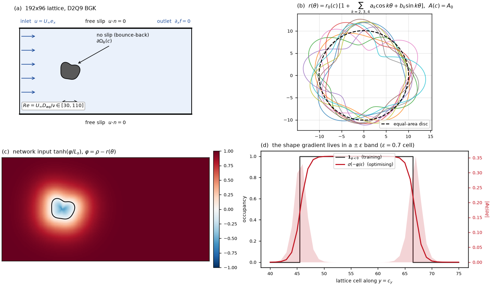
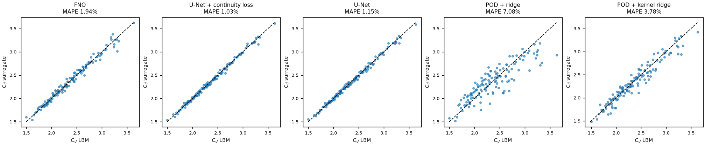
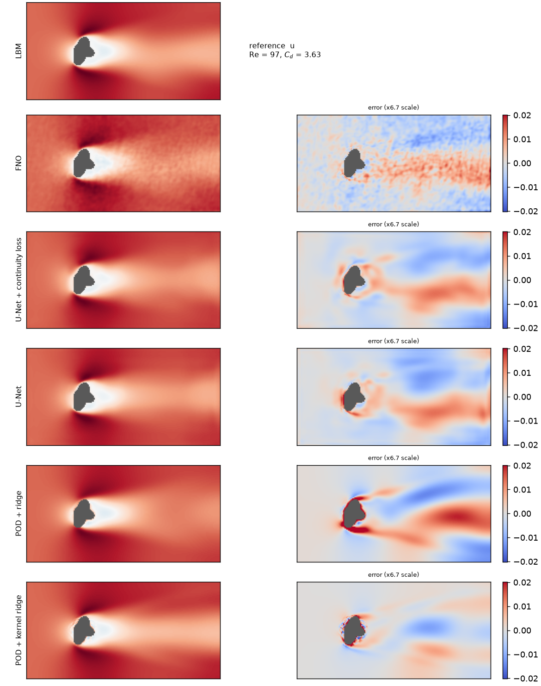
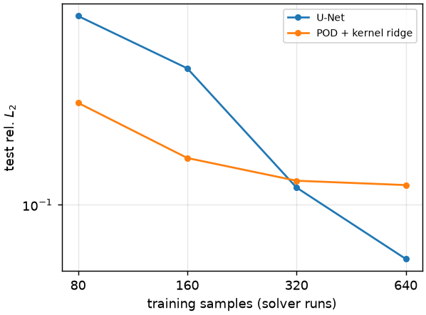
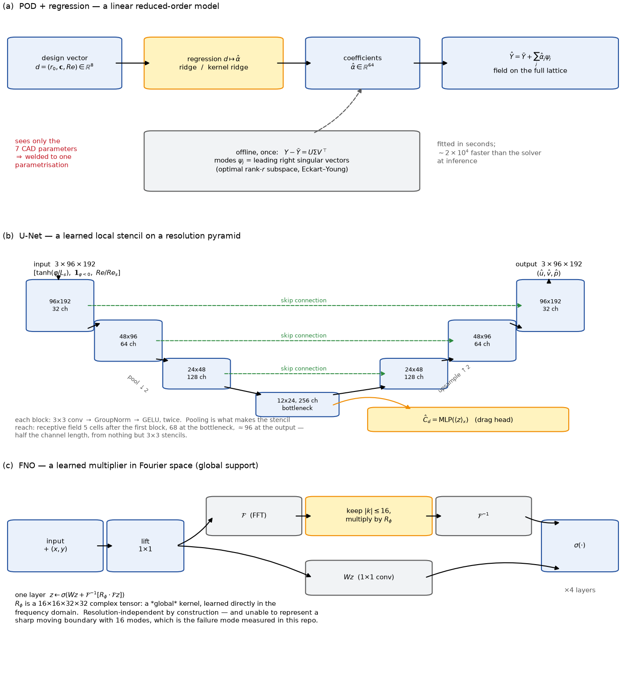
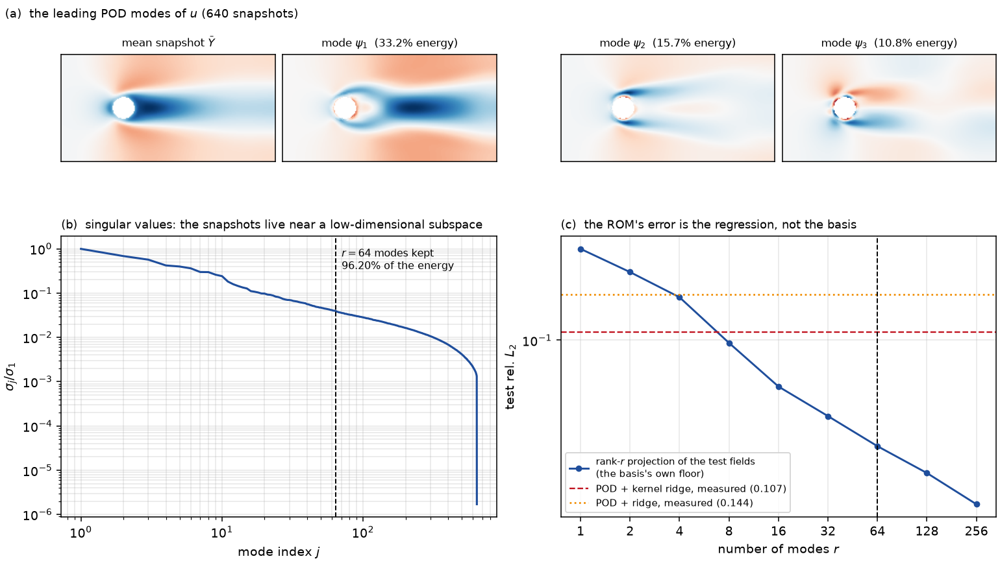
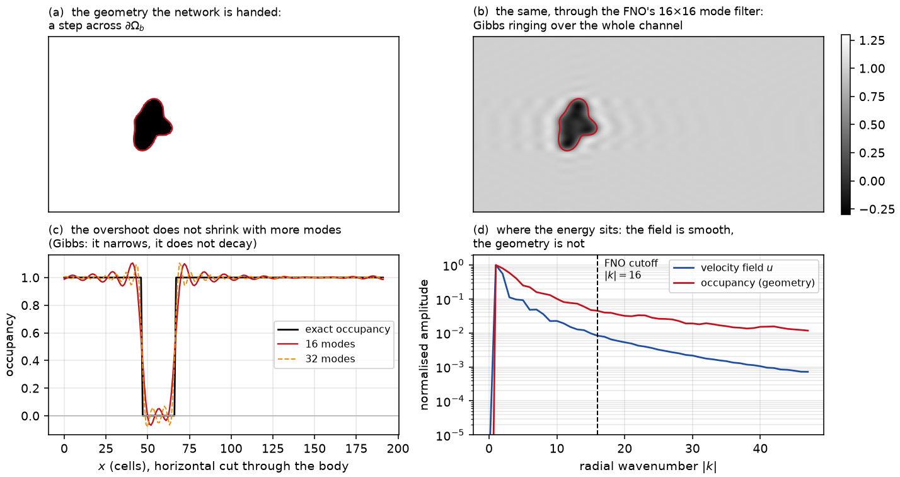
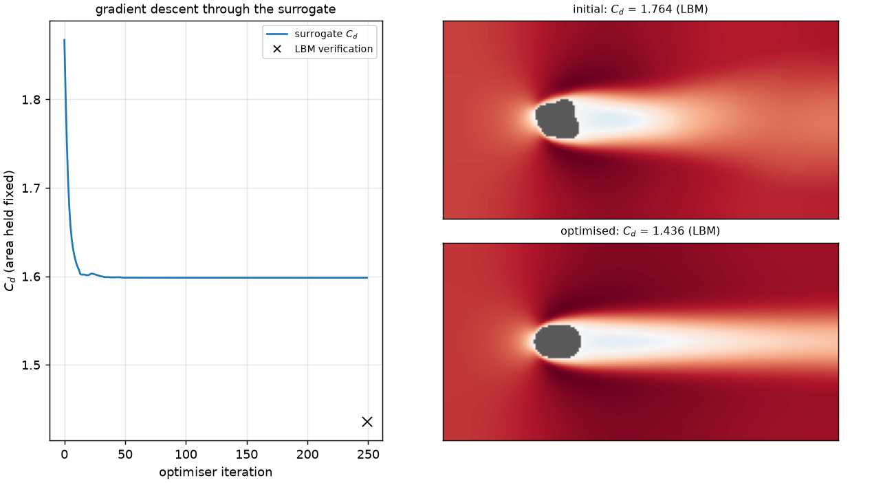
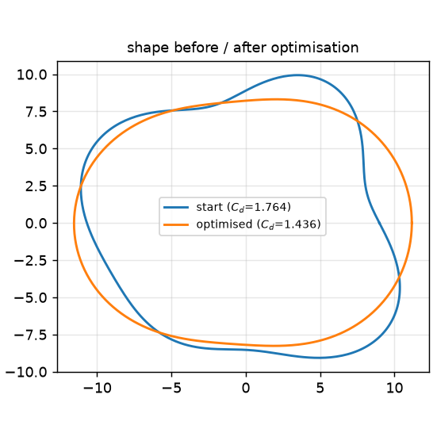

# flow-surrogate

A 2-D lattice-Boltzmann solver, five surrogates fitted to it, and a shape optimiser
that back-propagates through the surrogate to minimise drag at constant area — then
checks the answer against the solver.

Everything runs on a laptop: ~25 min to generate the dataset, ~4 min per model to
train.  Numbers are in [`RESULTS.md`](RESULTS.md), regenerated by `scripts/03_report.py`.

> **New to POD, U-Nets or neural operators?**  [`BACKGROUND.md`](BACKGROUND.md) explains
> every model in this repo from first principles — what a reduced-order model *is*, why a
> U-Net has a pyramid, what an FNO learns and why it rings at a sharp boundary, what a
> shape derivative is — with the mathematics and three explanatory figures.  This README
> assumes it.



*(a)* the channel, the boundary conditions and the only dimensionless group, $Re$;
*(b)* the design space — ten members of the shape family, all at **exactly** the same
enclosed area; *(c)* what the network actually sees, a squashed level set;
*(d)* the one trick that makes the pipeline differentiable, discussed in §5.
Regenerate with `python scripts/05_setup_figure.py`.

## Headline

640 solver runs, 128 unseen test geometries; every neural model trained for the same
40 epochs (~4 min each), the ROMs fitted in seconds.

| | rel L2 (u, v, p) | C_d error | C_d worst case | vs LBM |
|---|---|---|---|---|
| POD + ridge (classic ROM) | 0.144 | 7.08 % | 19.5 % | 17 600x |
| POD + kernel ridge | 0.107 | 3.78 % | 13.8 % | 19 800x |
| FNO | 0.080 | 1.94 % | 8.8 % | 343x |
| U-Net | 0.081 | 1.15 % | 3.9 % | 709x |
| **U-Net + continuity loss** | **0.078** | **1.03 %** | **4.2 %** | 713x |



*Predicted against solver drag coefficient on the 128 test geometries.  The ROM's
scatter is what a 3.8 % MAPE looks like; the networks sit on the diagonal.*

Three things worth reading off that table rather than the loss curves:

- **the ROM is not a straw man** — it costs nothing to train and is 25x faster at
  inference, and its field error is only 1.4x worse.  Where it actually loses is the
  engineering quantity: 3.8 % drag error against 1.0 %, and a 13.8 % worst case;
- **FNO matches the U-Net on field error but not on physics** — its continuity
  residual is 0.109 against the U-Net's 0.025 (LBM reference: 0.006), and the error
  maps below show why: high-frequency ringing through the wake, which is what a global
  Fourier basis does at a sharp moving boundary;
- **the continuity loss helps, but as a regulariser, not as a constraint** — it
  improved drag error (1.15 % -> 1.03 %) while barely moving the divergence residual
  (0.027 -> 0.025).  At this weight it is not enforcing physics; saying otherwise
  would be overselling it.



*Streamwise velocity on the highest-drag test case: solver reference, then one row per
model (prediction left, error right, on a 6.7x tighter colour scale).*

Off-distribution (higher Re, stronger deformations than anything in training) every
model roughly doubles its field error and the ranking is preserved — U-Net 0.078 ->
0.165, POD + kernel ridge 0.107 -> 0.257.  Nothing here generalises for free; the
neural surrogates simply degrade from a better starting point.

**Data efficiency** — the same two models refitted on subsets, equal training budget:

| solver runs | U-Net | POD + kernel ridge |
|---|---|---|
| 80 | 0.184 | **0.139** |
| 160 | 0.155 | **0.116** |
| 320 | **0.106** | 0.108 |
| 640 | **0.084** | 0.107 (saturated) |



The ROM wins below ~300 samples and then stops improving — a linear subspace fitted to
seven parameters runs out of things to learn — while the network crosses over and keeps
going.  For an engineering team the practical reading is: if the solver budget is a
hundred runs, build the ROM; the neural surrogate only earns its keep past a few
hundred, and its advantage is in the tail (worst-case drag error) long before it shows
up in the mean.

**Shape optimisation** (`scripts/04_optimize_shape.py`), 16 starts x 250 iterations =
4 000 surrogate evaluations in **17 s** (the same budget of LBM runs would be ~2 h):

| | drag, verified by the solver |
|---|---|
| best of 16 random starts | C_d = 1.764 |
| after gradient descent through the surrogate | **C_d = 1.436  (-18.6 %)** |
| what the surrogate predicted for that design | C_d = 1.598 (**11.3 % off**) |
| after one round of active learning | prediction 6.7 % off, optimum unchanged |

The optimiser converges to an elongated, streamlined body at constant area — the
physically expected answer.  The interesting number is the third row: the surrogate
was 11 % wrong about its own optimum, which is why the design is re-solved rather
than trusted.  Folding those 32 solver-labelled designs back into training halves that
gap without moving the optimum, i.e. active learning bought **reliability**, not a
better design.

---

## 1. The problem, in equations

### 1.1 What the solver approximates

The reference physics is steady, incompressible, laminar flow past a body
$\Omega_b(\mathbf c)$ held in a channel $\Omega$:

$$\nabla\cdot u = 0, \qquad (u\cdot\nabla)\,u = -\frac{1}{\rho}\nabla p + \nu\,\nabla^2 u \quad\text{in } \Omega\setminus\Omega_b(\mathbf c)$$

with a Dirichlet inlet $u = (U_\infty, 0)$, no slip on the body $u|_{\partial\Omega_b} = 0$,
free-slip channel walls $u\cdot n = 0$, $\partial_n u_t = 0$ (so no wall boundary layer
contaminates the wake), and a zero-gradient outlet.  After non-dimensionalisation the
only parameter left is the Reynolds number

$$Re = \frac{U_\infty D_{eq}}{\nu} \in [30, 110],$$

which is why $Re$ is a single scalar input channel rather than three separate ones.

### 1.2 The quantity of interest

Everything downstream is graded on the drag coefficient, not on the fields:

$$F = \oint_{\partial\Omega_b}\big(-p\,I + 2\mu\,S\big)\,n\,\mathrm{d}s,\qquad S = \tfrac12\big(\nabla u + \nabla u^{\top}\big),\qquad C_d = \frac{F\cdot e_x}{\tfrac12\rho\,U_\infty^2\,D_{eq}}.$$

$C_d$ is a *boundary* integral of a *derivative* of the solution, so a surrogate can be
excellent in $L^2$ over the domain and still be wrong about it — which is exactly what
the POD baseline turns out to be (0.107 field error, 3.8 % drag error).

### 1.3 The design space

The body is star-shaped, its boundary a truncated Fourier series in polar coordinates:

$$r(\theta) = r_0\left(1 + \sum_{k \in \{2,3,4\}} a_k\cos k\theta + b_k\sin k\theta\right),\qquad \mathbf c = (a_2, b_2, a_3, b_3, a_4, b_4)\in\mathbb R^6 .$$

The $k = 1$ modes are dropped: to first order they are a rigid translation, which is
already fixed by where the body sits in the channel.  Two closed forms make the rest of
the project simple.  The enclosed area is

$$A(r_0, \mathbf c) = \frac12\int_0^{2\pi} r(\theta)^2\,\mathrm d\theta = \pi r_0^2\left(1 + \tfrac12\lVert \mathbf c\rVert^2\right),$$

since distinct harmonics are orthogonal and $\int_0^{2\pi}\cos^2 k\theta\,\mathrm d\theta = \pi$;
and the geometry enters the network through a radial level set

$$\varphi_{\mathbf c}(x) = \lVert x - x_c\rVert - r\big(\theta(x)\big),\qquad \Omega_b = \{\varphi_{\mathbf c} < 0\}.$$

$\varphi$ is *not* a Euclidean signed distance — it is exact on $\partial\Omega_b$ and
monotone across it, which is what the network needs, and it is analytically
differentiable in $\mathbf c$, which is what §5 needs.

$D_{eq} = 2\sqrt{A/\pi}$ is the diameter of the equal-area disc.  Using it as the
reference length in $C_d$ means that comparing two shapes at constant area compares
*shapes* and not sizes — without it, the optimiser of §5 would trivially "reduce drag"
by shrinking the body.

## 2. The expensive model

### 2.1 Why not integrate Navier–Stokes directly

The equations of §1.1 look like the obvious thing to discretise, and a finite-volume
or finite-element code would do exactly that.  On this problem it would spend most of
its time on three difficulties that are not the physics one cares about:

- **Incompressibility is a global constraint.**  $\nabla\cdot u = 0$ has no time
  derivative, so pressure is not something that evolves — it is whatever
  instantaneously enforces the constraint.  In practice this means solving a Poisson
  problem $\nabla^2 p = -\nabla\cdot((u\cdot\nabla)u)$ (or an equivalent projection)
  at every time step, which couples every cell to every other cell and is where a
  Navier–Stokes code spends a large fraction of its wall time.
- **The advective term $(u\cdot\nabla)u$ is nonlinear and non-local.**  Getting it
  stable at moderate Reynolds numbers requires upwinding, flux limiters, or a
  semi-Lagrangian step; getting it *accurate* requires more.  None of that is
  intellectually hard, but all of it is fiddly and problem-specific.
- **A moving solid boundary is a moving mesh.**  The body $\Omega_b(\mathbf c)$
  changes with every design $\mathbf c$ we look at.  A body-fitted mesher would have
  to be re-run for each of the 900 samples in the dataset, and for every iterate of
  the optimiser in §5.  Immersed-boundary and cut-cell methods exist to avoid that,
  but they add their own machinery.

Lattice-Boltzmann side-steps all three by solving a **different equation with the
same continuum limit**.

### 2.2 What LBM actually does

Instead of tracking $(u, p)$, LBM tracks a discrete velocity distribution
$f_i(x, t)$ — nine numbers per cell in 2-D — that lives at a level halfway between
molecules and the continuum.  The equation it solves is the discrete-velocity BGK
Boltzmann equation

$$\partial_t f_i + e_i\cdot\nabla f_i = -\frac{1}{\tau}\big(f_i - f_i^{eq}(\rho, u)\big),$$

where $e_i$ are nine fixed lattice directions (the D2Q9 stencil: rest, four axis
neighbours, four diagonals), $\rho = \sum_i f_i$ and $\rho u = \sum_i e_i f_i$ are
recovered by summation, and $f_i^{eq}$ is a low-Mach expansion of the Maxwellian.
Discretised on the lattice with $\Delta t = \Delta x = 1$, one time step is *two
local operations*:

1. **collision** — relax each $f_i$ towards $f_i^{eq}(\rho, u)$ in place;
2. **streaming** — shift $f_i$ by one cell in direction $e_i$.

Both touch only the current cell (collision) or nearest neighbours (streaming).
There is no linear solve, no matrix, no global coupling — just a stencil update
repeated for as many steps as needed.

A Chapman–Enskog expansion (multi-scale expansion of $f_i$ in the Knudsen number
$\epsilon = \Delta x / L$) shows that the macroscopic moments of this scheme satisfy

$$\partial_t\rho + \nabla\cdot(\rho u) = 0,\qquad \partial_t(\rho u) + \nabla\cdot(\rho u\otimes u) = -\nabla p + \nabla\cdot\big(2\mu\,S\big) + \mathcal O(\epsilon^2, \mathrm{Ma}^2),$$

with $p = c_s^2 \rho$, $c_s^2 = 1/3$, and $\mu = \rho\,c_s^2(\tau - 1/2)$ — i.e.
weakly-compressible Navier–Stokes.  As long as the Mach number stays small
($\mathrm{Ma} = U_\infty/c_s \approx 0.14$ here), the compressibility error is
second order in $\mathrm{Ma}$ and LBM is a genuine Navier–Stokes solver, not an
approximation of something else.

### 2.3 What that buys, and what it costs

Compared to a projection-based Navier–Stokes code, LBM trades three things:

- **No pressure Poisson solve.**  Pressure is $c_s^2\rho$, read off the local
  density.  Incompressibility is not enforced — it *emerges* to $\mathcal O(\mathrm{Ma}^2)$.
  On a 192x96 grid this is the single biggest reason the solver fits in 1.7 s per
  sample.
- **The nonlinearity becomes local and algebraic.**  Convection is realised by the
  linear streaming step; the nonlinearity of $(u\cdot\nabla)u$ is hidden inside
  $f_i^{eq}$, which is a polynomial in $u$ evaluated cell-by-cell.  No upwinding,
  no limiters.
- **Complex boundaries are trivial.**  A solid cell is just a cell where the outgoing
  populations are reflected back — half-way bounce-back, one line of code, works
  for any shape and gives the wall force as a by-product (§ below).  No remeshing
  when $\Omega_b$ changes, which is precisely what a dataset of 900 different bodies
  needs.

The costs are equally structural.  LBM is **explicit and weakly compressible**: the
time step is bounded by $\mathrm{Ma}$ rather than by a CFL condition on a chosen
velocity, so pushing to genuinely incompressible or to high Reynolds numbers needs
either very small $\Delta t$ or more sophisticated collision operators (MRT,
regularised, cumulant).  Boundary layers at high Re are under-resolved on a uniform
lattice — grid refinement exists but is not free.  And the scheme is second-order,
which is fine here but not competitive with high-order spectral methods on smooth
problems.

For **this** problem — laminar, low-Mach, moderate Reynolds, many different bodies —
the trade is overwhelmingly in LBM's favour, which is why the reference solver is
LBM and not a Navier–Stokes projection code.

### 2.4 The scheme, concretely

`flowsurrogate/lbm.py` — a D2Q9 BGK lattice Boltzmann solver on a 192x96 lattice.  The
state is nine populations $f_i$ per cell, streamed along the lattice directions $e_i$
and relaxed towards a Maxwellian:

$$f_i(x + e_i,\, t+1) = f_i(x,t) - \frac{1}{\tau}\Big(f_i - f_i^{eq}\Big)(x,t),$$

$$f_i^{eq} = w_i\,\rho\left(1 + 3\,(e_i\cdot u) + \tfrac92 (e_i\cdot u)^2 - \tfrac32\lVert u\rVert^2\right),\qquad \rho = \sum_i f_i,\quad \rho\,u = \sum_i e_i f_i .$$

A Chapman–Enskog expansion of this scheme recovers the Navier–Stokes equations of §1.1
to second order with

$$\nu = c_s^2\left(\tau - \tfrac12\right) = \frac{\tau - 1/2}{3},\qquad p = c_s^2(\rho - 1),\qquad c_s^2 = \tfrac13,$$

which is the single line `tau = 3*nu + 0.5` in the solver.  The inlet velocity is
$U_\infty = 0.08$ in lattice units, i.e. $\mathrm{Ma} = U_\infty/c_s \approx 0.14$, low
enough that the compressibility error stays second order in Mach.

No slip on the body is half-way bounce-back, $f_{\bar\imath}(x, t+1) = f_i^{\text{post}}(x,t)$
with $e_{\bar\imath} = -e_i$, and the force follows from the momentum actually exchanged
on those blocked links:

$$F = \sum_{x\,\in\,\text{fluid}}\ \sum_{i\,:\, x + e_i \in \Omega_b} 2\,e_i\, f_i^{\text{post}}(x).$$

Fields and forces are time-averaged over the last $N_{avg} = 2500$ of $N = 9000$ steps,
and each sample stores the drift of the drag between the two halves of that window,

$$\delta = \frac{\big|\langle F_x\rangle_{\text{2nd half}} - \langle F_x\rangle_{\text{1st half}}\big|}{\big|\langle F_x\rangle\big|},$$

so unconverged cases are visible rather than silently averaged in.

Two things make it usable as a data generator on a laptop:

- **the batch dimension is a design dimension** — B geometries are marched in
  lock-step, which turns a latency-bound stencil into a bandwidth-bound one;
- **the whole time step is one `torch.compile` region**.  Eager mode issues ~40
  kernels per step over a 40 MB state.  Fusing them, plus replacing two
  index-tensor gathers by constant slices, took the solver from **6.7 to 1.7 s per
  sample** (3.9x) with bit-identical output.

### 2.5 Verification

Before fitting anything to a solver it is worth knowing whether the solver is right.
`scripts/01_validate_solver.py` runs steady flow past a circular cylinder and compares
against published values for an *unbounded* cylinder (C_d = 2.05 at Re = 20, 1.55 at
Re = 40; Tritton 1959, Fornberg 1980).  A channel of finite height over-predicts drag,
so the comparison needs the standard blockage correction

$$C_{d,\infty} \approx C_d\,(1 - \beta)^2, \qquad \beta = \frac{D}{H} \ \ (\text{blockage ratio}).$$

| grid | D (cells) | blockage β | Re | C_d raw | corrected | ref | err | L_w/D | ref |
|---|---|---|---|---|---|---|---|---|---|
| 192x96 (production) | 20 | 20.8 % | 20 | 3.127 | 1.960 | 2.05 | -4.4 % | 0.85 | 0.93 |
| 192x96 (production) | 20 | 20.8 % | 40 | 2.330 | 1.460 | 1.55 | -5.8 % | 1.95 | 2.35 |
| 288x192 | 20 | 10.4 % | 20 | 2.540 | 2.039 | 2.05 | **-0.5 %** | 1.00 | 0.93 |
| 288x192 | 20 | 10.4 % | 40 | 1.894 | 1.520 | 1.55 | **-1.9 %** | 2.30 | 2.35 |
| 288x192 | 30 | 15.6 % | 20 | 2.927 | 2.084 | 2.05 | **+1.6 %** | 0.97 | 0.93 |
| 288x192 | 30 | 15.6 % | 40 | 2.179 | 1.551 | 1.55 | **+0.1 %** | 2.20 | 2.35 |

Within 2 % once the domain is wide enough, and the recirculation length — an
independent check on the wake structure rather than on the integrated force — lands
within 2-8 % of Coutanceau & Bouard's measurements.  The production grid is
deliberately smaller and sits 4-6 % low, which is the price paid for a 1.7 s dataset
sample.  The surrogates are fitted to *this* solver, not to reality; but it is a
solver whose error is known and bounded.

## 3. The dataset

`scripts/00_generate_data.py`.  Shapes are rejection-sampled from the family of §1.3,
with $\min_\theta r(\theta) > 0.55\,r_0$ to reject pinched bodies that a 20-cell
diameter cannot resolve.

| split | n | what it is |
|---|---|---|
| `train` / `val` / `test` | 640 / 64 / 128 | Re ∈ [30, 110], coefficients in ±0.16 |
| `ood` | 64 | Re ∈ [110, 150], coefficients in ±0.24, wider radii — deliberately outside the training box |

Targets: time-averaged `u`, `v`, `p` and the drag coefficient.

## 4. The surrogates

### 4.1 The learning problem

Each sample is turned into a three-channel image, which is the *only* thing the
convolutional models ever see:

$$X(\mathbf c, Re) = \Big[\ \tanh\!\big(\varphi_{\mathbf c}/L_s\big),\quad \mathbf 1_{\{\varphi_{\mathbf c} < 0\}},\quad Re/Re_s\ \Big] \in \mathbb R^{3\times 96\times 192},$$

with $L_s = 16$ cells and $Re_s = 100$.  The `tanh` squash rather than a clip is
deliberate: far-field cells keep a small but non-zero gradient with respect to the
shape, which §5 needs.  A network $N_\theta$ maps $X$ to a field prediction $\hat Y$
(standardised $u, v, p$) and a scalar $\hat C_d$, and is fitted by

$$\mathcal L(\theta) = \big\lVert M \odot (\hat Y - Y)\big\rVert_{\mathrm{MSE}}^2 \;+\; \lambda_{cd}\,\big(\hat C_d - C_d\big)^2 \;+\; \lambda_{\text{phys}}\left(\frac{L}{U_\infty}\right)^{2}\Big\langle \big(\nabla_h\cdot\hat u\big)^2\Big\rangle_{\Omega_h},$$

where $M$ is the fluid mask, $\lambda_{cd} = 0.2$, $\lambda_{\text{phys}} \in \{0, 0.02\}$,
$L = 20$ cells, $\nabla_h$ is a central difference, and $\Omega_h$ the cells whose
five-point stencil is entirely fluid.  The divergence term is evaluated on the
**de-normalised** prediction, so $\lambda_{\text{phys}}$ has a physical meaning and does
not silently change when the normalisation statistics do.

Three metrics are reported side by side because they disagree:

$$\text{rel } L_2 = \frac{\lVert M(\hat Y - Y)\rVert_2}{\lVert MY\rVert_2},\qquad \text{MAPE} = \Big\langle \Big|\tfrac{\hat C_d - C_d}{C_d}\Big|\Big\rangle,\qquad r_{\text{div}} = \big\langle |\nabla_h\cdot\hat u|\big\rangle\,\frac{L}{U_\infty}.$$

$r_{\text{div}}$ is dimensionless and has a reference value: the LBM fields themselves
score 0.006, so 0.025 (U-Net) and 0.109 (FNO) are read against that, not against zero.

### 4.2 The five models

| model | input | why it is here |
|---|---|---|
| **POD + ridge** | 7 shape parameters + Re | the reduced-order model an engineering team builds first |
| **POD + kernel ridge** | idem | the same, done properly — a genuinely strong baseline on a 7-D design space |
| **U-Net** | rasterised level set + mask + Re | geometry-agnostic: never sees the parametrisation |
| **U-Net + continuity loss** | idem | adds the $\lambda_{\text{phys}}$ term above |
| **FNO** | idem + coordinates | the standard neural-operator answer |



*The three families, side by side.  [`BACKGROUND.md`](BACKGROUND.md) §4–§8 is the long
version of this figure.*

**POD** projects the snapshots onto their leading principal subspace and regresses the
coefficients on the design vector $d = (r_0, \mathbf c, Re)\in\mathbb R^8$:

$$Y(d) \approx \bar Y + \sum_{j=1}^{64}\alpha_j(d)\,\psi_j,\qquad \hat\alpha(d) = \sum_{i} \beta_i\,k(d, d_i),\quad k(d,d') = e^{-\gamma\lVert d - d'\rVert^2},$$

with $\beta = (K + \lambda I)^{-1}\alpha$ (kernel ridge) or a plain linear map (ridge).
The $\psi_j$ are optimal in the Eckart–Young sense — no rank-64 linear subspace
reconstructs these snapshots better — so the ROM's residual error is a statement about
the *regression* $d\mapsto\alpha$, not about the basis.  Measured: projecting the test
fields onto the rank-64 subspace gives 0.043 against the fitted ROM's 0.107, and the two
contributions are orthogonal, so **the regression's own share is
$\sqrt{0.107^2 - 0.043^2} = 0.098$** — almost all of it.  Its structural limitation is
the input: it takes the Fourier coefficients, so it is welded to one CAD template.



*The first 64 modes carry 96.2 % of the energy; the third panel is the sentence above,
drawn.*

**FNO** replaces the convolution by a truncated spectral multiplier,

$$z^{(\ell+1)} = \sigma\Big(W z^{(\ell)} + \mathcal F^{-1}\big[R_\phi \cdot \mathcal F z^{(\ell)}\big]\Big),\qquad R_\phi \text{ kept for } |k_1|, |k_2| \le 16,$$

which is a global basis — and that is precisely its problem here: a sharp solid
boundary that moves from sample to sample is the worst case for 16 Fourier modes, and
the ringing is visible in the error maps above.



*The geometry channel of a real test sample, before and after the FNO's $16\times16$ mode
filter, with a cut through the body and the radial energy spectra.  The overshoot is
Gibbs' phenomenon: adding modes narrows it, it does not shrink it.*

**U-Net** stays local (3x3 stencils across a 4-level pyramid).  Both networks read the
drag off the pooled bottleneck, $\hat C_d = \text{MLP}\big(\langle z\rangle_{x}\big)$,
rather than integrating the predicted surface stress — see §6.

## 5. Shape optimisation

`scripts/04_optimize_shape.py` — the reason the whole thing is differentiable.

### 5.1 The problem

$$\min_{\mathbf c\, \in\, \mathbb R^6}\ \ \hat C_d(\mathbf c) := N_\theta^{cd}\big(X(\mathbf c)\big) \qquad\text{s.t.}\qquad A(r_0,\mathbf c) = A_0,\qquad \lVert\mathbf c\rVert_\infty \le 0.16 .$$

The area constraint is **eliminated in closed form** rather than penalised.  Inverting
the area formula of §1.3 for the scale,

$$r_0(\mathbf c) = \sqrt{\frac{A_0}{\pi\left(1 + \tfrac12\lVert\mathbf c\rVert^2\right)}},$$

turns a 7-parameter equality-constrained problem into a 6-parameter unconstrained one.
No penalty weight to tune, no infeasible iterate, and the constraint holds to machine
precision at every step.  The box constraint is handled by projection, and it is there
for a different reason: it keeps the optimiser inside the envelope the surrogate was
trained on.

### 5.2 The gradient

The whole map $\mathbf c \mapsto \hat C_d$ is one differentiable graph,

$$\mathbf c \;\longrightarrow\; r_0(\mathbf c) \;\longrightarrow\; \varphi_{\mathbf c} \;\longrightarrow\; X(\mathbf c) \;\longrightarrow\; N_\theta \;\longrightarrow\; \hat C_d,$$

so one backward pass gives the full gradient.  Its geometric half is analytic: writing
$s(\theta) = 1 + \sum_k a_k\cos k\theta + b_k \sin k\theta$ so that $\varphi = \rho - r_0 s$,

$$\frac{\partial \varphi}{\partial a_k} = -\left[\frac{\partial r_0}{\partial a_k}\,s(\theta) + r_0\cos k\theta\right],\qquad \frac{\partial r_0}{\partial a_k} = -\,\frac{r_0\,a_k}{2\left(1 + \tfrac12\lVert\mathbf c\rVert^2\right)} .$$

The second term is the area constraint pushing back: growing any harmonic shrinks the
scale so that the area stays put, and every coefficient therefore feels every other one.

**The one non-obvious ingredient** is the occupancy channel.  The networks are trained
on a hard mask $\mathbf 1_{\{\varphi<0\}}$, whose derivative with respect to the shape
is zero almost everywhere — back-propagation through it returns nothing.  At
optimisation time it is replaced by a sigmoid with $\epsilon = 0.7$ cell:

$$\mathbf 1_{\{\varphi<0\}} \;\longrightarrow\; \sigma(-\varphi/\epsilon), \qquad \frac{\partial}{\partial\varphi}\,\sigma(-\varphi/\epsilon) = -\frac{1}{\epsilon}\,\sigma(1-\sigma) \ \xrightarrow[\ \epsilon\to 0\ ]{}\ -\,\delta(\varphi).$$

Numerically the two images are the same — they disagree only within ~1.5 cells of the
boundary, which `tests/test_pipeline.py` checks — but the derivative is now a smeared
surface delta concentrated on $\partial\Omega_b$ (panel (d) of the figure at the top).
Composed with $\partial\varphi/\partial\mathbf c$, which on the boundary is the normal
perturbation field, this is a discrete **shape derivative**: the same object a
classical adjoint method computes, except that here it costs one backward pass through
a network (~4 ms) instead of one adjoint Navier–Stokes solve per design.

Optimisation is projected Adam, 16 starts in parallel, 250 iterations:

$$\mathbf c \leftarrow \Pi_{[-0.16,\,0.16]^6}\Big(\mathbf c - \eta\,\text{Adam}\big(\nabla_{\mathbf c}\hat C_d\big)\Big),\qquad \eta = 8\times 10^{-3}.$$

### 5.3 What comes out, and why it is re-solved



*Left: the surrogate's drag along the 250 iterations, with the solver verification of
the final design as a cross — the vertical gap between the curve and the cross is the
11.3 % below.  Right: the LBM wake before and after, at identical area and $Re$.*



*The same designs as boundaries.  The optimised body measures 11.4 cells along the flow
and 8.3 across, against 9.9 for the equal-area disc — exactly
$r_0(1 \pm 0.16)$ with $r_0 = 9.84$.*

The optimum is essentially a single mode: $a_2 = 0.160$ (at its bound) with every other
coefficient within 0.02 of zero, i.e. $r(\theta)\approx r_0(1 + 0.16\cos 2\theta)$ — the
$k=2$ harmonic is the elongation mode, and elongating a body at constant area is the
textbook way to reduce pressure drag.  That the bound is *active* is worth stating: the
unconstrained optimum of this surrogate lies outside the box it was trained on, and the
box, not the physics, is what stops it.

The surrogate is then checked against the solver, and the gap is reported rather than
hidden:

$$\Delta = \frac{\hat C_d(\mathbf c^*) - C_d^{\text{LBM}}(\mathbf c^*)}{C_d^{\text{LBM}}(\mathbf c^*)} = 11.3\ \%.$$

This is not a surprise, it is structural.  The optimiser minimises
$\hat C_d = C_d + e(\mathbf c)$ and is therefore attracted to wherever the error $e$ is
most negative — the surrogate analogue of the winner's curse.  It says the *predicted
value* cannot be trusted; it does not say the design is bad, and here the solver
confirms a real 18.6 % reduction.

One round of **active learning** closes the loop: the 32 verified designs are folded
back into the training set, the model is warm-started from $\theta^*$ and fine-tuned,
and $\Delta$ drops to 6.7 % with the optimum essentially unchanged (1.436 -> 1.453 in
true $C_d$).  The optimiser has just told us exactly where the surrogate is being
trusted, which is the cheapest possible sampling criterion — and what it buys is
reliability, not a better design.

## 6. Limitations

- The flow is 2-D, laminar, and time-averaged; nothing here says anything about
  turbulence modelling.
- A 20-cell body diameter under-resolves the boundary layer; the solver is verified
  to a few percent, not to benchmark accuracy.
- The level set is radial ($\rho - r(\theta)$), not a true Euclidean distance field.  It
  is exact on the boundary and monotone across it, which is what the networks need, but
  a genuine SDF would be a better input for non-star-shaped geometries.
- Drag is a scalar head rather than an integral $\oint(-pI + 2\mu S)n\,\mathrm ds$ of the
  predicted surface stress.  The integral would be more physically consistent — and
  would make the drag gradient a boundary quantity — and is the obvious next step.
- The area constraint is exact but the box constraint is active at the optimum, so the
  reported optimum is a constrained one; widening the box means widening the training
  distribution first.

## 7. Running it

```bash
uv venv --python 3.12 .venv && VIRTUAL_ENV=.venv uv pip install -e .
./.venv/bin/python run_all.py            # everything, ~2 h on an M-series laptop
```

or step by step:

```bash
python scripts/00_generate_data.py       # ~25 min  -> data/
python scripts/01_validate_solver.py     # ~4 min   -> results/solver_validation.json
python scripts/02_train_all.py           # ~60 min  -> runs/
python scripts/03_report.py              #          -> RESULTS.md, figs/
python scripts/04_optimize_shape.py      # ~6 min   -> results/optimization.json
python scripts/05_setup_figure.py        # ~2 s     -> figs/setup.png
python scripts/06_explainer_figures.py   # ~20 s    -> figs/{pod_explained,architectures,fourier_truncation}.png
python -m pytest tests -q
```

Add `--device cpu` anywhere to avoid MPS.  `scripts/02_train_all.py --epochs 20
--skip-sweep` gives a usable smoke run in a few minutes.

`RESULTS.md`, `results/*.json` and `figs/*.png` are committed, so the numbers and every
figure in this README can be read without re-running anything; `data/` and `runs/`
(the solver dataset and the checkpoints) are not, being ~300 MB.

## 8. Layout

```
flowsurrogate/
  geometry.py    star-shaped bodies; NumPy path + differentiable Torch path
  lbm.py         batched, compiled D2Q9 solver
  data.py        generation, splits, normalisation, input channels
  models/        pod.py (ROM baselines), unet.py, fno.py
  train.py       shared training loop (masked loss, drag head, physics term)
  metrics.py     field / drag / continuity metrics
  evaluate.py    predictions -> numbers
  optimize.py    differentiable shape rendering + projected Adam + solver verification
  plots.py       figures
scripts/         00 generate, 01 validate, 02 train, 03 report, 04 optimise,
                 05 setup figure, 06 explainer figures (for BACKGROUND.md)
tests/           geometry, solver, pipeline
BACKGROUND.md    the mathematics behind every model here, from scratch
```
