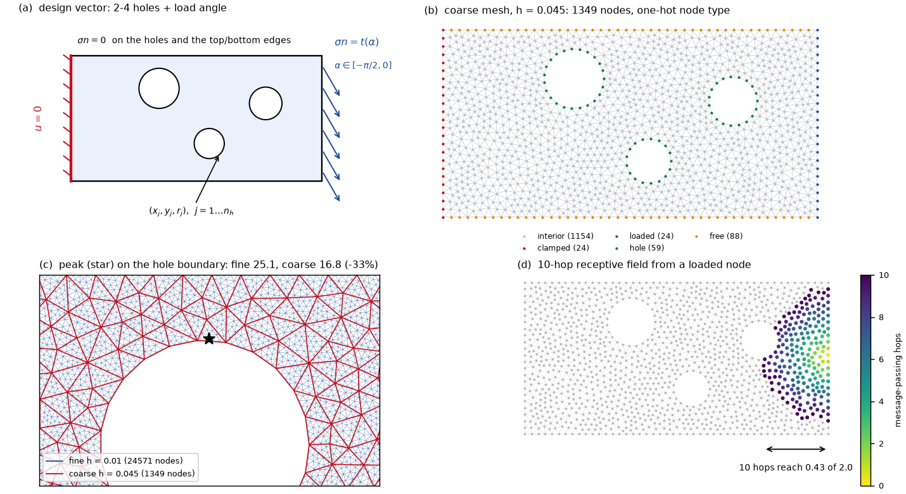
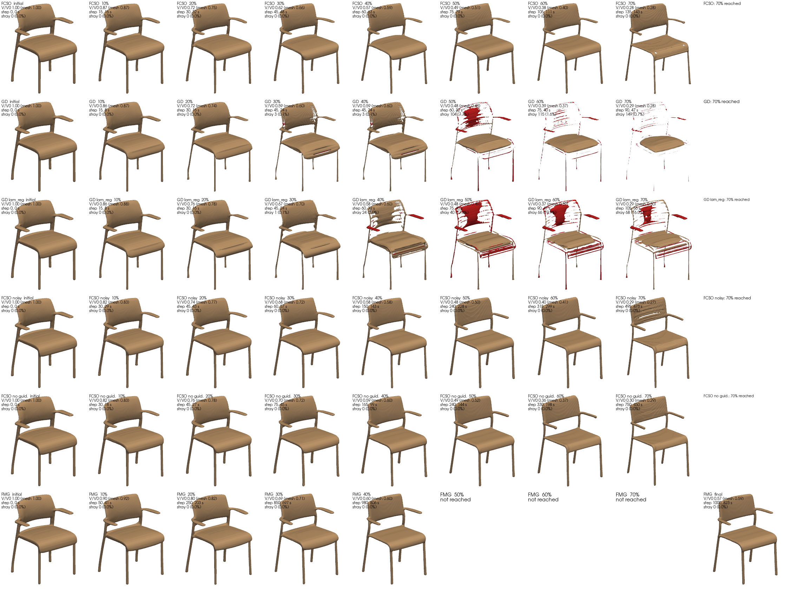
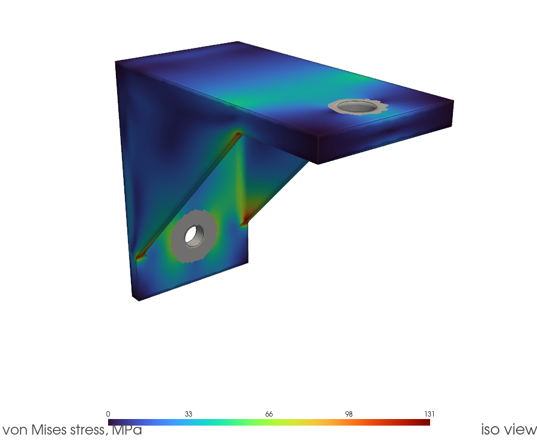

<p align="center">
  
</p>

<p align="center">
  <a href="flow-surrogate">flow-surrogate</a>&nbsp; · &nbsp;<a href="stress-gnn">stress-gnn</a>&nbsp; · &nbsp;<a href="fcso-chairs">fcso-chairs</a>&nbsp; · &nbsp;<a href="#bracket-lab-an-agent-in-the-design-loop">bracket-lab</a>&nbsp; · &nbsp;<a href="engine-copilot">engine-copilot</a>&nbsp; · &nbsp;<a href="flow-surrogate/RESULTS.md">results</a>&nbsp; · &nbsp;<a href="KNOWLEDGE-GRAPH.md">code&nbsp;map</a>
</p>

<p align="center">
  <sub>
    lattice Boltzmann &nbsp;·&nbsp; finite elements &nbsp;·&nbsp; POD / U-Net / FNO / MeshGraphNet &nbsp;·&nbsp; latent diffusion &nbsp;·&nbsp; Gaussian processes
    <br>
    PyTorch (Apple MPS) &nbsp;·&nbsp; CalculiX + Gmsh &nbsp;·&nbsp; FastAPI &nbsp;·&nbsp; React + Vite &nbsp;·&nbsp; Claude Agent SDK &nbsp;·&nbsp; MCP
  </sub>
</p>

---

Four studies of the same loop — a design, an expensive evaluation, a cheaper stand-in for
it, and an optimiser that will exploit whatever the stand-in gets wrong — and, on top of
them, an interactive platform that puts the results in an engineer's hands.

- **Two surrogate repos**, [`flow-surrogate`](flow-surrogate) and [`stress-gnn`](stress-gnn),
  each replacing a physics solver with a learned model and asking whether the optimum
  survives contact with the solver.
- **[`fcso-chairs`](fcso-chairs)** — a *generative* prior instead of a solver surrogate:
  shape optimisation in the latent space of a pretrained 3D diffusion model, where the
  question is whether the optimised shape is still a chair.
- **`bracket-lab`** — an *agentic* design loop: a Claude Code agent redesigns a 3D bracket
  through MCP tools that build the CAD, run a real FEA and query a surrogate, against a
  classical optimiser on the same budget.  The study lives in its own repository; this one
  carries its results page.

> **One more branch holds work in progress.**  `thermal-pinn` is a physics-informed network
> with no platform wiring yet.  It is not on `main`.

| | [`flow-surrogate`](flow-surrogate) | [`stress-gnn`](stress-gnn) |
|---|---|---|
| physics | 2-D incompressible flow (lattice Boltzmann) | 2-D linear elasticity (P1 finite elements) |
| geometry | parametric obstacle, **fixed Cartesian lattice** | perforated plate, **unstructured mesh, variable topology** |
| what varies | 7 shape coefficients + Reynolds number | 2-6 holes (position, radius) + load direction |
| surrogate input | rasterised level set | the mesh itself, as a graph |
| models compared | POD + ridge / POD + kernel ridge / U-Net / U-Net + physics loss / FNO | pointwise MLP / grid U-Net / MeshGraphNet (+ global latent, + coarse-solve input) |
| the question | *can I differentiate through the surrogate to optimise a shape, and does the optimum survive contact with the solver?* | *can a surrogate on a 1k-node mesh give 25k-node answers, and does it rank candidate designs better than a cheap solve?* |

Both run end to end on a laptop (Apple M-series, MPS).  Data generation is ~20-25 min per
project; training is minutes per model.




*The two problems, top and bottom: a body in a channel, parametrised by six Fourier
coefficients on a fixed 192x96 lattice; and a perforated plate, parametrised by 2-6 holes,
meshed differently for every design.*

## Two more studies: a generative prior, and an agent

| | [`fcso-chairs`](fcso-chairs) | `bracket-lab` |
|---|---|---|
| object | 10 ShapeNet chairs (3D occupancy field) | parametric aluminium shelf bracket (3D, CAD) |
| design space | 512 x 8 latent of a pretrained shape autoencoder | 7 parameters: thicknesses, fillet, gussets, cutout |
| evaluation | differentiable volume on a 64³ grid; marching cubes at 128³ | Gmsh + CalculiX, second-order tets, ~58k nodes, ~14 s |
| stand-in | class-conditional EDM diffusion prior (3DShape2VecSet), **no training** | Gaussian process on 160 FEA designs |
| optimiser | FCSO (Adam + prior correction) vs plain latent gradient descent | a Claude Code agent over MCP vs Optuna TPE, ≤ 15 FEA each |
| the question | *at equal volume reduction, how much slower is FCSO, and are the chairs still chairs?* | *does an agent that reasons over stress maps beat a classical optimiser on the same FEA budget?* |

### FCSO: optimising inside a generative model

[`fcso-chairs`](fcso-chairs) reproduces Flow-Corrected Shape Optimization (arXiv 2608.07199)
on a laptop.  Plain gradient descent on a shape latent reaches any volume target, and
leaves the decoder's domain on the way: the chair shatters into dozens of floating
fragments.  FCSO alternates a short Adam phase with a *correction* — the latent is
integrated back down the diffusion model's probability-flow ODE from a small noise level,
with a guidance term that holds the volume — so the prior pulls the shape back towards
something it recognises as a chair.  Both the decoder and the corrector are the public
3DShape2VecSet weights; nothing is trained.

<p align="center">
  
</p>

*One chair, every method, from the initial shape to −70 % volume.  FCSO (top row) thins
it in one piece; gradient descent (second row) gets there faster and in fragments, drawn
in red.  This is one of the three chairs FCSO keeps recognisable at −70 %, not a typical
one — the per-chair grids for all ten are in [`report/trajectories/`](fcso-chairs/report/trajectories),
and [`report/viewer.html`](fcso-chairs/report/viewer.html) shows them in 3D.*

The expected result — whole chairs at 70 %, at 2-4x the cost of GD — is only partly
reproduced.  FCSO is slower than advertised (5.3x GD's time to −70 %, paired), it stalls
on 4 of the 10 chairs before reaching the target, and of the 6 it brings there, only 3
still look like the chair they started as: on the two bulky upholstered chairs the
guidance term dominates the ODE drift and pushes the latent off the prior altogether.
What does hold is the comparison with GD on the same chairs: fewer stray components on 6
of 6, a smaller stray volume on 5 of 6.  The full account, including why FCSO behaves in
two regimes, is [`fcso-chairs/REPORT.md`](fcso-chairs/REPORT.md).

### bracket-lab: an agent in the design loop

An AI agent (Claude Code) is asked to lower the mass of a bracket carrying 500 N at its
tip, subject to $\sigma_{vM} \le 138$ MPa and $\delta_{max} \le 0.5$ mm — a baseline that
starts infeasible.  It has no shell, only MCP tools: *evaluate* (CAD → mesh → CalculiX),
*render*, *stress_map*, *retrain*, *history*, plus a freeform build123d server.  The
server enforces a budget of 15 FEA runs and 60 surrogate queries.  The protocol it follows
(`AGENT.md`) is the Flow Lab's *Verify* button made systematic: write a rationale citing
earlier numbers, screen with the GP (mean + 2σ must clear both limits), spend FEA only on
the lightest survivor, retrain after every FEA, and look at the stress map before touching
a structural feature.  Every call is logged.

<p align="center">
  
</p>

*The lightest verified design (agent-01, 90.5 g): long, thin gussets and a thin back
plate, which the agent chose by comparing earlier FEA runs at equal mass.  The solver was verified
first — a cantilever against beam theory to 0.18 %, and a mesh-convergence study that
found, and fixed, a stress singularity at the gusset toe the optimiser would otherwise
have exploited.*

The honest result: the two agent runs bracket Optuna (90.5 g and 94.1 g against 91.5 g),
and a 160-sample Latin hypercube already contains a feasible design at 91.8 g.  On seven
parameters the agent is not clearly better than a classical optimiser; most of the gain
comes from the structure of the design space, and the optimisers add about 1 %.  What the
agent adds is the trail — every proposal carries its reason, and its structural decisions
follow the stress maps.  All three optima stay feasible on a finer mesh.

## The platform

[`engine-copilot`](engine-copilot) wraps both research repos — untouched, as read-only
libraries — in a FastAPI backend and a React interface, so the surrogates can be *used*
rather than read about.  Move a Fourier coefficient and the drag coefficient follows in
about 60 ms; the fields, the streamlines and the interval move with it.  Drag a hole
across the plate and the von Mises map is re-meshed, re-solved and re-predicted in about
230 ms.

<p align="center">
  
</p>

*One real session, captured by [`docs/capture.py`](docs/capture.py) against a running
backend — not a mock-up.*

What the lab does, top to bottom:

- **Predict** — six sliders and a Reynolds number in, a drag coefficient out, next to the
  model's measured error, its confidence interval and the latency it took.  The three
  fields (axial velocity, transverse velocity, pressure) are the network's actual output.
- **Animate** — client-side RK4 streamlines through the predicted field, or the true LBM
  streamed frame by frame over SSE, in the same panel, on a toggle.
- **Optimise** — Adam through the frozen surrogate at constant projected area, streaming
  its convergence live.
- **Verify** — re-run the optimised design in the real solver.  This is the button the
  whole project is about, and it is deliberately not automatic.
- **Report** — export the run as Markdown.  A report produced before the verification
  says in as many words that nothing has confirmed the surrogate.
- **Ask** — a Claude Agent SDK copilot (⌘/Ctrl-J) that sees the design on screen and
  reaches the same services the interface does, through eight read-only tools called
  in-process.  It drives the local `claude` CLI, so there is no API key anywhere in this
  project.

The **Stress Lab** is the same loop on the other repo, minus the one thing the geometry
forbids: click to place a hole, drag it, scroll to resize it, and the von Mises field
re-meshes and re-predicts under it, next to the coarse FEM solve it has to beat — the
baseline typically misses the peak by a quarter to a third, and the panel says by how
much.  *Optimise* is a randomised local search over the surrogate at constant removed
area, not a gradient descent: the mesh topology changes on every hole move, so there is no
gradient to descend (which is the whole point of the comparison below).

The two later studies have a page each, read-only: they present a finished run rather
than drive a live one, and need no backend.

- **FCSO Review** (`/fcso`) — three measured tiles at −50 % volume (whole chairs, stray
  volume, time cost against GD), a 3D trajectory grid per chair with FCSO and GD side by
  side under one shared camera, and the table of all six methods at −50 and −70 %.
- **Bracket Lab** (`/bracket`) — best feasible mass, $\sigma_{eval}$ and $\delta_{max}$
  against their limits, FEA runs used; the baseline and best stress maps; the lightest
  feasible mass per FEA run for both agents and Optuna; the comparison table.

Both are generated, never typed: `fcso-chairs/scripts/export_platform.py` and
`engine-copilot/frontend/scripts/build_bracket_data.py` write `public/fcso/` and
`public/bracket/` from the studies' own run logs and result tables.

<p align="center">
  
</p>

*The copilot is given the design on screen, so a question needs no preamble.  It never
states a drag coefficient without the error attached to it, and every tool call it makes
stays in the transcript — this one is a real turn, captured with the rest.*

<p align="center">
  
</p>

*The optimiser lands on a design it scores at $C_d = 1.549$; the solver, re-run on that
same design, returns 1.432 — an 8.9 % gap between the surrogate's account of its own
optimum and the physics.  The committed run in `results/optimization.json` measures the
same effect at 11.3 %, against a drag cut of 18.6 % that the solver does confirm.
Surfacing that gap rather than hiding it is the point of the panel.*

## Results at a glance

**`flow-surrogate`** — 640 solver runs, 128 unseen test geometries.

| | field rel L2 | drag error | vs solver |
|---|---|---|---|
| POD + kernel ridge (ROM baseline) | 0.107 | 3.78 % | 19 800x |
| U-Net + continuity loss | **0.078** | **1.03 %** | 700x |

Gradient descent through the surrogate cuts drag **18.6 % at constant area, verified by
the solver** — 4 000 design evaluations in 17 s against ~2 h of solver time.  The
surrogate was 11 % wrong about its own optimum, and one round of active learning halved
that gap without moving the optimum: it bought reliability, not a better design.  The
ROM/network crossover sits at ~320 solver runs.

**`stress-gnn`** — 400 training designs, 120 unseen test designs.

| | peak stress error | unseen mesh size | off-distribution |
|---|---|---|---|
| coarse FEM, no ML | 35.8 % | 24.4 % | **35.5 %** |
| U-Net on a Cartesian grid | **5.2 %** | **5.1 %** | 88.1 % |
| MeshGraphNet + global, fed the coarse solve | 6.0 % | 7.6 % | 51.0 % |

The surrogates are worth ~6x on their own distribution.  Everything else cuts against the
premise the project was built on, and is reported as such: the Cartesian baseline wins on
this geometry family; graph-network discretisation invariance degrades outside the trained
mesh-size range while the mesh-blind baseline does not; off-distribution every surrogate is
worse than the coarse solve it replaces; and in a 150-candidate design study the *biased*
coarse solve ranks designs slightly better (Spearman +0.892) than the debiased surrogate
(+0.856), because ranking cares about scatter and not about bias.

The conclusion that survives all of it: a surrogate earns its place where an *absolute*
number is needed inside a trained envelope, not where a cheap solve can already order the
candidates.

**`fcso-chairs`** — 10 ShapeNet test chairs, six methods, ~7 h on an M3 Pro.

| at −70 % volume | FCSO (x0 guidance) | latent GD |
|---|---|---|
| chairs reaching it (1 000-step budget) | 6/10 | **10/10** |
| median time | 254 s | **76 s** |
| reached chairs in one piece | **2/6** | 0/10 |
| stray volume, same 6 chairs (median) | **1.2 %** | 42.4 % |

The prior does what it is for — far fewer fragments than GD on every chair both methods
bring to −70 % — at 5.3x GD's time, with four budget stalls and three chairs out of six no
longer recognisable.  The fragment count under-reports that last failure; the Chamfer
distance to the initial shape is what shows it.

**`bracket-lab`** — at most 15 FEA per run, same initial surrogate.

| | mass | vs baseline | $\sigma_{eval}$ / 138 MPa | $\delta_{max}$ / 0.5 mm | FEA used |
|---|---|---|---|---|---|
| baseline | 101.4 g | — | 180.0 (infeasible) | 0.710 | — |
| agent-01 | **90.5 g** | **−10.7 %** | 131.1 | 0.475 | 7 |
| agent-02 | 94.1 g | −7.2 % | 120.5 | 0.434 | 7 |
| Optuna TPE | 91.5 g | −9.8 % | 126.8 | 0.447 | 6 |
| best of 160 random samples | 91.8 g | −9.5 % | 134.3 | 0.455 | 160 |

Two agent runs and one TPE seed are too few to rank them, and the table says so: the agent
is not a better optimiser here, it is a more legible one.

---

## The common problem, formally

Both repos instantiate the same three-stage template.  A design vector $d$ fixes a
geometry $\Omega(d)$; a PDE gives a field; a functional of that field is the number an
engineer actually wants:

$$\mathcal A\big(u;\,\Omega(d)\big) = 0,\qquad J(d) = Q\big(u_d\big).$$

Here $\mathcal A$ is steady Navier–Stokes or linear elastostatics, and $J$ is the drag
coefficient $C_d$ or the peak von Mises stress $\max_\Omega \sigma_{vm}$.  In both cases
$J$ is a *boundary* or *pointwise* functional of a *derivative* of $u$ — which is why
field accuracy and engineering accuracy disagree throughout both projects.  One evaluation
costs 1.7 s and 0.83 s respectively, so a thousand-design loop is hours.

**Stage 1 — sample and solve.**  Draw $\{d_i\}_{i=1}^N$, run the solver, keep both the
field and $J$.  **Stage 2 — fit** an encoder $X(d)$ and a network:

$$\theta^\star = \arg\min_\theta\ \frac1N\sum_{i=1}^N \ell\Big(N_\theta\big(X(d_i)\big),\ \big(u_{d_i},\, J(d_i)\big)\Big),$$

with $\ell$ carrying a field term *and* a term on $J$ itself, because a model fitted to
the field alone is not fitted to the quantity of interest.  **Stage 3 — put it in a
design loop:**

$$\min_{d\,\in\,\mathcal D}\ \hat J_{\theta^\star}(d)\qquad\text{s.t.}\qquad g(d) = 0,$$

the constraint being constant area in one project and constant removed area in the other —
in both cases so that the optimiser cannot cheat by removing material.

Everything that differs between the two repos follows from **the encoder $X$**.  A fixed
Cartesian lattice makes $X(d)$ a tensor of constant shape and, crucially, a
*differentiable* function of $d$, so stage 3 is gradient descent through the whole
pipeline.  An unstructured mesh makes $X(d)$ a graph whose node count and connectivity are
combinatorial functions of $d$; nothing differentiates, and stage 3 becomes a search over
sampled candidates.  That single choice is why the Flow Lab's *Optimise* button runs Adam
and the Stress Lab's runs a randomised search.

### The two failure modes, one per project

**Optimising against your own error.**  Write $\hat J = J + e$.  Minimising $\hat J$
does not sample $e$ neutrally — it actively seeks out the designs where $e$ is most
negative, so

$$\mathbb E\big[\,e(d)\ \big|\ d = \arg\min \hat J\,\big] \;<\; \mathbb E\big[\,e(d)\,\big]$$

even for a surrogate that is unbiased on its training distribution.  This is the
surrogate's winner's curse, and it is a statement about the predicted *value*, not about
the design.

Measured in `flow-surrogate`: **11.3 % off at the optimum, against 1.03 % on the test
split** — the error where the optimiser chose to stand is an order of magnitude larger than
the error the model advertises for itself, and the optimum sits on the boundary of the box
the model was trained in.  (In this run it lands on the pessimistic side: the solver finds
*less* drag than the surrogate promised.  The magnitude is the finding, not the sign.)
The design itself is genuinely 18.6 % better, verified by the solver, and one
active-learning round on the 32 designs the optimiser proposed halves the gap.

**Ranking is not accuracy.**  Write a strategy's score as $\hat s = \psi(s) + \varepsilon$
with $\psi$ increasing.  Rank correlation is *invariant* to $\psi$ and destroyed only by
$\varepsilon$: a solver that is 35 % low everywhere ranks designs almost perfectly, while
an unbiased surrogate with more scatter ranks them slightly worse.  Measured in
`stress-gnn`: Spearman +0.892 for the coarse solve against +0.856 for the surrogate that
corrects its bias.

The two are duals of each other.  The first says that a surrogate used as an *objective*
must be verified by the solver — which is why *Verify* is a button in the Flow Lab and not
an automatic step.  The second says that a surrogate used as a *ranker* may not be needed
at all, and that the case for it is the certification question ("does this part pass at
250 MPa?"), where the bias that ranking forgives is exactly what matters — which is why the
Stress Lab shows the coarse solve next to the prediction rather than hiding it.

### Where the other two studies sit in the template

**`fcso-chairs` changes the encoder and the constraint.**  The design vector is the latent
$z$ of a pretrained autoencoder, so $X(z)$ is differentiable and stage 3 is gradient
descent, as in the Flow Lab.  But the constraint that keeps the optimiser honest is no
longer an equation $g(d) = 0$: it is *stay on the data manifold*, which nobody can write
down, and which the diffusion prior enforces by correction instead.  GD shows what happens
without it — the volume objective is met by walking off the manifold, the same move as
walking into the surrogate's error, with the decoder's extrapolation playing the part of
$e(d)$.

**`bracket-lab` changes the optimiser.**  Stage 3 is run by an agent, the surrogate is a
GP that reports its own uncertainty, and the first failure mode is handled by
construction: a candidate is only sent to the solver if $\hat\mu + 2\hat\sigma$ clears
both limits, and only the solver's number counts.  In the logged runs the FEA tended to
come in *below* the GP's prediction, so the screen was conservative — both agents stopped
with about 8 of 15 FEA unspent.

## "Isn't that the same project twice?"

Mathematically, yes, and the section above says so up front: both are the same recipe.
Swap the operator and the loss and the two codebases would converge.

As engineering, no — and the reason is the one thing that actually decides which techniques
are available: **how the geometry is represented**.

**`flow-surrogate` lives on a fixed grid.**  Every sample has the same shape, so the problem
is an image-to-image problem and the whole convolutional / neural-operator toolbox applies.
That buys something specific: the pipeline from shape coefficients to predicted drag is one
differentiable graph, so shape optimisation is back-propagation, not a search.  The project
is built around that — and around the failure mode it creates, which is that an optimiser
will happily walk into the surrogate's own error until you close the loop with the solver.

**`stress-gnn` lives on unstructured meshes.**  Node count, connectivity and even the number
of holes change from sample to sample, so a CNN has nowhere to stand: it can only see the
part after resampling onto a grid.  The expectation going in was that this would cost it
accuracy at the stress concentrations on curved hole boundaries.  It was measured rather
than asserted — the grid U-Net is trained on the same data, scored at the same mesh nodes,
and reported in the same table — and it won.  Reading *why* it won, and what would have to
change for it not to, is most of what that repo is about.  The second question there is
different from the first project's: a design loop does not need exact stresses, it needs the
*ranking* of candidates to be right, and it turns out a cheap biased solve already provides
that.

Doing only one of them would leave out either the mesh-native representation problem or the
differentiable-optimisation story — and, as it turned out, only the pair of them shows that
the same recipe gives a clean win in one setting and a negative result in the other.

## Shared method, and what is deliberately not shared

Both repos follow the same discipline, because it is the part that transfers:

- **the solver is verified before anything is learned from it** — `flow-surrogate`
  reproduces published cylinder drag to a few percent after the standard blockage
  correction; `stress-gnn` passes a constant-stress patch test to 1e-9 and an
  energy-balance check;
- **a non-neural baseline is always in the table** — a POD reduced-order model on
  seven parameters is hard to beat in-distribution, and a coarse FEM solve is already a
  usable answer.  A neural surrogate reported without them is not a result;
- **the metric is the engineering quantity**, not the loss — drag coefficient, peak von
  Mises stress — reported next to the field error, because the two disagree;
- **generalisation is measured off-distribution**, on splits built to be outside the
  training range, not only on a random test split;
- **cost is measured end to end**, including the meshing and the data generation, not just
  the forward pass.

The two later studies hold to the same rules.  `fcso-chairs` keeps plain latent GD and
four other variants in every table and judges shape by fragments *and* by Chamfer distance,
because the volume it optimises says nothing about whether a chair is left.  `bracket-lab`
verifies CalculiX against beam theory and a mesh-convergence ladder before any
optimisation, pits the agent against Optuna and a random Latin hypercube on the same
budget, and re-checks every optimum on a finer mesh.

What is not shared: the repos have separate environments, separate dependencies and no
common package.  They are meant to be read independently; only the platform imports the
two surrogate repos, and it reads the other two studies' results as exported files.

## Run it

Three independent parts, each with its own virtual environment.  The research repos stand
alone; the platform installs both as libraries.

```bash
# the science
cd flow-surrogate && python3.12 -m venv .venv && ./.venv/bin/pip install -e .
./.venv/bin/python run_all.py --quick        # generate -> train -> optimise
cd ../stress-gnn  && python3.12 -m venv .venv && ./.venv/bin/pip install -e .
./.venv/bin/python run_all.py --quick        # mesh -> solve -> train -> rank

# the platform (two servers, one browser tab)
cd ../engine-copilot && python3.12 -m venv .venv
./.venv/bin/pip install -e ../flow-surrogate -e ../stress-gnn -e .

# terminal 1 — the backend must run from backend/: the package is imported from the
# source tree, not pip-installed, so any other cwd gives ModuleNotFoundError
cd engine-copilot/backend  && PYTHONPATH=. ../.venv/bin/uvicorn engine_copilot.main:app --reload --port 8000
# terminal 2
cd engine-copilot/frontend && pnpm install && pnpm dev      # http://localhost:5173

# the copilot, if you want it — an existing Claude Code session, never an API key
npm install -g @anthropic-ai/claude-code && claude login
```

`fcso-chairs` has its own environment and needs the public 3DShape2VecSet weights and a
few hundred megabytes of ShapeNet chairs; the steps are in
[`fcso-chairs/README.md`](fcso-chairs/README.md).  A full run of the six methods on ten
chairs is about 7 h.  `bracket-lab` lives in its own repository (CalculiX through conda,
the agent run through `claude -p` with its two MCP servers); to refresh its page here:

```bash
python3 engine-copilot/frontend/scripts/build_bracket_data.py /path/to/bracket-lab
python3 fcso-chairs/scripts/export_platform.py       # after fcso-chairs/scripts/make_report.py
```

Reading the results requires none of it to be re-run: every table and figure is committed.

## Layout

```
flow-surrogate/     LBM solver, surrogates, gradient-based shape optimisation
stress-gnn/         FEM solver, mesh graph networks, design-ranking study
fcso-chairs/        FCSO vs latent gradient descent on 10 ShapeNet chairs, with a 3D viewer
engine-copilot/     FastAPI + React platform on top, with a Claude Agent SDK copilot, and
                    the static FCSO Review and Bracket Lab pages
docs/               README assets — the mark, the banner, the screenshots, and the
                    scripts that generate them
```

Each research repo has its own `README.md` (what it does, the result table, how to run it),
`RESULTS.md` (generated tables), `figs/` (all committed), `tests/`, and a `run_all.py`:
[`flow-surrogate`](flow-surrogate/README.md), [`stress-gnn`](stress-gnn/README.md).  Only
`data/` and `runs/` are left out of the repos, being a few hundred megabytes of solver
output and checkpoints.

`engine-copilot` treats both as read-only libraries and turns them into an interactive
demo — see [`engine-copilot/README.md`](engine-copilot/README.md), and
[`KNOWLEDGE-GRAPH.md`](KNOWLEDGE-GRAPH.md) for the navigation map of the whole repo.

<sub>The mark is not decoration: it is a dot "C" drawn as a lattice of cells clipped to an
annulus, where a cell's radius follows the horizontal axis and its colour the vertical one
on the measure ramp — a discretised field, which is what both repos are about.  It is
generated by <a href="docs/make_logo.py"><code>docs/make_logo.py</code></a>, never hand-drawn.
The interface, and everything in <code>docs/</code>, follows the <em>Calque</em> charte:
paper, one orange used only as a measure scale, one ink-filled element per screen.</sub>
