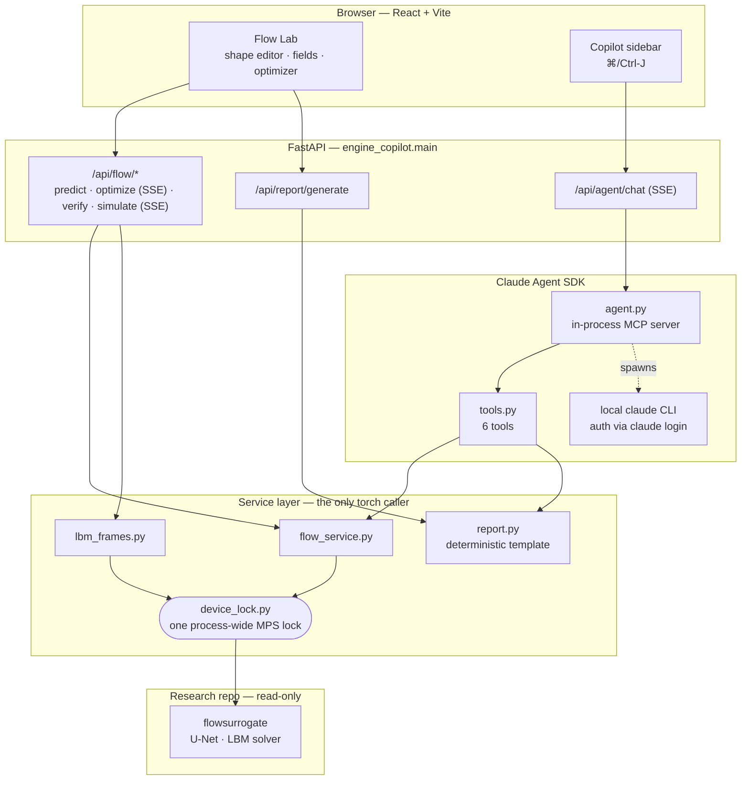

# Engine-Copilot

Local web platform exposing the `flow-surrogate` surrogates behind an interactive UI,
plus a Claude-orchestrated chat that calls the same tools. Built following
`../PLATFORM_PLAN.md`.

> On `main` this platform carries the **Flow Lab only**. The Stress Lab it was also
> built for lives on the `stress-lab` branch, with its routes, service, tools and page
> intact; `PLATFORM_PLAN.md` still describes both, deliberately.

## Status

Landed: **M0** (scaffolding), **M1** (flow prediction, real U-Net surrogate), **M2**
(client-side RK4 streamlines + real LBM frame streaming with a live Von Kármán wake),
**M3** (optimizer panel with live convergence plot + shape morph, verify-with-solver
against the real LBM), **M4** (Stress Lab — now on the `stress-lab` branch, not here),
**M5** (Claude Agent SDK chat, all 8 planned tools, verified live — 6 of them on this
branch) and **M6** (Markdown report export). See `git log` for the exact history and
`PLATFORM_PLAN.md §6` for what each milestone covers.

Outstanding: the **demo GIF** called for in M6 is not in the repo — recording it needs
a headless browser driver and `ffmpeg`, neither of which is installed here, and adding
Playwright to the frontend's dependency tree for one animation is a call for the repo
owner to make. To produce it: `pnpm add -D playwright && npx playwright install
chromium`, drive `http://localhost:5173` through a shape change → Optimize → Verify,
capture frames, and assemble with `ffmpeg -i frame%04d.png docs/demo.gif`.

Known limitations:
- The chat agent resumes context via the SDK's `resume` session id rather than a
  fully server-managed multi-session model — fine for one user, would need
  per-browser-tab session handling for multiple concurrent users.
- All torch/MPS model calls (flow predict/optimize/verify, LBM frame streaming) are
  serialised behind one process-wide lock (`engine_copilot/device_lock.py`) — a live
  full-stack run surfaced a real crash (`cd.sum().backward()` losing its grad_fn)
  under concurrent request traffic on Apple's MPS backend; the lock trades a little
  throughput for correctness on a single-GPU laptop.

## Architecture

`flow-surrogate/` is treated as a read-only library: nothing in the backend
reimplements its physics, it renders inputs, calls the model and reshapes
outputs for JSON. The service layer is the only thing that touches torch, and the agent
tools call those same service functions in-process — a tool is never an HTTP round trip
back into this app.



Two things that look odd until you know why. Every torch/MPS call funnels through one
process-wide lock — concurrent traffic on Apple's MPS backend produced a real crash, and
a single-GPU laptop has no throughput to lose anyway. And `/api/report/generate` renders
from a fixed template instead of calling Claude: the `render_report` tool would otherwise
re-enter the agent that called it.

## Setup

```bash
cd engine-copilot
python3.12 -m venv .venv
./.venv/bin/pip install -e ../flow-surrogate -e .

cd frontend
pnpm install

# Copilot sidebar only — no API key, ever:
npm install -g @anthropic-ai/claude-code
claude login
```

No API key, no `.env` secret anywhere in this project. The copilot runs on the
**Claude Agent SDK**, authenticated via the local `claude login` session (your
Claude Code subscription) — see `PLATFORM_PLAN.md §5, §7.5`.

The copilot is a sidebar on every page (⌘/Ctrl-J), not a separate tab: it receives
the design currently on screen, so you can ask about it without restating the numbers.

## Run

```bash
# backend
cd engine-copilot/backend && PYTHONPATH=. ../.venv/bin/uvicorn engine_copilot.main:app --reload --port 8000

# frontend
cd engine-copilot/frontend && pnpm dev
```

Open `http://localhost:5173`.

## Reports

The lab exports a Markdown report once an optimisation has run — **Export report**, next
to *Verify with solver*. The copilot can produce the same document on request ("write me
a report"), because the chat tool and the button call the same renderer.

The report is a fixed template, not a generated text: every number in it comes straight
from the solver or the surrogate. A flow report run before **Verify with solver** says in
as many words that nothing confirmed the surrogate — an un-verified optimum is reported
as exactly that.

## Tests

```bash
cd engine-copilot && ./.venv/bin/python -m pytest -q
```

`pyproject.toml` puts `backend/` on pytest's path, so no `PYTHONPATH` is needed. The
suite hits the real singletons — no mocking — so it loads the models and takes ~40 s.
The two slowest tools, `flow_verify` and `flow_simulate`, are not covered there: both
run the real LBM for tens of seconds, and their service-layer counterparts already are.
